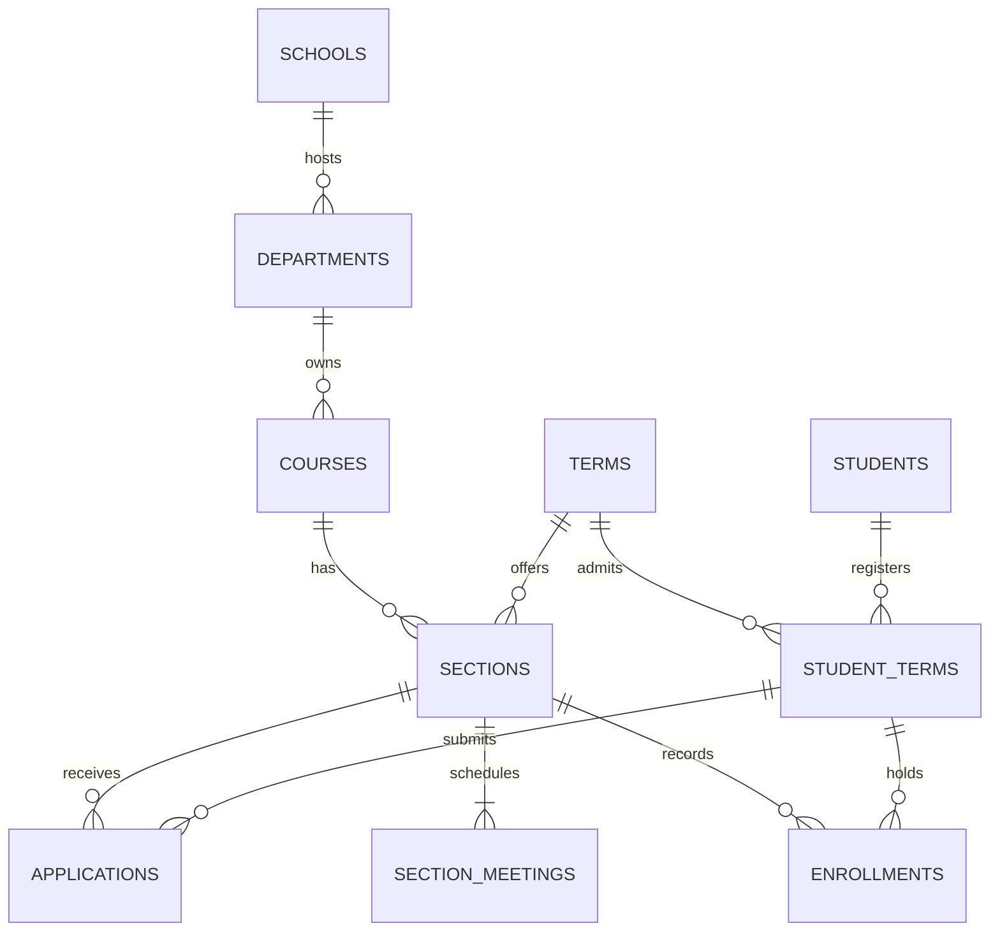
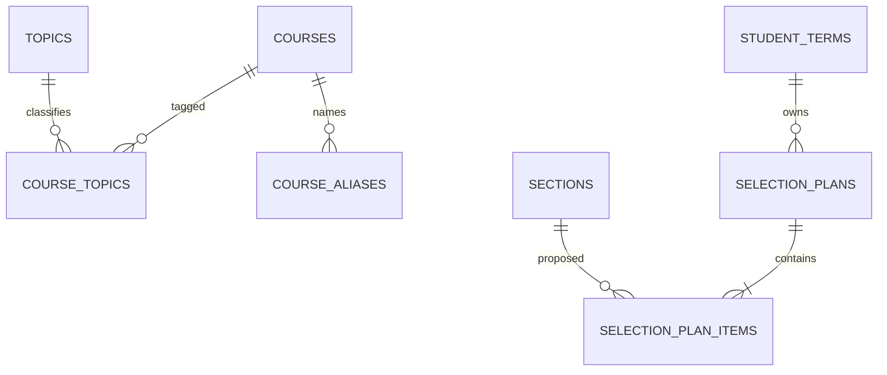
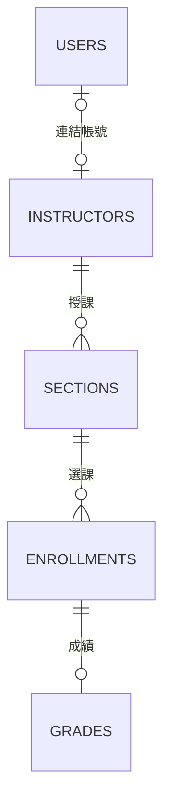
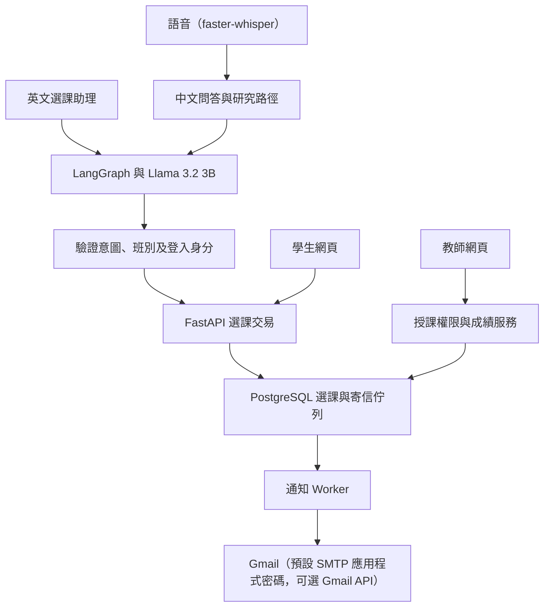

# CourseFlow 大學選課系統需求說明書

| 項目 | 內容 |
|---|---|
| 專題 | 國立臺灣科技大學 資料庫設計期末專題 |
| 文件版本 | 4.1｜依教師正式規格修訂，並更新為 `v3.0.1` 的實作結果 |
| 日期 | 2026-11-26（Asia/Taipei）。4.0 版為 2026-11-24 |
| 驗收依據 | 教師提供的 `Database.pdf`，University Course Registration System，第 1–4 節 |
| 程式基準 | 目前版本：GitHub `main` 提交 `fa2e6b2`，標籤 `v3.0.1`。[固定提交](https://github.com/programmerKB/CourseFlow/commit/fa2e6b230122c7ad88c9db486c21eebc22a6b375) · [版本標籤](https://github.com/programmerKB/CourseFlow/tree/v3.0.1)。開發起點為 `v2.1.0`（`a9c28f3`），見 §1.2 |
| 課程指定技術 | PostgreSQL、LangGraph、Llama 3.2 3B、Gmail API、Web 介面與自然語言助理。`v3.0.1` 寄信預設改用 Gmail 應用程式密碼（SMTP），Gmail API 為可切換選項，差異見 §7.2 |
| 專題既有技術 | React、TypeScript、FastAPI、SQLAlchemy、Alembic、Docker Compose、Git、GitHub。`v3.0.1` 另用 Ollama 提供 Llama 3.2 3B、faster-whisper 轉寫語音，不使用雲端語言模型 |

## 1. 系統目標與設計依據

交付版須讓學生由網頁或英文自然語言助理完成正式加退選。兩個入口使用同一套選課交易與同一個 PostgreSQL 資料庫，檢查衝堂、18 學分上限、重複課及名額。正式加選完成後，系統自動以 Gmail 寄送選課確認信。授課教師登入後可查本班正式名單，輸入及更新個別學生的成績。

CourseFlow `v2.1.0` 提供初選、分發、週課表、中文語音、三校電資課庫與研究方向試排。這些功能納入回歸驗收。以 P0 展示教師規格，P1 維護既有擴充，P2 記錄後續構想。本文件的 API、資料表和通知時點以需求條款表示；`v3.0.1` 已依本文件實作，逐項狀態見 §1.3、§1.4，驗收證據見 §9.2。

| 官方參考 | 本專題採用的設計 | 來源 |
|---|---|---|
| 臺灣科技大學 | 班別詳情顯示開課系所、時段、大綱及名額，管理員調整容量時須保留已選名額。 | [臺科大教務處課務組](https://www.academic.ntust.edu.tw/p/404-1048-78759.php?Lang=zh-tw) |
| 臺灣師範大學 | 文件公開分發規則及未錄取原因。本專題使用固定種子重現同一組分發結果。 | [臺師大 115-1 選課注意事項](https://www.aa.ntnu.edu.tw/uploads/asset/data/6a38a689843f750599985637/115%E5%AD%B8%E5%B9%B4%E5%BA%A6%E7%AC%AC1%E5%AD%B8%E6%9C%9F_%E5%90%84%E5%AD%B8%E5%88%B6%E9%81%B8%E8%AA%B2%E6%B3%A8%E6%84%8F%E4%BA%8B%E9%A0%85-1150609%E5%AE%9A%E7%A8%BF%E7%89%88.pdf) |
| 臺灣大學 | 介面標示初選、待分發、結果公布與即時加退選時程。 | [臺大課程網](https://course.ntu.edu.tw/) · [學生選課流程簡介](https://www.aca.ntu.edu.tw/WebUPD/aca/UAADForms/%E5%AD%B8%E7%94%9F%E9%81%B8%E8%AA%B2%E6%B5%81%E7%A8%8B%E6%A5%B5%E7%B0%A1%E7%89%88%E7%B0%A1%E4%BB%8B.pdf) |
| Harvard University | 允許學生先探索和試排課程，再確認提交。 | [Harvard College Course Registration](https://firstyear.college.harvard.edu/course-registration) |

### 1.1 國立臺灣大學系統電資研究所課程

FR-14 擴充課程名稱參考國立臺灣大學、國立臺灣師範大學及國立臺灣科技大學的官方課程地圖、研究所課程表或已公開的大綱。學校及系所欄位用於搜尋、推薦與辨別同名課。系統頁面應標示「模擬選課」，並在班別詳情提供原始課程資料連結。[國立臺灣大學系統三校簡介](https://triangle.ntu.edu.tw/about.html)

下表為 `v2.1.0` 的 **40 筆課程主檔**及 115-1 的 **41 個三校模擬班別**所參考的課程。同名課依學校與開課系所各自建檔。每門至少有一個主題與一個模擬班別。所有課號採專題代碼。時段、學分、先修、教師與其餘名額等供展示使用，現行校方開課資訊以表內連結為準。

| 學校與研究所課程來源 | 筆數 | 納入專題的課名 | 官方參考 |
|---|---:|---|---|
| 臺大｜電機工程學研究所 | 4 | 適應控制系統、最佳控制、電力系統控制與穩定度、嵌入式系統與軟體工程 | [電機所碩士班課程地圖](https://coursemap.aca.ntu.edu.tw/course_map_all/class.php?code=921M) |
| 臺大｜電子工程學研究所 | 5 | 類比積體電路、電腦輔助積體電路系統設計、數位訊號處理架構設計、高等數位系統設計、半導體元件物理 | [IC 與系統組](https://giee.ntu.edu.tw/tw/courses/ics/) · [奈米電子組](https://giee.ntu.edu.tw/tw/courses/ne/) |
| 臺大｜資訊工程學研究所 | 5 | 自然語言處理、分散式系統、高等作業系統、深度學習之應用、資料庫系統設計 | [自然語言處理](https://nol.ntu.edu.tw/nol/coursesearch/print_table.php?class=&course_id=922+U0670&dpt_code=9220&lang=CH&semester=114-2&ser_no=10508) · [分散式系統](https://nol.ntu.edu.tw/nol/coursesearch/print_table.php?class=&course_id=922+U1580&dpt_code=9220&semester=114-2&ser_no=48414) · [高等作業系統](https://nol.ntu.edu.tw/nol/coursesearch/print_table.php?class=&course_id=922+M1360&dpt_code=9220&semester=110-2&ser_no=80197) · [深度學習之應用](https://nol.ntu.edu.tw/nol/coursesearch/print_table.php?class=&course_id=922+U4340&dpt_code=9220&semester=114-1&ser_no=26131) · [資料庫系統設計](https://nol.ntu.edu.tw/nol/coursesearch/print_table.php?class=&course_id=922+M1440&dpt_code=9220&semester=96-1&ser_no=16911) |
| 臺大｜電信工程學研究所 | 1 | 大型語言與語音模型技術 | [臺大課程網大綱](https://nol.ntu.edu.tw/nol/coursesearch/print_table.php?class=&course_id=921+U3580&dpt_code=9420&semester=115-1&ser_no=12317) |
| 臺師大｜電機工程學系碩士班 | 6 | 高等數位信號處理、數位通訊系統、控制系統設計、類比積體電路設計、射頻與微波積體電路、嵌入式系統 | [碩士班課程架構表](https://course.ntnu.edu.tw/coursemapdata/couHM75.pdf) |
| 臺師大｜資訊工程學系碩士班 | 5 | 分散式處理系統、高等計算機結構、機器學習、電腦視覺、高等資料庫系統 | [碩士班課程資訊](https://www.csie.ntnu.edu.tw/index.php/course_ms/) · [課程規劃](https://www.csie.ntnu.edu.tw/index.php/course_ms/course/) |
| 臺科大｜電機工程系研究所 | 4 | 電力系統分析與實務、電力電子建模與分析、數位控制系統、先進行動通訊系統 | [115 學年度研究所專業選修科目課程規劃表](https://www.ee.ntust.edu.tw/var/file/27/1027/img/3406/ElectiveCourses_Graduate.pdf) |
| 臺科大｜電子工程系研究所 | 7 | 高等計算機結構、資料庫設計、計算機演算法、智慧型視訊監控系統、嵌入式深度神經網路處理、類比積體電路設計與佈局、儲存系統架構與應用 | [研究所課程分類表](https://ece.ntust.edu.tw/p/412-1017-90.php?Lang=zh-tw) · [北區 AI 資源中心課程](https://ai-center.ntust.edu.tw/courses/schools?school=0022&term=1151) |
| 臺科大｜資訊工程系研究所 | 3 | 機器學習、高等計算機結構、強化學習於人機互動系統開發 | [高等計算機結構大綱](https://www.csie.ntust.edu.tw/var/file/38/1038/img/2176/344112436.pdf) · [北區 AI 資源中心課程](https://ai-center.ntust.edu.tw/courses/schools?school=0022&term=1151) |

主題至少涵蓋大型語言模型與語音、機器學習與電腦視覺、資料庫與分散式系統、計算機結構與嵌入式、半導體與 IC 設計、訊號與通訊、控制與電力。可用「記憶體系統」尋找高等計算機結構、儲存系統架構與應用。「邊緣 AI」可連到嵌入式深度神經網路處理。課號示例 `NTUST-ET-001` 代表專題內的臺科大電子系高等計算機結構。

### 1.2 GitHub v2.1.0 開發起點

下表為本版開始開發時的 `v2.1.0` 行為，保留作為回歸對照。`v3.0.1` 的變更見 §1.4。

| 功能 | 截至 `a9c28f3` 的版本行為 | 程式與文件 |
|---|---|---|
| 網頁與選課交易 | 115-1 預設為初選。加退選情境可進行正式加退選。服務已實作先修、衝堂、名額、個別學期學分上限、列鎖及冪等性。示範種子有 `25.0` 設定，P0 補上全系統 18 學分上限。 | [README 展示情境](https://github.com/programmerKB/CourseFlow/blob/v2.1.0/README.md#L163-L192) · [交易服務](https://github.com/programmerKB/CourseFlow/blob/v2.1.0/backend/app/registration.py) · [種子資料](https://github.com/programmerKB/CourseFlow/blob/v2.1.0/backend/app/seed.py#L303-L305) |
| 選課助理 | 已有 LangGraph 查課與推薦、Gemini 文字解析，以及中文「我要加選」單門提交。中文初選指令回候選供學生確認。現有退選問法提供課表入口，P0 新增 Llama 驅動的英文加退選工具。 | [助理流程](https://github.com/programmerKB/CourseFlow/blob/v2.1.0/backend/app/chat.py) · [單門指令](https://github.com/programmerKB/CourseFlow/blob/v2.1.0/backend/app/chat_enrollment.py) |
| 課庫、試排及研究方向 | 115-1 種子提供 40 門參考課程、41 個三校模擬班別、校系及主題篩選、16 條修課路徑與可確認的批次試排。 | [三校課程與修課路徑](https://github.com/programmerKB/CourseFlow/blob/v2.1.0/README.md#L185-L201) |
| 語音與區網 | 瀏覽器錄音與音檔上傳均可查課和操作既有助理功能。區網可用 HTTP 上傳音檔，亦可開啟 Compose HTTPS 服務供瀏覽器錄音。支援編輯辨識文字與延續研究試排。 | [區網與語音](https://github.com/programmerKB/CourseFlow/blob/v2.1.0/README.md#L93-L129) |
| 通知 | 本人可按鈕寄出課表，分發公布會寄摘要。兩者使用 Outbox 和 SMTP Worker，支援 Mailpit 或 Gmail SMTP。P0 新增正式選課後的 Gmail API 通知。 | [現有通知實作](https://github.com/programmerKB/CourseFlow/blob/v2.1.0/backend/app/worker.py) · [寄送設定](https://github.com/programmerKB/CourseFlow/blob/v2.1.0/README.md#L289-L319) |
| 教師與教務 | 管理員可管理學期、容量、分發和通知。現行 `instructors` 為授課資料，登入限制為 `STUDENT` 或 `ADMIN`。migration `0005` 調整既有示範教師名稱，P0 另建教師帳號關聯、名單與成績。 | [帳號與教師模型](https://github.com/programmerKB/CourseFlow/blob/v2.1.0/backend/app/models.py#L22-L72) · [migration 0005](https://github.com/programmerKB/CourseFlow/blob/v2.1.0/backend/alembic/versions/0005_demo_instructor_names.py) |
| 更新與部署 | `deploy.sh` 支援保留 volume 的更新、選用 HTTPS 與設定 115-1 初選起訖。設定變更保留原登記並記錄稽核，公布分發後固定該次初選時段。 | [部署與初選設定](https://github.com/programmerKB/CourseFlow/blob/v2.1.0/README.md#L46-L91) |

### 1.3 教師規格與驗收追蹤

下列 T 編號為本文件依 `Database.pdf` 第 2–4 節整理。「需求與驗收」對應 §3 的功能需求與 §9 的驗收情境，「`v3.0.1` 狀態」為目前程式的實作與驗證結果。

| 教師項目 | 要求 | 需求與驗收 | `v3.0.1` 狀態 |
|---|---|---|---|
| T-01 | 學生以英文自然語言完成加選、退選。 | FR-21、AT-37、AT-38 | 完成。實機 Llama 3.2 3B 以多種英文問法加選、退選（§9.2） |
| T-02 | 學生透過 Web 介面完成加選、退選。 | FR-05、AT-08、AT-45 | 完成。網頁加退選與英文助理共用同一交易 |
| T-03 | 完成選課後收到 Gmail 確認信，寄送使用 Gmail API。 | FR-24、AT-40、AT-41 | 功能完成，實寄待驗。所有通知信經 Gmail 寄出：預設 Gmail SMTP 應用程式密碼，`GMAIL_TRANSPORT=api` 改用 Gmail API（規格寫 Gmail API，見 §7.2）。真實寄送依 AT-40 補驗 |
| T-04 | 阻止上課時段重疊，兩個入口執行同一限制。 | FR-23、AT-39 | 完成。網頁與英文助理回相同 `TIME_CONFLICT`，首尾相接可選 |
| T-05 | 每位學生每學期最多 18 學分，兩個入口執行同一限制。 | FR-23、AT-39、AT-44 | 完成。上限 `min(個人上限, 18)`，資料庫另有 `CHECK (credit_limit BETWEEN 0 AND 18)` |
| T-06 | 教師可查授課班別的已選學生名單。 | FR-25、AT-42 | 完成。「我的授課」只列本人班別的 `ENROLLED` 學生 |
| T-07 | 教師可新增與更新個別學生的成績。 | FR-26、AT-43 | 完成。0–100 分、兩位小數，新增與修改皆留稽核 |
| T-08 | 系統以 PostgreSQL 保存資料。 | FR-22、AT-13、AT-44 | 完成。migration `0006`；Docker 全新冷啟與重啟（AT-13）待在部署主機補驗 |
| T-09 | 選課 Agent 採用 LangGraph。 | FR-22、AT-37、AT-38 | 完成。`english_registration` 與中文 `course_assistant` 兩個 LangGraph 流程 |
| T-10 | 語言模型使用 Llama 3.2 3B。 | FR-22、AT-37 | 完成。英文意圖與中文查詢計畫皆用 `llama3.2:3b`（Ollama），不使用雲端模型 |
| T-11 | Agent 經指定工具與 PostgreSQL 互動。 | FR-09、FR-22、AT-10、AT-38 | 完成。模型只提出結構化意圖或計畫，由指定工具與參數化查詢存取 PostgreSQL |
| T-12 | 學生與教師具有獨立權限。 | FR-27、AT-42、AT-43 | 完成。`STUDENT`、`INSTRUCTOR`、`ADMIN` 分別檢查，跨角色回 `403`、他班回 `404` |
| T-13 | Web 與助理共用資料庫，選課狀態一致。 | FR-05、FR-06、FR-22、AT-45 | 完成。兩入口使用同一修課 ID，教師名單同步 |

### 1.4 v3.0.1 實作摘要

| 項目 | `v3.0.1` 的做法 | 程式與文件 |
|---|---|---|
| 英文加退選 | LangGraph `english_registration`：Llama 3.2 3B 輸出結構化意圖，後端以規則檢查明確性、否定、問句、條件、引述、多門課與他人操作，再經 `add_course`／`drop_course` 工具寫入。 | [english_agent.py](https://github.com/programmerKB/CourseFlow/blob/v3.0.1/backend/app/english_agent.py) |
| 中文查詢與研究路徑 | 移除 Gemini。完整固定句型直接查資料庫，其餘問題由同一個 Llama 3.2 3B 產生查詢計畫，學生原句沒有的系所、學校、星期、門數與時段一律刪除後才執行。 | [chat.py](https://github.com/programmerKB/CourseFlow/blob/v3.0.1/backend/app/chat.py) |
| 語音 | 移除 Gemini。API 容器內以 faster-whisper（`base`、int8）轉寫，OpenCC 轉臺灣繁體，映像離線執行。 | [voice.py](https://github.com/programmerKB/CourseFlow/blob/v3.0.1/backend/app/voice.py) |
| 模型證據 | 每則助理回覆、API 的 `agent.llm` 與日誌附模型伺服器回報的模型名稱、token 數與耗時；未呼叫模型時標示本機規則或 `CHAT_STUB`。 | [README](https://github.com/programmerKB/CourseFlow/blob/v3.0.1/README.md#確認助理真的呼叫-llama而非固定規則) |
| 18 學分與衝堂 | 共用交易服務檢查 `min(個人上限, 18)` 與時段重疊；migration `0006` 封頂既有上限並留稽核。 | [registration.py](https://github.com/programmerKB/CourseFlow/blob/v3.0.1/backend/app/registration.py) · [0006](https://github.com/programmerKB/CourseFlow/blob/v3.0.1/backend/alembic/versions/0006_instructor_grades_gmail.py) |
| 教師名單與成績 | `INSTRUCTOR` 角色、「我的授課」頁、`grades` 表、成績稽核。 | [instructor.py](https://github.com/programmerKB/CourseFlow/blob/v3.0.1/backend/app/instructor.py) |
| Email | 選課確認信、課表與分發結果皆由 Outbox Worker 寄出。預設 Gmail SMTP 應用程式密碼，可切換 Gmail API；`verify-email` 檢查設定，`retry-failed` 重寄失敗信。 | [worker.py](https://github.com/programmerKB/CourseFlow/blob/v3.0.1/backend/app/worker.py) · [gmail.py](https://github.com/programmerKB/CourseFlow/blob/v3.0.1/backend/app/gmail.py) |
| 部署 | Windows 主機的 Ollama 可由 VM 以 `LLAMA_BASE_URL` 連線；`deploy.sh` 最後檢查 Llama 與 Gmail 設定，失敗只警告。 | [README](https://github.com/programmerKB/CourseFlow/blob/v3.0.1/README.md) |

## 2. 角色與主要畫面

| 角色 | 可執行的操作 | 主要畫面 |
|---|---|---|
| 訪客 | 查已公開的學期、班別、時段、餘額與時程。 | 課程查詢、班別詳情、登入 |
| 學生 `STUDENT` | 網頁與英文助理加退選、本人課表、課表 Email、初選登記與結果、研究路徑及試排。 | 課程查詢、我的選課、我的課表、選課助理 |
| 授課教師 `INSTRUCTOR` | 開啟本人授課班別、查正式選課名單、輸入或修改該班個別成績。 | 我的授課、班別名單與成績 |
| 教務管理員 `ADMIN` | 維護學期、時段、開課班及容量，公布分發並查通知狀態。 | 學期與開課管理、分發與通知 |
| 通知 Worker | 從 Outbox 取得寄送工作，依通知種類傳送並記錄結果。 | 教務通知管理顯示處理狀態 |

FastAPI 由 Session 解析 `student_id` 或 `instructor_id`。教師操作以 `sections.instructor_id` 核對授課關係，並以學期和班別檢查身分範圍。學生對自己課表有讀寫權限，其餘同學的名單及成績均不開放。教師名單與成績功能經 Web 介面操作。英文屬助理輸入與結果展示需求，Web 原有繁體中文介面可沿用。時間採 `Asia/Taipei`。

## 3. 功能需求與優先順序

**P0** 為教師要求及其直接依賴。**P1** 為 CourseFlow 既有延伸，開發後需回歸。**P2** 為後續擴充。既有 FR 編號保留，FR-21 起補上教師規格與版本更新。

| 編號 | 優先 | 系統應提供 |
|---|---|---|
| FR-01 | P0 | 以虛構帳號完成學生及教務管理登入、登出與 Session 查詢。授課教師登入依 FR-27。 |
| FR-02 | P0 | 依學期、系所、課程代碼或名稱、教師及星期查班別，顯示全部時段、學分、先修、名額與選課狀態。 |
| FR-03 | P1 | 開放初選時接受登記及取消，顯示時間窗與待分發狀態。 |
| FR-04 | P1 | 初選截止後，由管理員執行可重現、可重送的分發並公布錄取與未錄取原因。 |
| FR-05 | P0 | 於即時加退選期間，學生可在網頁加退選。後端提交後刷新課表、名額及總學分，並遵循 FR-23。 |
| FR-06 | P0 | 顯示同一資料庫的本人課表及選課狀態。正式總學分只計 `ENROLLED`，待分發班別獨立標示。兩個介面可立即查得已提交的資料。 |
| FR-07 | P1 | 管理員可維護學期、班別、先修、容量及時段，管理異動留稽核。 |
| FR-08 | P1 | 分發公布產生摘要，包含錄取、未錄取原因及結果頁連結。錄取確認信另遵循 FR-24。 |
| FR-09 | P0 | 提供助理的選課規則、公開班別及本人選課查詢。查詢透過指定工具，具體班別提供可追溯連結。`v3.0.1` 的中文自由問句由 Llama 3.2 3B 產生查詢計畫，欄位經原句核對後才執行。 |
| FR-10 | P2 | 手動收藏、儲存多份試排課表並比較方案。 |
| FR-11 | P2 | 候補、授權碼加選及志願排序。 |
| FR-12 | P1 | 按研究方向或系所推薦當期班別，說明課程與主題的關聯、資格、時段及研究延伸。 |
| FR-13 | P1 | Agent 按條件自動試排，學生可刪減項目並一次確認。系統按學期階段提交初選登記或正式加選。 |
| FR-14 | P1 | 維護 §1.1 三校電資課程、主題、同名辨識與官方來源，示範班別標示「模擬選課」。 |
| FR-15 | P1 | 已登入學生可用中文明確指令加選唯一班別。遇同名或部分命中則讓學生選班。初選期間提供確認登記的入口。 |
| FR-16 | P1 | 保留華語錄音、音檔上傳、轉寫修正與可選朗讀，共用中文助理查詢、加選和試排。`v3.0.1` 以伺服器內的 faster-whisper 轉寫，錄音不傳到外部服務。 |
| FR-17 | P1 | 學生可手動寄出包含正式及待分發時段的課表快照。管理員可查看寄送進度。 |
| FR-18 | P1 | 保留預設 115-1 單學期初選與可切換的加退選示範情境。 |
| FR-19 | P1 | 支援依系所取得建議、「我剛剛選了什麼？」與依星期、系所查剩餘名額等固定問法。 |
| FR-20 | P1 | 依 §12 提供 16 條研究修課路徑、已修課對照、當期開課狀態與未來進程，可接續試排。 |
| FR-21 | P0 | 學生能以不同的英文自然語句要求正式加選或退選。確認唯一班別、意圖明確且規則通過後，從聊天流程完成寫入並回操作結果。 |
| FR-22 | P0 | 英文助理以 Llama 3.2 3B 解析意圖、LangGraph 編排與指定工具處理。工具使用登入身分及既有 FastAPI 交易服務，與 Web 共用 PostgreSQL。回應與日誌附模型伺服器回報的模型名稱、token 數與耗時，可查證確實呼叫模型。 |
| FR-23 | P0 | 所有正式加選路徑共用 §4.2。任何已選時段重疊或加選後超過 18 學分都須拒絕。本專題保留較低的個別學分上限。 |
| FR-24 | P0 | 正式錄取或加選交易提交時建立本人確認信事件。Worker 以 Gmail 寄送並保留寄送狀態與訊息 ID 以供驗收。`v3.0.1` 預設 Gmail SMTP 應用程式密碼，`GMAIL_TRANSPORT=api` 時改用 Gmail API（§7.2）。 |
| FR-25 | P0 | 教師按學期看本人授課班別及每班 `ENROLLED` 學生。名單依課號、班別、學號辨識，涵蓋姓名及目前成績。 |
| FR-26 | P0 | 教師在授課班別為個別正式選課學生登錄或修改成績，寫入成績與稽核。 |
| FR-27 | P0 | 新增 `INSTRUCTOR` 登入角色並連結既有教師主檔。後端分別檢查角色、班別的教師與該生選課狀態。 |
| FR-28 | P1 | 保留 115-1 初選時段設定、區網 HTTP 同源操作、HTTPS 麥克風與音檔上傳等 `v2.1.0` 交付功能。 |
| FR-29 | P1 | 所有語言模型與語音辨識在本機或自管伺服器執行，不使用雲端語言模型：文字用 Llama 3.2 3B，語音用 faster-whisper（`v3.0.1` 新增）。 |
| FR-30 | P1 | 管理員可檢查寄信設定、寄測試信，並在修正設定後重寄失敗的通知（`verify-email`、`retry-failed`，`v3.0.1` 新增）。 |

## 4. 選課流程與商業規則

### 4.1 階段與狀態

多學期模式的選課學期依序安排 `INITIAL` 與 `ADD_DROP`，各窗口互不重疊。115-1 單學期設定見 §4.4。所有期限以資料庫時間及半開區間 `[starts_at, ends_at)` 判定。公開後固定班別時段與分發種子。115-1 的初選窗口可依 §4.4 在公布前調整。設定、公開與分發操作皆留稽核紀錄。

| 對學生顯示的階段 | 判定條件 | 可執行的選課操作 |
|---|---|---|
| `UPCOMING` 初選未開放 | 已公開且早於初選開始。 | 查詢課程與時程。 |
| `INITIAL` 初選登記 | 初選時間窗內。 | 登記、取消登記、查詢個人登記，確認 Agent 批次登記。 |
| `AWAITING_ALLOCATION` 待分發 | 初選已截止、分發尚未公布，且為單學期模式或早於加退選截止。 | 查詢登記與時程。 |
| `RESULTS` 結果已公布 | 分發已公布，且為單學期模式或早於加退選開始。 | 查看分發結果與正式課表。 |
| `ADD_DROP` 即時加退選 | 多學期模式中，分發已公布且在加退選時間窗內。 | Web 加退選、英文助理加退選、中文直接加選、查看課表與確認批次加選。正式加選依 FR-24 通知。 |
| `CLOSED` 已截止 | 多學期模式中，到達加退選截止時間。 | 查看已有結果與課表。未公布時顯示待公布提示。 |

- **登記狀態** `PENDING` 可於初選期間轉成 `CANCELLED`，取消後可重新登記原班或其他班。分發時，仍為 `PENDING` 的紀錄轉為 `ACCEPTED` 或 `REJECTED`。同一課程的另一班已有 `PENDING` 時，使用者須先取消該筆登記。
- **課表與學分** 錄取或即時加選建立 `ENROLLED`，退選轉為 `DROPPED`。每週課表呈現 `ENROLLED` 與 `PENDING` 全部時段，`PENDING` 標為「待分發」，總學分只計 `ENROLLED`。取消後，該筆登記移出「我的選課」與週課表。`REJECTED` 可在「我的選課」查原因。加退選期內可依資格與餘額重選已退班次。
- **登記與錄取時點** 初選登記確認階段、學期修課資格及班別有效性。分發及即時加選執行全部錄取規則。登記畫面須標示「待分發」，選課助理的試查結果須標明查詢時間。
- **行政維護** 班別的課程、學分、教師、時段、先修條件與是否開放選課在學期公開前設定。公開後可調整容量，且新容量須大於或等於當前有效選課人數。保留使用過的學期及班別資料，以及結果與稽核的關聯。

### 4.2 錄取規則

依下表順序判斷，回傳遇到的第一個業務錯誤。學生的註冊身分與操作階段由 API 先行檢查。分發共用下列規則，逐筆以該批次前面已錄取的選課為基準。

| 順序 | 規則 | 失敗代碼 |
|---|---|---|
| 1 | 班別屬於指定學期且開放選課。課程名錄可顯示未開放選課的班別及其狀態。 | `SECTION_UNAVAILABLE` |
| 2 | 同學期對該課程尚無有效選課，跨班別也適用。 | `ALREADY_ENROLLED` |
| 3 | 目標班別的所有先修科目，均已在先前學期通過。 | `PREREQUISITE_MISSING` |
| 4 | 任兩個每週時段在同一星期幾時，以 `start_a < end_b AND start_b < end_a` 判定重疊。比對目標班別的全部時段與現有課表。 | `TIME_CONFLICT` |
| 5 | 加選後的有效總學分須小於或等於 `min(student_terms.credit_limit, 18)`。剛好 18 學分可受理，較低的個別上限照常生效。 | `CREDIT_LIMIT_EXCEEDED` |
| 6 | 班別有效選課人數小於容量。 | `SECTION_FULL` |

每班至少有一個固定的每週上課時段，開始早於結束，同班的時段互不重疊。時段使用星期一至日 `1`–`7` 和本地時間。兩節首尾相接可同時選。學分採十進位儲存與比較。畫面名額標示查詢時間，最終錄取以成功提交的交易為準。

### 4.3 初選分發

1. 管理員在初選截止後執行一次「分發並公布」。系統在取得學期鎖後檢查截止時間與既有分發紀錄。若已公布，回傳既有批次與摘要。測試資料可用固定種子，多次請求仍對應同一批次。
2. 擷取全部 `PENDING` 登記。以固定格式 `v1|seed|student_id|section_id` 的 UTF-8 字串計算 SHA-256，按小寫十六進位摘要升冪排序。摘要相同時依 UUID 的字串值排序，先比 `student_id` 再比 `section_id`。登記時間不作為排序鍵。
3. 逐筆依 §4.2 審核，寫入結果與原因。錄取者同時產生正式選課。以學生為單位建立分發摘要，並為有錄取者建立確認信事件。分發批次、全部結果、選課、稽核與通知事件在同一交易提交，該時點即為公布時間。沒有待分發紀錄時，可正常公布零筆結果。
4. 任一步驟失敗時回滾整批，管理員可再次送出分發。若管理員在排定的加退選時間過後才完成分發，系統依照原截止時間判定是否還能加退選，並公布結果供查詢。

### 4.4 115-1 初選預設與加退選展示

- **預設模式。** `PUBLIC_INITIAL_TERM_ID` 預設為 115-1。乾淨部署的初選在初始化後第 7 天截止，接著為待分發與結果公布。`INITIAL_START_AT` 與 `INITIAL_END_AT` 可設定帶時區的起訖。公布後固定日期。調整窗口留稽核、保留原登記。
- **即時加退選。** 教師規格展示使用公開且已完成分發、階段為 `ADD_DROP` 的學期。全新隔離環境可將 `PUBLIC_INITIAL_TERM_ID` 設為空值並使用 `--scenario add-drop`。初選期間如需加課，畫面顯示可確認的登記入口及待分發狀態。
- **更新資料。** Seed 使用固定 UUID。補齊既有示範資料、沿用原有班別與紀錄。系統只在符合既有示範資料條件的學期重開初選；完成正式分發的學期維持公布結果。[初選及場景](https://github.com/programmerKB/CourseFlow/blob/v2.1.0/README.md#L67-L78) · [部署展示流程](https://github.com/programmerKB/CourseFlow/blob/v2.1.0/README.md#L163-L183)

## 5. PostgreSQL 資料設計

### 5.1 核心關聯





### 5.2 資料字典

`id` 採 UUID，事件時間採 `timestamptz`。`v3.0.1` 的 Alembic 至 `0006`。`0001` 建立核心，`0002` 增加推薦，`0003–0004` 擴充三校及主學期，`0005` 更新示範教師名稱，`0006_instructor_grades_gmail` 新增教師角色與帳號關聯、成績表、18 學分約束、寄送訊息 ID 與 `v_credit_limit_overloads`。下表含本版新增的角色、成績與確認信欄位。[資料模型](https://github.com/programmerKB/CourseFlow/blob/v3.0.1/backend/app/models.py)

| 資料表 | 主要欄位與鍵 | 資料用途 |
|---|---|---|
| `users`、`auth_sessions` | `users(id, login, email, password_hash, role, is_active)`，`login` 正規化且唯一，角色新增 `INSTRUCTOR`。`auth_sessions(token_hash PK, user_id FK, expires_at, revoked_at)`。 | 登入帳號、角色與可撤銷的 Session。 |
| `departments`、`schools` | `schools(id, code UNIQUE, name)`，`departments.school_id FK`，`UNIQUE (school_id, code)`。 | 三校代碼 `NTU`、`NTNU`、`NTUST`，支援校系篩選與課程來源。 |
| `students`、`instructors` | `students.user_id` 唯一且為 FK。`student_no` 唯一。兩者有 `department_id`。教師新增可空且唯一的 `user_id FK → users.id`。 | 學生身分、授課資料及教師登入映射。 |
| `terms`、`registration_periods` | `terms(id, code UNIQUE, start_date, end_date, catalog_published_at, allocation_seed)`。`registration_periods(term_id, kind, starts_at, ends_at)` 以 `(term_id, kind)` 為 PK。 | 學期及選課窗口。 |
| `student_terms` | `(student_id, term_id)` 複合 PK 與 FK，`credit_limit numeric(4,1)`。新增 `CHECK (credit_limit BETWEEN 0 AND 18)`。 | 修課資格與學分上限，亦為同一學生學期選課的鎖定點。 |
| `courses`、`sections` | `courses(id, code UNIQUE, department_id FK, title, description, catalog_origin, source_url)`。`sections(id, term_id, course_id, section_no, instructor_id, credits, capacity, is_selectable)`，`UNIQUE (term_id, course_id, section_no)`。 | 課程主檔及開課班。`UNIVERSITY_REFERENCE` 課程保留官方資料來源，`PROJECT_DEMO` 為專題模擬。 |
| `course_aliases` | `(course_id, normalized_alias)` 為 PK，`course_id` 為 FK。 | 單門指令的課名別名。搭配學期、校系與班號比對，可新增確定對應的英文別名。 |
| `topics`、`course_topics` | `topics(id, code UNIQUE, label)`，`course_topics(course_id, topic_id)` 為複合 PK，兩欄皆為 FK。 | 課程與研究主題的多對多關聯，由種子資料建立。 |
| `section_meetings` | `id, section_id, weekday, start_time, end_time, room`。同一班的同日相同區間唯一。 | 一班可多時段上課。至少一個時段為班別公開的條件。 |
| `section_prerequisites`、`course_completions` | 前者 `(section_id, required_course_id)` 為 PK。後者 `(student_id, course_id, completed_term_id)` 為 PK。各識別碼有 FK。 | 依班別設定直接先修條件。修課歷史只收錄已通過的科目，其學期結束日須早於目標學期開始日才可用於擋修檢查。 |
| `applications` | `id, student_id, term_id, course_id, section_id, status, submitted_at, decided_at, reason_code, allocation_run_id`，`UNIQUE (student_id, term_id, section_id)`。 | 初選登記與分發結果。`allocation_run_id` 可由 `(term_id, allocation_run_id)` 複合 FK 約束在同一學期。 |
| `enrollments` | `id, student_id, term_id, course_id, section_id, status, source, updated_at`，`UNIQUE (student_id, term_id, section_id)`，`source` 為 `INITIAL` 或 `ADD_DROP`，表示最近一次成功錄取來源。 | 當前正式選課及退選狀態。各次異動留存在稽核紀錄。 |
| `allocation_runs` | `id, term_id UNIQUE, algorithm_version, seed, published_at, accepted_count, rejected_count`。 | 初選分發單次性、可重現性與結果摘要。 |
| `selection_plans` | `id, student_id, term_id, phase, status, created_at, expires_at, confirmed_at`。`(student_id, term_id)` 為 FK，`(id, term_id)` 為唯一鍵。 | Agent 試排草案及單次確認狀態。`phase` 為 `INITIAL` 或 `ADD_DROP`，`status` 為 `DRAFT` 或 `SUBMITTED`，草案是否逾時由 `expires_at` 判定。 |
| `selection_plan_items` | `plan_id, term_id, section_id, course_id, position`。`(plan_id, section_id)` 為 PK，`(plan_id, position)` 及 `(plan_id, course_id)` 皆唯一。 | 限定可確認的班別與原試排順序，供選課稽核追查。 |
| `audit_events` | `id, actor_user_id FK, term_id FK, action, target_type, target_id, occurred_at, payload`。 | 留存選課、操作來源、分發、管理與成績異動。批次選課記 `plan_id`。 |
| `idempotency_keys` | `(student_id, term_id, request_key)` 為 PK，含 `request_fingerprint, response_status, response_body, created_at`。 | 同一鍵送出相同操作可重播成功結果。Web、助理、草案確認與寄課表沿用此機制。 |
| `notification_outbox` | `id, event_key UNIQUE, term_id FK, recipient_user_id FK, type, payload, status, attempt_count, next_attempt_at, lease_until, claim_token, sent_at, last_error`。新增可空的 `provider_message_id`。 | 寄送佇列。增加 `REGISTRATION_CONFIRMATION` 與寄送證據（Gmail API 訊息 ID，或 SMTP 寄出時以 `smtp:` 開頭的 Message-ID），保留 `TIMETABLE` 及 `ALLOCATION`。 |
| `grades`（新增） | `enrollment_id PK/FK → enrollments.id`，`score numeric(5,2) NOT NULL`，`CHECK (score BETWEEN 0 AND 100)`，`graded_by_user_id FK → users.id`、`created_at`、`updated_at`。 | 每筆修課紀錄最多一筆現行成績，異動歷史由 `audit_events` 留存。 |

### 5.3 約束、索引及查詢

- `applications`、`enrollments` 以 `(student_id, term_id)` 參照 `student_terms`，並以 `(section_id, term_id, course_id)` 參照 `sections` 的對應唯一鍵。複合外鍵確保兩張表帶入的 `term_id` 與 `course_id` 和班別一致，供跨班別唯一性約束使用。
- 為 `applications` 建立 `(student_id, term_id, course_id)` 的 partial unique index，條件為 `status = 'PENDING'`。`enrollments` 對相同鍵建立條件為 `status = 'ENROLLED'` 的 partial unique index。
- 使用 `NOT NULL`、`CHECK` 與 FK 保護必要欄位、狀態值、非負容量、正學分、0–18 的學分上限、日期先後和時段合法性。時段交疊、學期時段順序及容量與總學分等跨列規則，由交易服務檢查。歷史關聯採受限制的刪除策略。
- 開課查詢與班別時段查詢利用既有唯一鍵索引的前綴。另建查有效名額的 `enrollments(section_id) WHERE status = 'ENROLLED'`、待分發的 `applications(term_id) WHERE status = 'PENDING'` 與通知輪詢索引 `(status, next_attempt_at)`。
- 以 `JOIN` 連接學期、課程、班別、教師與時段。查名額時先依班別彙總有效選課，再和課程時段關聯，避免多個上課時段造成重複計數。提供 `v_section_availability`、`v_public_section_catalog`、`v_public_section_meetings`。公開 View 只返回已公開學期的公開欄位，供課程查詢及 Agent 使用。
- 推薦查詢使用 `course_topics(topic_id, course_id)` 索引，並提供 `v_public_section_topics`，只公開已公開班別的主題代碼與標籤。以 `EXISTS` 或先彙總主題命中，維持每班一筆候選。
- FR-20 的修課路徑以版本化設定維護 `track_code`、別名、相關主題、各階段目標與課程來源。已納入課庫的課程連到既有課程主檔，並以現有課程、班別和主題關聯取得學期資料。
- 課表在同一查詢讀取正式選課及待分發班別識別碼，再組裝班別的完整時段，避免分發公布時分次取資料造成狀態不一致。排程信件時保存這份快照。[課表查詢程式](https://github.com/programmerKB/CourseFlow/blob/v2.1.0/backend/app/registration.py)
- 公開課程 View 以校系外鍵提供 `school_code`、`school_name`、`department_name` 與 `source_url`。索引 `course_aliases(normalized_alias, course_id)` 支援精確別名查找。正式加選使用後端解析出的班別 ID。
- `selection_plan_items` 透過 `(plan_id, term_id)` 和 `(section_id, term_id, course_id)` 分別參照草案與班別。草案、選課與稽核的關聯保留在 PostgreSQL。草案內容只儲存班別與確認所需資料。

### 5.4 交易與併發控制

網頁與 Agent 單門加退選使用同一個 FastAPI 交易服務，以 PostgreSQL `READ COMMITTED` 搭配列鎖。Agent 批次選課依 §7.4 增加草案鎖與多班別檢查。既有中文文字及語音加選也透過此服務。

1. 以 `FOR SHARE` 鎖住目標 `terms` 列，接著以 `FOR UPDATE` 鎖住 `student_terms`。同一學生的同一學期選課請求依序執行。初選登記及取消也使用此鎖定順序，維持申請唯一性並和分發互斥。
2. 即時加退選要求帶 `Idempotency-Key`。在學生學期鎖內先查已提交的鍵值，同一請求指紋重送時回傳原成功結果。同鍵異指紋回 `409 IDEMPOTENCY_KEY_REUSED`。指紋包含方法、路徑和正規化請求內容。
3. 以 `FOR UPDATE` 取得目標班別列鎖。取得鎖後讀取 `clock_timestamp()` 判定階段，再用新的 SQL statement 讀取有效選課人數、個人課表、學分等。加選執行 §4.2，退選確認該生確有目標班別的 `ENROLLED`。容量以 `COUNT` 自有效選課推導，可讓最後一席與退選釋出在鎖內計算。
4. 成功時一併提交選課異動、稽核及成功回應的鍵值。正式加選同交易建立 §7.2 的 Gmail 確認事件。課表及名額於提交後反映狀態，寄送 Worker 於交易之外處理。成功回應遺失時，學期仍公開即可以原鍵值跨選課期限重送。
5. 管理操作若修改學期選課條件，包含設定、公開、容量變更與分發，先取得 `terms` 的 `FOR UPDATE`。因此批次分發與容量異動會等待該學期進行中的選課交易完成。分發以單一交易逐筆處理。異動服務均使用共同鎖定順序，交易內只做資料庫作業。

### 5.5 教師名單、成績與升級



- **授課關係。** `instructors.user_id` 是允許空值的唯一 FK。未啟用登入的既有示範教師仍可作為班別教師。教師登入需有 `INSTRUCTOR` 角色、啟用帳號與對應教師資料。以系統資料核對授課班別及學期。
- **名單查詢。** 以 `sections`、`enrollments` 與 `students` 查本人授課班別的 `ENROLLED` 學生，並由 `LEFT JOIN grades` 帶入分數。尚未評分的欄位為空值，零分照常顯示。可沿用已有的有效選課班別索引。排序採學號，並回傳供更新使用的 `enrollment_id`。
- **成績規格。** 此專題採 0–100 分，最多兩位小數。每筆修課紀錄保有一筆目前成績，增修使用該生的 `enrollment_id`。在交易中核對授課關係及有效選課，鎖住選課資料列後寫入分數與異動稽核。稽核保存教師帳號、時間、課程範圍及異動前後分數。相同值重送可回原成績。課表退選後保留原成績紀錄，名單只列有效選課。重加同學期同班沿用相同修課 ID，授課教師可再更新該分數。
- **資料升級。** migration `0006_instructor_grades_gmail` 接在 `0005` 後，加入教師帳號關聯、成績表、18 學分約束與寄送訊息 ID 欄位。把既有大於 18 的 `credit_limit` 改為 18 並寫稽核 `CREDIT_LIMIT_CAPPED`，更新種子。舊學期的課表、班別和寄信紀錄照原 ID 保留。若既有有效選課總學分已超限，`v_credit_limit_overloads` 與 `python -m app.manage credit-overloads` 列出該學生學期，可退選並按 §4.2 拒絕後續超修。降版時若已有成績或教師帳號則拒絕執行。

## 6. REST API 與介面契約

所有路徑以 `/api/v1` 開頭。文字請求與回應採 JSON，語音請求使用 `multipart/form-data`。欄位採 `snake_case`，學期及班別以 ID 定位。前端從 FastAPI 的 OpenAPI schema 取得欄位定義。錯誤回應包含 `code`、`message`、`request_id`，必要時帶 `details`。`401` 為未登入，`403` 為身分或學期資格不符，`404` 為資源不可得，`409` 為業務狀態衝突，`422` 為輸入欄位格式不符。

| 方法與路徑 | 權限 | 契約摘要 |
|---|---|---|
| `POST /auth/login`、`POST /auth/logout`、`GET /auth/me` | 登入公開，其餘需登入 | 登入接收 `login`、`password`，登入與身分查詢回傳角色及顯示名稱，登出撤銷 Session。 |
| `GET /departments` | 公開 | 回傳系所的 `id, code, name`，供查課篩選。 |
| `GET /schools`、`GET /topics` | 公開 | 提供公開學校、系所及研究主題選項，支援班別篩選。 |
| `GET /terms`、`GET /terms/{term_id}/registration` | 公開 | 查詢公開學期、目前階段、選課時段、分發公布時間。 |
| `GET /terms/{term_id}/sections` | 公開 | `q, department_id, instructor, weekday, school_code, topic_code, page, page_size` 取交集。預設每頁 20 筆、最多 50 筆。回 `items, total, page, page_size, as_of`。 |
| `GET /terms/{term_id}/sections/{section_id}` | 公開 | 回班別、時段、大綱、先修、校系、`catalog_origin`、`source_url`、容量、有效人數與剩餘名額。 |
| `PUT /me/terms/{term_id}/applications/{section_id}` | 學生 | 初選登記，已是 `PENDING` 時回傳同一筆結果。先為同課程另一班登記時回 `409 APPLICATION_EXISTS`。成功回 `200`。 |
| `DELETE /me/terms/{term_id}/applications/{section_id}` | 學生 | 初選期內取消登記。沒有有效登記時亦回 `204`。 |
| `GET /me/terms/{term_id}/applications` | 學生 | 回傳本人待分發、錄取及未錄取登記、原因與時間。取消的登記由清單隱藏。 |
| `POST /me/terms/{term_id}/enrollments` | 學生 | 接收 `section_id`、`Idempotency-Key`。成功回 `201`、選課、剩餘名額、總學分、通知 ID 與查詢時間。 |
| `DELETE /me/terms/{term_id}/enrollments/{section_id}` | 學生 | 須附 `Idempotency-Key`。成功回 `204`。查無本人有效選課時回 `404 ENROLLMENT_NOT_FOUND`。 |
| `GET /me/terms/{term_id}/timetable` | 學生 | 回 `items`（正式選課）、`pending_items`（待分發）、各班完整時段、`total_credits, credit_limit, as_of`。 |
| `POST /me/terms/{term_id}/timetable/email` | 學生 | 以 `Idempotency-Key` 將本人當下課表排入寄送佇列。成功 `201` 回 `notification_id`。相同鍵重送可取回相同結果。 |
| `GET /me/terms/{term_id}/sections/{section_id}/eligibility` | 學生 | 選課條件試查。回傳 `phase, eligible, reason_code, as_of`，同 §4 規則，`eligible` 代表此刻可即時加選。 |
| `POST /me/terms/{term_id}/selection-plans/{plan_id}/confirm` | 學生 | 接收 `section_ids`、`Idempotency-Key`。成功回 `200`、草案、階段及各班狀態。`ADD_DROP` 提交新增本次的確認信通知 ID。 |
| `GET /admin/catalog` | 管理員 | 回傳開課表單可選擇的課程、系所與教師，供選項或搜尋使用。 |
| `GET/POST /admin/terms`、`PUT /admin/terms/{term_id}/registration-periods` | 管理員 | 瀏覽公開及草稿學期。建立學期、初選與加退選時段，並設定分發種子。 |
| `GET /admin/terms/{term_id}/registration` | 管理員 | 讀取可管理學期的選課階段、時程及分發摘要，含草稿學期。 |
| `GET/POST /admin/terms/{term_id}/sections`、`PATCH /admin/terms/{term_id}/sections/{section_id}` | 管理員 | 瀏覽、設定班別、時段、先修條件與容量。低於有效選課人數的容量回 `409 CAPACITY_BELOW_ENROLLED`。 |
| `GET /admin/terms/{term_id}/sections/{section_id}` | 管理員 | 讀取指定學期的班別詳情。管理介面可使用此路由查閱尚未公開的班別。 |
| `POST /admin/terms/{term_id}/publish` | 管理員 | 驗證學期、選課時段及班別資料，公開課程目錄。 |
| `POST /admin/terms/{term_id}/allocation` | 管理員 | 分發並公布。回傳 `run_id, published_at, accepted_count, rejected_count`。既有批次回相同結果。 |
| `GET /admin/terms/{term_id}/notifications` | 管理員 | 依學期分頁查通知類型、狀態、嘗試次數、預計重試、寄出時間與錯誤代碼。 |
| `POST /chat` | 學生 | 接收 `message`、選填 `term_id, section_id, track_code`。回 `mode, answer, sources, as_of, request_id, agent`。推薦可附 `recommendation.roadmap`。加退選須附 `Idempotency-Key`，成功回 `action` 及對應狀態。`agent` 含 `graph, model, intent, tools, llm`，`llm` 為模型伺服器回報的 token 數與耗時。 |
| `POST /chat/voice` | 學生 | P1 既有入口。上傳 `audio`，可選填 `term_id, track_code`，附 `Idempotency-Key`。回文字助理結果及轉寫，見 §7.6。轉寫成功但模型逾時時回 `503 CHAT_UNAVAILABLE` 並保留 `transcript`。 |
| `GET /instructor/terms/{term_id}/sections` | 教師 | 新增。回本人在指定學期的授課班別與有效選課人數。 |
| `GET /instructor/terms/{term_id}/sections/{section_id}/roster` | 教師 | 新增。回本班 `enrollment_id, student_no, student_name, score, graded_at`。未登分的分數為 `null`。 |
| `PUT /instructor/terms/{term_id}/sections/{section_id}/roster/{enrollment_id}/grade` | 教師 | 新增。以 `score` 新增或更新個別成績，成功回 `200`、分數與時間。後端核對教師、班別、學期及正式選課。 |

選課窗口外的登記、取消、加退選及草案確認回 `409 REGISTRATION_CLOSED`。學期已公開且學生具修課資格時，可隨時寄送本人課表。初選截止前執行分發回 `409 ALLOCATION_NOT_READY`。已公開班別未開放選課時回 `409 SECTION_UNAVAILABLE`，識別碼不存在或跨學期時回 `404`。錄取失敗碼沿用 §4.2。衝堂的 `details` 可含衝突班別，超學分可含計算後總學分與上限。必要的 `Idempotency-Key` 缺少、訊息過長或參數無效時回 `422`。

模型逾時、連不到或輸出無法驗證時回 `503 CHAT_UNAVAILABLE`，`details.reason_code` 為 `LLAMA_NOT_CONFIGURED`、`LLAMA_UNREACHABLE`、`LLAMA_TIMEOUT`、`LLAMA_MODEL_UNAVAILABLE`、`LLAMA_INVALID_OUTPUT` 等固定代碼，選課資料不變。

英文助理成功加選的 `mode` 為 `add_course`，退選為 `drop_course`。`action` 回 `status`（`ENROLLED` 或 `DROPPED`）、`term_id, section_id, enrollment_id, total_credits, remaining, submitted_at`。沿用既有校系、課名及班號資訊。正式加選回通知 ID。釐清時回 `mode=clarify` 與候選或補問資訊，選定後重驗同一操作。

教師 API 以 `403` 回覆角色不符，以 `404` 回覆非本人授課或目標修課紀錄不適用。分數格式或範圍不符回 `422`。成績表單更新後以 API 回傳的目前分數為準。

## 7. 選課助理與 Email

課程指定的英文流程使用 Llama 3.2 3B。LangGraph 將解讀結果交給 FastAPI 的指定工具。Web 按鈕與助理工具都由登入身分進入同一套選課交易。教師查名單、寫成績同樣使用此 PostgreSQL 的正式選課資料。`v3.0.1` 移除 Gemini：中文查詢計畫改用同一個 Llama 3.2 3B，語音轉寫改用伺服器內的 faster-whisper。



### 7.1 Agent、Llama 與指定工具

1. **辨識意圖。** 用 Llama 3.2 3B 分析英語輸入。可選用 Instruct 版。模型產出結構化欄位，例如 `intent`、`course_hint`、`section_no`。FastAPI 驗證欄位型別及允許的意圖，再依 LangGraph 狀態路由。Gmail、成績、權限與資格均由系統服務判斷。[Meta 模型文件](https://huggingface.co/meta-llama/Llama-3.2-3B-Instruct)
2. **核對上下文。** 寫入意圖須來自使用者明確要求，並限定本人與選定學期。使用後端班別匹配取得唯一且可操作的 `section_id`。回覆問題、否定、引用、同名多班、條件句及未辨識內容時，採查詢或釐清。畫面選擇候選後，後端重查它屬於原指令和同一學期。
3. **呼叫指定工具。** 後端從允許的工具清單取用資料或提交，模型傳入的欄位無法指定他人帳號或改寫資料庫查詢內容。課表跟正式操作由服務載入，公開查課使用參數化查詢及公開 View 權限。教師名單與成績存取限定教師 API。
4. **回覆與失敗。** 以工具結果組合英文確認、班別、選課狀態、總學分、原因與連結。模型逾時、不可用或無效輸出時，保留既有狀態，回明確錯誤及網頁加退選入口。自動化測試可替換模型回應，AT-37 使用已部署的 Llama 3.2 3B 進行實機驗收。
5. **`v3.0.1` 的明確性判定。** 是否為「本人現在要求加選或退選」由 Llama 的 `explicit_request` 或常見祈使句規則判定，因此 “yo can u sign me up for CS101 A pls” 這類口語也可寫入；否定、問句、條件、引述、一次兩門與替他人操作一律不寫入。模型輸出的課號必須出現在學生原句中。
6. **中文查詢計畫（`v3.0.1`）。** LangGraph `course_assistant` 先以固定句型處理完整明確的問題，其餘交給 Llama 3.2 3B 產生 `tool, keyword, department, school_code, weekday, has_seats, sort, topic, track_code, target_count, available_times`。程式逐欄核對學生原句：沒說出的系所、學校、星期、門數與時段刪除，型別不符的欄位捨棄，查他人資料與代為退選仍由本機防護攔下。只提到研究方向、沒有加退選動詞的英文訊息也走此流程。
7. **可查證。** 每則回覆的 `agent.llm` 與 API 日誌記錄模型伺服器回報的模型名稱、提示與輸出 token 數及耗時，不記錄學生訊息。`python -m app.verify_llama` 與 `python -m app.verify_assistant` 以真實模型探測並比對 PostgreSQL。

| 可用工具或路徑 | 資料來源與輸入 | 預期行為 |
|---|---|---|
| `get_registration_status` | 目前公開學期及選課窗口 | 回傳階段與操作時程。 |
| `query_public_courses` | 符合 schema 的學期、主題、校系、別名、星期及名額篩選 | 執行參數化 `SELECT`，只查公開 View。預設每班一筆，最多 20 班及來源連結。原有中文固定問法可直接到此工具。 |
| `get_my_timetable` | Session 的學生與已授權學期 | 查本人正式課表、待分發登記及總學分。退選解析僅查本人正式選課。 |
| `add_course` | 已核對的學期、唯一班別、登入學生及冪等鍵 | 使用 §5.4 共同交易檢查 §4.2，成功後回 `ENROLLED` 及確認信事件。 |
| `drop_course` | 本人有效選課定位出的學期、班別及冪等鍵 | 使用 §5.4 共同交易轉成 `DROPPED`，釋出名額並更新總學分。 |
| 試排與建議 | 公開班別、學生本人資格與主題標籤 | 延續 §7.3–7.4 與 §7.7 的推薦、草案與確認。 |

### 7.2 Gmail 確認信與既有通知

本專題將「完成選課」定義為 PostgreSQL 提交成功、課程成為 `ENROLLED`。即時單筆加選一筆操作寄一封，批次確認一個成功草案寄一封。沿用初選時，於分發公布後對有錄取的學生依批次寄一封。待分發、純查詢、試排草案、退選及失敗請求維持零筆選課確認信。

| 通知事件 | 觸發與收件人 | 寄送與內容 |
|---|---|---|
| `REGISTRATION_CONFIRMATION`（P0 新增） | Web、Agent 單筆加選、批次加選或初選正式錄取。收件人取本人帳號的已設定信箱。 | Worker 經 Gmail 寄出。信內列學期、課程代碼、班號、學分、總學分、提交時間（臺北時間）和課表入口。 |
| `TIMETABLE`（P1 既有） | 本人在「我的課表」按「寄送課表」。 | 與確認信相同的寄送方式，寄出當下快照，含正式、待分發時段、教室及學分。 |
| `ALLOCATION`（P1 既有） | 初選分發公布後，對有分發結果的學生建立摘要。 | 與確認信相同的寄送方式，列錄取、未錄取與原因，以及結果入口。 |

- **同一交易與去重。** 將正式選課、稽核、成功回應的冪等鍵與確認信 Outbox 事件一起提交。確認信 `event_key` 依學生、學期與本次成功操作或分發批次產生。相同請求重送時重播原結果，沿用同一筆事件。同一班退選後以新操作再加選，可建立新的確認事件。
- **實際寄送。** Worker 沿用 `FOR UPDATE SKIP LOCKED`、租約與 claim token 取得工作，所有信種使用同一寄送方式並保存訊息 ID、送出時間及 `SENT` 狀態。測試以虛構學生帳號配可收信的測試 Gmail 位址（`manage set-email`）。
  - **預設：Gmail SMTP 應用程式密碼**（`GMAIL_TRANSPORT=smtp`）。連線 `smtp.gmail.com:587` 先 STARTTLS 再登入（或 465 SSL），不降級為明文。訊息 ID 以 `smtp:` 開頭。[Gmail 應用程式密碼](https://support.google.com/accounts/answer/185833)
  - **選用：Gmail API**（`GMAIL_TRANSPORT=api`）。使用已授權寄件帳號、OAuth refresh token 與 `gmail.send` 權限，組裝郵件並呼叫 `users.messages.send`，保存 Google 回傳的訊息 ID。[Gmail API 寄信](https://developers.google.com/workspace/gmail/api/guides/sending) · [方法與 OAuth 權限](https://developers.google.com/workspace/gmail/api/reference/rest/v1/users.messages/send)
  - **與教師規格的差異。** `Database.pdf` 的 Email Service 為 Gmail API。實作曾全部改用 Gmail API，但個人 Gmail 帳號需建立 Google Cloud OAuth 用戶端、維護測試使用者，且測試狀態的 refresh token 約 7 天失效，因此 `v3.0.1` 依使用者決定預設改回應用程式密碼。驗收要求 Gmail API 時改設 `GMAIL_TRANSPORT=api` 並依 README 取得 OAuth 憑證，兩條路徑都有自動化測試。
- **重試與展示。** Worker 保留 `PENDING`、`PROCESSING`、`SENT`、`FAILED`。暫時性失敗（連線、逾時、5xx）沿用既有重試間隔與次數；帳密、授權或設定錯誤（`SMTP_AUTH_FAILED`、`SMTP_NOT_CONFIGURED`、`GMAIL_*`）直接記為 `FAILED`，只存固定代碼並在管理頁顯示處理提示，修正後以 `python -m app.manage retry-failed` 重新排入。`python -m app.manage verify-email [--send-to]` 檢查設定並寄測試信，部署最後也執行同一檢查。學生介面依交易結果顯示「選課成功，確認信已排入寄送」，教務介面查實際寄送狀態。測試需涵蓋重送與失敗回滾。外部請求若在 Gmail 已受理後遺失回應，仍可能重複投遞。課堂 Gmail 驗收需核對實際收件與事件紀錄。

### 7.3 依研究方向或系所推薦課程與試排

FR-20 的分階段修課諮詢依 §7.7 回傳路徑。這類諮詢在收到試排或代選請求時，才從符合下列條件的班別建立草案。

1. **解析需求。** 研究方向模式以既有別名或 Llama 3.2 3B 查詢計畫（§7.1 第 6 點）解析主題、關鍵字、目標門數及可上課時段。門數預設 3，接受 1–5 門。學生可只指定系所，例如「我是電子系學生，給我修課建議」，此時從該系的公開班別取候選。學期優先採畫面選擇或預設 115-1，班別所有時段均須符合學生提出的時段限制。學生亦可指定參考學校。
2. **查詢並排序。** 以參數化 SQL 從該學期已公開班別找候選。版本化主題對照表將「大語言模型」「大型語言模型」「LLM」對應至 `llm`，並以 `nlp`、`retrieval`、`deep_learning`、`ml_systems` 為關聯主題。每班依直接標籤命中 6 分、任一關聯標籤命中 3 分、課名或大綱任一關鍵字命中 1 分加總。已知主題使用其共用關鍵字，並納入學生另行指定的關鍵字。只保留正分候選，按分數降序，同分按課程代碼、班號、班別 ID 升序，取前 20 筆。未登錄主題可用關鍵字查課名或大綱，查無資料時提示放寬條件或換學期。
3. **試排及原因。** 後端依排序逐一挑班，對照個人課表、先修紀錄、學分上限、時段限制與本方案已挑班別，直到達到目標門數或候選用完。即時加選另檢查最新名額。同課異班只挑一班。初選將該生原有 `PENDING` 登記一併納入試排，用來避免重複、衝堂或超修的登記組合。標示相關但未選入的課程及可判定的原因，如衝堂、額滿、先修未過。剩餘門數不足時回傳目前可行組合與原因。
4. **前端顯示。** 建議卡顯示班別連結、課名、班號、推薦證據、學分、所有時段、教室、名額、先修條件及資格。試排區顯示原有正式選課、初選時已有的待分發登記、建議班別及預估總學分。條件合格才建立草案。其他情況顯示可查課程、適用時程與未建立草案的原因。班別顯示學校與官方課程來源。
5. **研究延伸。** 依主題對照表和實際命中的課程，附上最多兩個研究或修課方向。每個方向列出對應課程與一個可以繼續做的題目，例如修讀資訊檢索與 RAG 後，比較不同向量檢索方法對回答正確率的影響。

`recommendation` 回 `topic, target_count, candidates, learning_extensions, plan, baseline, registration, plan_unavailable_reason`。候選有 `section_id, course_code, course_title, section_no, credits, meetings, remaining, is_selectable, prerequisites, eligibility, score, match_reason, selected, reason_code`。`baseline` 以 `enrolled, pending, considered_credits, credit_limit` 呈現試排依據。`plan` 含 `plan_id, term_id, phase, as_of, expires_at, section_ids, projected_credits`，無可提交方案時為 `null`。保留校系欄位及語音入口。[推薦程式碼](https://github.com/programmerKB/CourseFlow/blob/v2.1.0/backend/app/recommendation.py)

#### 大語言模型方向示範

學生輸入「我的研究方向是大語言模型，請推薦這學期相關的課，幫我選三門。」示範設定為即時加退選開放，學生已有 9 學分、上限 18 學分，已通過所需先修。下列名稱及資料皆用於專題測試。

| 示範班別 | 與研究方向的關聯 | 上課時間、學分與名額 | Agent 試排結果 |
|---|---|---|---|
| `DEMO-501` 大型語言模型專題 | 語言模型微調、對齊與評估 | 週二 13:20–16:20，3 學分，剩 4 席 | 建議加入 |
| `DEMO-502` 自然語言處理 | 語言表示、序列建模及 NLP 評估 | 週一 09:10–12:10，3 學分，剩 6 席 | 建議加入 |
| `DEMO-503` 資訊檢索與 RAG | 文件檢索、排序及檢索增強生成 | 週三 10:10–13:10，3 學分，剩 2 席 | 建議加入 |
| `DEMO-504` AI 系統與模型部署 | 推論延遲、模型量化與服務部署 | 週四 13:20–16:20，3 學分，剩 3 席 | 與目前課表衝堂 |
| `DEMO-505` 向量資料庫與語意搜尋 | Embeddings、向量索引與語意搜尋 | 週五 10:10–13:10，3 學分，已額滿 | 顯示為相關課程及額滿狀態 |

115-1 加退選情境的此示例預估總學分為 18。取消勾選一班後為 15，按「確認加選」提交。115-1 初選情境使用「確認初選登記」，成功顯示「待分發」。推薦可涵蓋臺大電信所「大型語言與語音模型技術」等三校課程，試排以資料庫時段及資格為準。

### 7.4 Agent 批次選課與一次確認

| 階段 | 確認後的動作 | 成功狀態 |
|---|---|---|
| `INITIAL` | 批次建立或恢復登記紀錄，適用一般初選規則與 §7.3 試排條件。名額由正式分發決定。 | `PENDING`，出現在「我的選課」。 |
| `ADD_DROP` | 批次執行 §4.2 的即時加選規則並更新有效課表。 | `ENROLLED`，出現在「我的課表」。 |
| 其他 | 顯示可提交的階段及起訖時間，停用確認按鈕。 | `409 REGISTRATION_CLOSED` 適用於送到伺服器的窗口外確認。 |

- **草案與確認。** 依研究方向推薦及試排時，先建立草案。草案屬於發起學生和指定學期，有效期到建立後 15 分鐘或當前選課窗口截止時間，以較早者為準。一次確認可送出草案內的 1–5 個不同班別。可在畫面刪減班別，加入其他班須重新產生草案。單門直接加選依 §7.5 執行。
- **交易。** 依 `terms FOR SHARE`、`student_terms FOR UPDATE`、草案列 `FOR UPDATE`、目標班別依 ID 升序 `FOR UPDATE` 鎖定。驗證本人草案後查冪等鍵。需要提交時先鎖住所有選定班別，再用資料庫時間重查階段、期限和最新選課資料。初選套用目前有效課表及待分發登記的衝堂和累計學分檢查。加退選依 §4.2。兩階段均將本批已通過審查的班別一併計入，確保同批組合也符合限制。
- **提交或回滾。** 全部成立時，一個交易寫入登記或正式選課、稽核與冪等回應，並將草案標記為 `SUBMITTED`。正式加選同交易建立一筆確認信事件，稽核保留 `plan_id`。任一班不符合時整批回滾，回傳原因及 `details.section_id`，畫面提供「更新試排」。成功後學生可在「我的課表」寄送更新後的課表。
- **確認錯誤與重送。** 找不到本人草案回 `404 PLAN_NOT_FOUND`。階段已切換或已過期回 `409 PLAN_EXPIRED`，目前窗口已關閉時回 `409 REGISTRATION_CLOSED`。選了草案外的班別回 `409 PLAN_SELECTION_MISMATCH`。已確認的草案以新鍵值提交回 `409 PLAN_ALREADY_SUBMITTED`。相同鍵值、相同計畫與班別集合重送時，重播原成功回應，即使草案已過期。相同鍵值搭配其他班別集合時回 `409 IDEMPOTENCY_KEY_REUSED`。

### 7.5 英文加退選與既有中文加選

P0 的英文對話可在 `ADD_DROP` 階段透過 FR-21–22 工具正式加退選。明確要求本人操作、後端找到唯一班別，且共用交易檢查通過時，在聊天流程內完成。

| 英文範例 | 結果 |
|---|---|
| “Please enroll me in CS101, section A.”／“I'd like to add CS101 A.” | 找到唯一班別，依 §4.2 加選。 |
| “Please drop CS101, section A.”／“Remove CS101 A from my schedule.” | 在本人正式選課中定位該班，退選即時反映至 Web。 |
| “Can I take CS101?” | 回資格、時段或候選，維持課表。 |
| “Drop the course.”／“Don't drop CS101.” | 依情況要求指定課程或回覆目前課表狀態。 |

P1 保留 FR-15–16 的中文與語音入口，依相同學期與後端選課規則運作。`v3.0.1` 的中文單門指令解析也接受語音轉寫常見的「我想要加選、CS101 A 班」寫法（動詞後的頓號、班號前的空白）。

學生在助理選好學期後，可打字或說「我要加選資料庫設計」。在即時加退選期間，助理找到唯一一班且學生符合規則時，當次請求完成加選並更新「我的課表」。初選期間由學生確認登記。

| 輸入或情況 | 助理的動作 |
|---|---|
| 「我要加選臺科大電子系的高等計算機結構」 | 在選定學期比對臺科大電子系、課名與班別。唯一且符合資格時立即加選。 |
| 「我要加選高等計算機結構」 | 有多校或多班符合時，列出校系、班號、上課時間和名額。學生點選「加選此班」或重新說出完整指令即可提交。 |
| 「這門課可以加選嗎？」或「我不要加選這門課」 | 回傳查詢或說明，維持現有課表。 |
| 「我的研究方向是大語言模型，幫我選三門」 | 回傳推薦與可確認的試排草案，依 §7.3–7.4 處理。 |
| 唯一班別但額滿、衝堂、先修不足、超學分或已選 | 回傳對應錯誤及學生可檢查的資訊。 |
| 目前是初選 | 回傳候選班別與時程。學生點「登記此班」並確認後，透過初選登記介面提交。 |
| 目前待分發或已截止 | 回 `409 REGISTRATION_CLOSED`，並顯示目前階段及選課時程。 |

1. **辨識指令。** 後端用明確的指令式樣，例如「我要加選」「幫我加選」「請加選」，搭配一門課的名稱或課號進入直接加選。引用、疑問、否定、含糊代詞或一次提及多門課時，回查詢、釐清或試排。登入學生及畫面選定或公開預設的 `term_id` 決定操作範圍。缺少可用學期時請學生選學期。只有完成比對的後端節點會呼叫交易服務。
2. **指定班別。** 正規化全半形、空白和英文字母大小寫。以別名表把「台科大」「NTUST」對應至臺科大，把「電子系」對應至指定學校的電子工程系。依課號、完整課名或已建置的課程別名查找，再套用指令明示的校系、班號。比對涵蓋選定學期全部公開候選。多筆命中時回 `mode=clarify` 與 `choices`。部分字串結果也可供挑選，待學生指定班別後提交。`choices` 含班別 ID、校系、名稱、班號、時段及剩餘名額，依課程代碼與班號排序，最多回 5 筆及查詢入口。
3. **提交與防止重複。** 文字或語音加選須有 `term_id` 與 `Idempotency-Key`，走 §5.4 的同一筆加選交易，於鎖內重查資格與名額。請求指紋含路徑、學期及文字或上傳音訊的 SHA-256。重送已提交的請求可在轉寫或查課前重播，交易內再次檢查冪等鍵。選課、操作來源稽核、成功回應與確認事件於同一交易提交。手動寄送課表維持 §7.2 的按鈕。
4. **顯示結果。** 成功回 `200` 與 `mode=add_course`。`action` 包含 `status=ENROLLED, term_id, enrollment_id, section_id, school_code, course_title, section_no, total_credits, remaining, submitted_at`。前端顯示「已加選」、所選校系與班號，並更新課表。業務拒絕沿用 §4.2 錯誤代碼與 §6 形式。失敗及等待釐清時皆維持原課表。

### 7.6 語音互動

本節為 FR-16 的擴充，使用 §7.5 的班別辨識與加選交易。

| 操作或技術 | 既有功能與規格 |
|---|---|
| 麥克風介面 | 助理提供「開始錄音」、「停止並送出」與「取消」。錄音時顯示圖示與秒數。只有送出的最終錄音進入辨識。送出時也支援鍵盤操作。 |
| 瀏覽器錄音 | React 在受信任的 HTTPS 或 localhost 透過 `getUserMedia` 與 `MediaRecorder` 擷取音訊。用 `MediaRecorder.isTypeSupported()` 選用 WebM/Opus、MP4/AAC 或 Ogg/Opus。錄滿 20 秒時停止收音，等學生送出或取消。也可從裝置選擇 WebM、M4A、MP4、Ogg、WAV 或 MP3 音檔，區網 HTTP 同樣可用。 |
| 上傳與轉寫 | 每次至多 20 秒、5 MiB。FastAPI 驗證後以 FFmpeg 轉成 16 kHz 單聲道，於 API 程序內以 faster-whisper（預設 `base`、int8、2 執行緒、VAD）轉寫。提示詞帶入選課常用語以保留課號及班號，輸出以 OpenCC 轉臺灣繁體。模型在建置映像時下載，執行時離線（`HF_HUB_OFFLINE=1`）。轉寫上限 20 秒，整次語音請求上限 30 秒。 |
| 共享指令流程 | 顯示辨識到的指令或問題。初選期間顯示可確認登記的班別。加退選期間清楚的單門加選轉入 §7.5。辨識後可把文字放回輸入框修正。語音試排可帶入前一個研究方向。 |
| 朗讀回覆 | 可按「朗讀回覆」。瀏覽器支援 `SpeechSynthesis` 時，以 `zh-TW` 朗讀加選成功訊息、候選或失敗原因。畫面始終顯示完整文字結果。 |
| 權限及故障 | 麥克風未授權或瀏覽器不支援時，可選擇音檔或使用文字輸入。靜音或不清楚回 `422 VOICE_UNCLEAR`（平均信心過低、文字重複或只重述提示詞也算不清楚）。檔案太大回 `413`，不支援格式回 `415`，辨識模型載入失敗回 `503 VOICE_UNAVAILABLE`。 |

錄音介面顯示錄音在本系統伺服器以 Whisper 轉寫，不傳到外部服務。轉寫回傳 `transcript` 與清晰、含糊或靜音狀態，保留能辨識到的課名及班號。前端在結束錄音或離開頁面時釋放麥克風。系統處理完畢即清除音訊與轉寫暫存。可重播的成功回應保存選課結果及辨識到的加選指令所對應的標準化校系、課名與班號。

### 7.7 研究方向與分階段修課建議

1. **辨識研究方向。** 以版本控管的主題及同義詞對照 §12.1 的 16 條路徑。版本化別名或文字模型協助辨識方向，後端驗證 `track_code`，對應既有、可查證的主題標籤和課程參考。方向太廣或同時命中多條路徑時，請學生選擇。例如「IC 設計」可選「數位 IC」或「類比與混合訊號 IC」。「NVM」可先確認重點在記憶體架構或元件與製程。
2. **將路徑對上課庫。** 依課程代碼或已驗證的校系與課名關聯查找。使用學生選定的學期或公開預設學期，由公開班別取得當期開課資訊、時段與名額，再依 §4.2、§7.3 判定是否適合試排。同名課保留校系及班別連結，示範班別標示「模擬選課」。學生可指定學校、時段及門數。若尚無適用學期，先回路徑並提供選擇學期的入口。
3. **依本人修課進度建議。** 由 FastAPI 查登入者的已通過課程，保留整條路徑並標示已完成的課。依目前缺少的基礎、實際先修及該學期開課，預設優先推薦下一步的 1–3 門。學生自述的背景可用來調整解說。正式資格以資料庫紀錄判定，登入者的私有課表、成績與修課資格由後端查詢。
4. **給出研究進程。** 畫面依序顯示基礎、進階與專題。每條路徑至少提供一項可做的專題、一個可重現的產物及評估指標。課程為校方規劃參考或本期查無公開班別時，顯示來源或相應狀態，供未來修課規劃。
5. **接到選課流程。** 純修課建議可回當期候選與完整路徑，`plan` 為 `null`。學生另外要求試排時，沿用 §7.3–7.4 建立草案和一次確認。明確單門加選指令仍依 §7.5 判定。

`recommendation.roadmap` 建議使用 `track_code, title, stages`。`stages` 依序回 `FOUNDATION`（基礎）、`SPECIALIZATION`（進階）、`RESEARCH`（研究），各項包含 `goals, courses, milestone`。研究階段的 `milestone` 應含 `project, deliverable, metrics`。課程可有 `title, course_code, school_code, department_name, source_url, availability, completed, sections`。`completed` 只依本人紀錄標示，未知可回 `null`。`sections` 的每筆資料須能以系統班別 ID 連回同一學期的公開課程，並可附既有的資格結果。

| `availability` | 建議畫面標籤與判定 |
|---|---|
| `OFFERED` | 本期有公開班別。是否開放、剩餘名額與學生資格由各班資訊呈現。 |
| `NO_PUBLIC_SECTION` | 在系統課庫中，所選學期查無公開班別。 |
| `CURRICULUM_REFERENCE` | 來自已查證的課程規劃，附原始資料網址，供後續修課參考。 |
| `TERM_NOT_SELECTED` | 已有可對照的系統課程，待選擇學期後確認班別。 |

例如學生問「我修過資料庫設計，想做 AI Agent，這學期先修什麼？」後端先核對是否已有通過紀錄，再列出當期查得的自然語言處理或分散式系統班別。研究階段可用 CourseFlow 做工具選擇與結果回覆的實驗，交付測試題集、執行紀錄、工具選對率與端到端成功率。

## 8. 技術與部署需求

| 層級 | 交付規格 |
|---|---|
| Frontend | 保留 React、TypeScript、Vite 與 Nginx。使用同源 `/api/v1`。學生助理顯示英文指令結果與衝突原因，教師端顯示授課名單、成績輸入、更新成功與表單驗證。 |
| Backend | FastAPI、Pydantic、SQLAlchemy 2.x 與 Alembic。Web 和 Agent 共用驗證、交易、稽核及通知服務，教師 API 單獨檢查角色與授課關係。 |
| Database | 沿用 PostgreSQL 16、`course_db` volume 與 migration、應用程式、公開查詢權限。應用與公開查詢的帳號分開，連至同一 PostgreSQL 資料庫。 |
| Agent 與模型 | 驗收部署以 LangGraph 編排工具，需經模型處理的文字意圖及對話使用 Llama 3.2 3B。`v3.0.1` 以 Ollama 提供 `llama3.2:3b`（Compose `llm` profile，或 VM 經 `LLAMA_BASE_URL` 連到 Windows 主機的 Ollama），亦支援 OpenAI 相容端點。語音使用映像內的 faster-whisper。不使用 Gemini 或其他雲端模型。README 記錄模型版本、端點設定及驗證方式。 |
| Email | 所有通知信由同一 Worker 經 Gmail 寄出：預設 Gmail SMTP 應用程式密碼，`GMAIL_TRANSPORT=api` 改用 Gmail API（§7.2）。未設定 Gmail 帳號時可寄到內附 Mailpit 預覽。開發測試模擬 SMTP 與 Gmail API 回應，正式驗收依 AT-40 實寄。 |
| Authentication | 沿用 Argon2id、可撤銷的 Session 與 `HttpOnly`、`SameSite=Lax` Cookie。安全來源及 HTTPS 沿用 `APP_ORIGIN`、`APP_ALLOWED_ORIGINS` 與 `COOKIE_SECURE`。 |
| Docker Compose | PostgreSQL 健康後執行一次性 migration，並啟動 API、前端與 Worker。HTTPS 可用既有服務設定。`deploy.sh --llm` 啟動內附 Ollama 並下載模型；模型若另外部署（例如 Windows 主機），README 提供 `scripts/windows/setup-ollama.ps1` 與 `scripts/check-ollama.sh`。部署最後檢查 Llama 與 Gmail 設定，失敗只警告。 |
| 設定與金鑰 | `.env.example` 提供 `LLAMA_*`（模型位址、名稱、逾時）、`WHISPER_*`（語音模型、執行緒、預載）、`GMAIL_TRANSPORT`、`SMTP_*`（Gmail 帳號與應用程式密碼）與選用的 `GMAIL_*` OAuth 欄位範例，沿用 115-1 初選與資料庫設定。實際憑證只放在不進 Git 的 `.env`，程序日誌只記請求 ID、模型名稱、token 數、狀態與錯誤代碼，不記密碼與學生訊息。 |
| 故障與效能 | 沿用 `/health/live`、`/health/ready` 與結構化日誌。模型服務不可用時 Web 仍可加退選。實測 Llama 3.2 3B 每次 0.4–2.1 秒；faster-whisper `base` 每段 0.7–1.8 秒、程序約多用 450 MB 記憶體。寄信失敗由 Worker 重試，已提交的選課可查。既有課程搜尋目標為 1,000 班、20 並行的暖機後 p95 ≤ 500 ms，量測報告應說明環境。 |

### 8.1 部署、更新與區網使用

- **可重現基準。** 取得 `v3.0.1` 後按 README 初始化，migration 至 `0006`。從 `v2.1.0` 升級保留原有班別、登記、選課、分發、先修與通知；`.env` 需刪除 `GEMINI_*`、設定 `LLAMA_BASE_URL` 與 Gmail 寄信，並重新建置映像（語音模型於建置時下載）。既有部署如只套用環境設定或 migration，可使用 `--skip-seed`。[CourseFlow 部署](https://github.com/programmerKB/CourseFlow/blob/v3.0.1/README.md#docker-compose-啟動)
- **初選日期及正式驗收學期。** `INITIAL_START_AT`、`INITIAL_END_AT` 同填帶時區的時間，並在允許時由部署程式修改。保持預設設定可展示 115-1 初選。正式加退選驗收使用隔離資料庫，將 `PUBLIC_INITIAL_TERM_ID` 設空，首次採 `--scenario add-drop`。若使用已有測試庫，先確認當下階段為 `ADD_DROP`。[初選設定](https://github.com/programmerKB/CourseFlow/blob/v2.1.0/README.md#L67-L78) · [情境啟動](https://github.com/programmerKB/CourseFlow/blob/v2.1.0/README.md#L163-L183)
- **入口。** 預設 Web `8080`、API 文件 `8000/docs`、Mailpit 預覽信箱 `8025`。可用 `deploy.sh --https` 啟用預設 `8443` 的 HTTPS 入口。區網同源 HTTP 可使用文字聊天及上傳音檔。瀏覽器錄音使用 localhost 或受信任的 HTTPS。`APP_ORIGIN` 同時用於信件連結。[區網與 HTTPS](https://github.com/programmerKB/CourseFlow/blob/v2.1.0/README.md#L93-L129)
- **維持資料一致。** Compose 使用同一份資料庫 volume。驗收時分別以空資料庫與 `v2.1.0` 升級資料庫測試，重啟後再次核對原有選課與新成績。
- **模型位址。** VM 透過 VMware NAT 連 Windows 主機的 Ollama 時，`LLAMA_BASE_URL` 填 Windows 的 VMnet8 位址（例如 `http://192.168.169.1:11434`），Windows 端以 `OLLAMA_HOST=0.0.0.0` 監聽並以防火牆只開放 VM 網段。

## 9. 驗收測試

下表保留專題的既有行為與回歸案例。教師規格的新增驗收見 §9.1，對應關係見 §1.3。

API 與併發測試必須連接 PostgreSQL。使用固定測試時間、學期、容量與種子，並在交易後查資料表驗證容量、唯一性和狀態。測試報告涵蓋下表結果，附上一筆課程查詢與一筆有效名額查詢的 SQL 和 `EXPLAIN (ANALYZE, BUFFERS)` 結果。

| 編號 | 測試情境 | 預期結果 |
|---|---|---|
| AT-01 | 匿名查課，學生登入，使用學生身分呼叫管理 API。 | 公開查課成功。個人課表要求登入。學生取得 `403`，與其他學生資料隔離。 |
| AT-02 | 依課程、教師或星期查詢含兩個時段的班別。 | 每班一筆，詳情顯示全部時段，名額計算等於容量減有效選課。 |
| AT-03 | 在初選開始時間登記，在截止時間再次登記。初選中重送相同登記、嘗試再登記同課另一班、取消後改登記另一班。 | 開始時刻受理、截止時刻回 `409`。同班保留一筆待分發。另一班先被拒絕，取消後成功。 |
| AT-04 | 兩學生競爭一席。以相同資料與 seed 在乾淨資料庫分發，並重送分發請求。 | 兩個資料庫錄取同一人，另一人為 `SECTION_FULL`。同一批次只提交一次，各通知類型依學生及批次去重。 |
| AT-05 | 有意讓分發過程中的一筆寫入拋出資料庫錯誤，再重試。 | 失敗批次的選課、結果、稽核與通知全數回滾。重試可完整公布。 |
| AT-06 | 20 位學生同時加選同一班的最後一席。 | 恰有一筆 `201`，其餘為 `409 SECTION_FULL`。查詢資料庫有效人數等於容量。 |
| AT-07 | 同一學生同時加選兩班，分別測試時段相衝、同課另一班、合計學分超上限，以及首尾相接且學分合規的班別。 | 前三組各一班成功，另一筆回對應錯誤。首尾相接的合規兩班皆成功。 |
| AT-08 | 先修未過時加選，退選釋出一席後由另一位合格學生加選，管理員嘗試把容量降到已選人數以下。 | 分別得到 `PREREQUISITE_MISSING`、有效人數先減後增，以及 `CAPACITY_BELOW_ENROLLED`。 |
| AT-09 | 加退選成功後模擬網路斷線，送出相同鍵值。另以同一鍵送不同班別。 | 原請求回原狀態碼與資料，選課異動及稽核各只執行一次。異指紋回 `409 IDEMPOTENCY_KEY_REUSED`。 |
| AT-10 | 問選課規則、自然語言查名額、查本人、查他人課表。核對公開查詢帳號權限。 | 正確回覆並附適當來源。拒絕他人資料。公開查詢帳號只可讀取指定 View。 |
| AT-11 | 用驗收部署的 Llama 查課及檢核工具結果（中文查詢計畫以 `verify_assistant` 比對 PostgreSQL），另測未設定、逾時或服務不可用。語音以本機 faster-whisper 回歸。 | 查課結果可對照 PostgreSQL。模型出錯時顯示原因及網頁入口，Web 可正常操作。 |
| AT-12 | 按「寄送課表」，模擬 SMTP 拒絕連線再恢復。 | API 先回 `201`。Outbox 以 `SMTP_UNREACHABLE` 進入重試，恢復後收件匣（Mailpit 預覽或 Gmail）收到課表信，管理頁顯示 `SENT`、嘗試次數與訊息 ID。 |
| AT-13 | 在全新環境依 README 啟動 Compose、執行 seed，再以相同設定重啟。 | migration 執行成功，核心情境可操作，既有選課資料由 volume 保留。 |
| AT-14 | 在即時加退選環境用「大語言模型」及「LLM」各查一次，再測試無關主題，以及未開放、額滿、衝堂、缺先修及超學分的班別。 | 同義詞查得一致排序結果。推薦與研究延伸皆對應資料庫班別。無命中時回空結果。各不可選班皆未進入可提交草案。 |
| AT-15 | 在初選及加退選環境各要求 Agent 選三門。先查資料庫，再於畫面取消勾選一班並確認。 | 確認前只有草案。兩階段各提交兩班，分別回 `PENDING` 或 `ENROLLED`，並更新週課表的對應狀態。 |
| AT-16 | 試排兩班後，由其他學生先拿走其中一班的最後名額，或以人工加選造成衝堂。 | 確認回 `409` 與對應的班別及原因。整批選課、稽核與通知維持零筆新增，原草案可供檢視。 |
| AT-17 | 批次確認成功後模擬斷線，以相同鍵值重送，再以同鍵搭配不同班別、以新鍵重送及用他人帳號確認。 | 相同請求重播原回應。其他情境分別回 `409 IDEMPOTENCY_KEY_REUSED`、`409 PLAN_ALREADY_SUBMITTED`、`404 PLAN_NOT_FOUND`，成功紀錄各建立一次。 |
| AT-18 | 嘗試確認逾時草案、窗口外草案或加送草案外班別。 | 分別回 `PLAN_EXPIRED`、`REGISTRATION_CLOSED` 或 `PLAN_SELECTION_MISMATCH`，皆無選課異動。 |
| AT-19 | 從 GitHub 全新 clone 並 checkout 最終版本標籤，依 README 使用虛構資料啟動。檢查追蹤檔案與提交歷史。 | 標籤、文件、migration、seed、測試與環境範例齊備。核心展示可從該版本重現。金鑰、憑證及真實個資的檢查結果為零。 |
| AT-20 | 載入 §1.1 三校課程，以校別、系所與主題交叉查詢，再查同名的高等計算機結構。 | 40 筆參考課程主檔均有校系、標籤及官方連結。各校系同名課具有不同代碼，三校課程可被推薦查詢取得。 |
| AT-21 | 即時加退選期間輸入「我要加選臺科大電子系的高等計算機結構」。另用專題課號測試。 | 授權學生在原請求內完成加選，課表新增該班、扣一個名額並增加學分。 |
| AT-22 | 輸入未限定校系的同名課、同課兩班、部分課名，或輸入「我可以加選資料庫設計嗎？」與否定句。 | 依情況顯示校系及班號讓學生指定，或只回答問題。選課紀錄維持原狀，學生明確選定候選後才提交。 |
| AT-23 | 對唯一可辨識班別分別測試額滿、衝堂、缺先修、學分超限、重複選課，以及初選或截止時段。 | 即時加選回對應原因。初選可從候選班別確認登記，確認後課表顯示待分發。 |
| AT-24 | 用瀏覽器麥克風說出 AT-21 的指令，按「停止並送出」。用伺服器上的 faster-whisper 實機驗證一次，並使用清楚錄音 fixture 做自動化回歸。 | 顯示辨識文字與加選成功班別，課表新增該班。支援朗讀的瀏覽器可播放結果。 |
| AT-25 | 取消錄音、拒絕麥克風權限、上傳靜音或超限檔，或模擬辨識逾時。 | 取消時無 API 寫入。其餘情境顯示失敗原因與重錄或文字入口，課表維持原狀。音訊資料沒有寫入資料庫或日誌。 |
| AT-26 | 用文字、語音和手動操作同時競爭最後一席。重送勝出請求。另用相同鍵值和不同音訊重送曾成功的語音加選。 | 一次錄取及一筆選課稽核。其他有效競爭請求回 `SECTION_FULL`。原鍵原內容重播成功結果，改用不同內容回 `409 IDEMPOTENCY_KEY_REUSED`。 |
| AT-27 | 以預設配置啟動 115-1。測試公開學期清單、其他學期直連與初選截止後分發。 | 公開入口只列 115-1，其他學期讀取回 `404`。初選後依 `AWAITING_ALLOCATION` 與 `RESULTS` 顯示狀態。 |
| AT-28 | 初選登記含兩次上課時段的班別，查看「我的選課」及「我的課表」，再取消登記。 | 課表兩個時段都標示待分發，正式總學分只計錄取或加選。取消後兩頁皆移除該班。 |
| AT-29 | 同時有已選及待分發班別時按「寄送課表」，重送同一鍵，再調整選課後寄送一次。 | 同鍵回同一筆通知。第一封含快照中的全部時段與狀態。第二次主動寄送對應更新後的課表。 |
| AT-30 | 輸入「我是電子系學生，給我修課建議」與「我剛剛選了什麼？」。 | 系所問題返回公開電子系候選與本人可試排的草案。本人問題分列正式選課與待分發，來源連到同一學期。 |
| AT-31 | 從本機或私有 IPv4 同源入口登入並寫入，再測自訂允許來源和無授權的跨站來源。 | 合法來源可登入及送出，無授權來源回 `403 ORIGIN_FORBIDDEN`。 |
| AT-32 | 逐一輸入 §12.1 的 16 個研究方向，再測 RTOS、LLM、AI Agent、RTL、RF 等稱呼及「我想找進階課」等方向未定的問題。 | 各方向與別名對應正確路徑。順序為基礎、進階、研究。缺少研究方向時請學生補充。 |
| AT-33 | 分別輸入「IC 設計」與「NVM」。從助理提供的選項確認興趣。 | 助理先釐清數位／類比 IC、記憶體架構／元件製程，再回所選方向的課程與專題。 |
| AT-34 | 推薦資料含本期公開班別、已建檔但本期無公開班別、僅見於官方規劃的課，以及兩校同名課。另測沒有可用學期。 | 開課狀態符合 §7.7。班別連結指向正確學期及校系。官方規劃課顯示資料來源及參考狀態。無適用學期時顯示路徑及學期選擇入口。 |
| AT-35 | 兩學生用相同問題取得 AI Agent 修課建議，其中一人已通過資料庫先修，另一人僅在問題中自述修過。 | 各自顯示本人的已修課進度。正式先修資格依資料庫判定。自述背景只影響解說。 |
| AT-36 | 先問 RF 修課與未來專題，再要求試排當期符合條件的班別。 | 修課諮詢回三階段、研究成果與評估指標，`plan` 為 `null`。試排僅納入符合條件的本期公開班別，並依 §7.4 確認後提交。 |

### 9.1 教師規格的新增驗收

以隔離的 PostgreSQL 建立 15 學分、衝堂、同名及不同教師班別等資料。測試完整的登入、工具回應、API 結果與資料列。真實模型與 Gmail 的測試另以已設定的展示環境執行。

| 編號 | 測試情境 | 通過條件 |
|---|---|---|
| AT-37 | 以實際 Llama 3.2 3B 執行 §7.5 英文加選及退選，各以兩種問法輸入。 | LangGraph 的請求紀錄可辨識模型名稱及所呼叫工具。允許的指令各觸發正確交易，回覆與 PostgreSQL 選課狀態一致。 |
| AT-38 | 用英文詢問是否能加選、否定、指定他人、缺學期或班號不明。分別測試模型輸出錯誤與模型逾時。 | 正常查詢可回覆，歧義要求釐清，未授權或故障時顯示原因及 Web 入口。以上各情境無正式選課異動。模型輸入無法變更登入身分或指定任意 SQL。 |
| AT-39 | 用 Web 與英文助理各跑同一組時段與學分案例。由 15 加 3 達 18，再試無衝堂的一門 3 學分課。獨立測試不同班別的部分時段重疊和首尾相接。 | 18 可成功，21 回 `CREDIT_LIMIT_EXCEEDED`。時段交疊回 `TIME_CONFLICT`，首尾相接且其他條件符合時成功。比較兩入口錯誤碼及最終資料，另跑 AT-07 的併發案例。 |
| AT-40 | 分別由網頁及英文助理單筆加選、批次確認加選，以及由初選分發錄取，核對各路徑的寄送時點。 | 每次成功的單筆操作或加選草案，以及每位獲錄取學生的分發批次各有一筆確認信事件。實際寄送（預設 Gmail SMTP，或 `GMAIL_TRANSPORT=api` 的 Gmail API）回成功與訊息 ID，設定的 Gmail 信箱收到符合學期、課號、班號及學分的信。 |
| AT-41 | 模擬選課回滾、同鍵重送、寄信暫時失敗（SMTP 連線或 Gmail API 5xx）及恢復，以及帳密錯誤後以 `retry-failed` 重寄。另測試批次當中一班失敗，以及只有待分發或退選。 | 失敗交易、待分發及退選不排確認信。重送沿用同事件和成功回覆。寄信失敗可重試，正式選課仍可在兩介面查得。 |
| AT-42 | 教師登入，查看自己的班及另一名教師的班，班內另放已退選及待分發的學生。用學生帳號直呼教師名單 API。 | 名單僅見本人授課班的 `ENROLLED` 學生。學生回 `403`，其他教師班回 `404`。課表異動後重新查可反映名單變化。 |
| AT-43 | 為同一名學生新增 82 分、改成 90 分並刷新。試填 101、使用其他教師與學生的 Session，並以其他班的 `enrollment_id` 送出。 | 成績表同筆更新並留下授課教師與異動稽核。分數超範圍回 `422`，錯誤角色回 `403`，班別或選課錯配回 `404`，成績保持原值。 |
| AT-44 | 從 `v2.1.0` 的 `0005` 資料庫升級，保留原有紀錄，準備含上限 25 的學生。 | migration 後既有班別、選課、通知及 ID 可對照，教師帳號由關聯授權，學分上限有效值不大於 18。較早已超過 18 的紀錄可由維護查詢列出，可正常退選。 |
| AT-45 | 用 Web 加選後於英文助理查詢及退選，刷新 Web。再由英文助理加選並由 Web 退選。 | 兩入口讀寫同一班別及選課識別碼。網頁課表、助理結果、教師名單及資料列的狀態、名額和學分一致。 |
| AT-46 | 於可修改的 115-1 設初選起訖並留一筆登記，測試公布後再次修改與只填一個日期。 | 正常日期更新並保留登記及稽核。分發已公布或日期設定不完整時，部署設定檢查拒絕變更。 |
| AT-47 | 在區網 HTTP 上傳已知音檔，再於 HTTPS 或 localhost 錄音。用中文語音選定研究方向並接續試排。 | 音檔上傳、轉寫、編輯及推薦資料正確。語音能保留方向，符合規則的草案可確認。 |

### 9.2 已發布的證據與本版驗收

`v2.0.0` 的驗證報告記錄 146 項後端、13 項 Playwright、8 項部署腳本測試通過，以及本機 Mailpit 寄信與升級至 `0004` 的結果。`v2.1.0` 基準依 GitHub 程式及 README 核對，含 `0005`、初選設定與區網語音。[v2.0.0 驗證報告](https://github.com/programmerKB/CourseFlow/blob/v2.1.0/docs/verification-v2.md) · [v2.1.0 變更](https://github.com/programmerKB/CourseFlow/compare/v2.0.0...v2.1.0)

`v3.0.1` 的結果記錄於 [v3.0.1 驗證報告](https://github.com/programmerKB/CourseFlow/blob/v3.0.1/docs/verification-v3.0.1.md)，SQL 與執行計畫見 [explain-v3.0.1.txt](https://github.com/programmerKB/CourseFlow/blob/v3.0.1/docs/explain-v3.0.1.txt)。

| 類別 | 結果 |
|---|---|
| 自動化測試 | 後端 158 項全部通過（含 FFmpeg 音訊整合測試，無略過）、Playwright 16 項、部署腳本 15 項通過，前端 TypeScript 與 Vite 建置成功。教師規格 AT-37–AT-45 的情境在 `test_teacher_spec.py`。 |
| AT-37 英文實機 | VM 經 `LLAMA_BASE_URL` 連 Windows 主機 Ollama，模型 `llama3.2:3b`（Q4_K_M）。`student05` 由 15 學分用口語加選到 18 學分並寄確認信事件，21 學分回 `CREDIT_LIMIT_EXCEEDED`，衝堂回 `TIME_CONFLICT`，“I dropped CS301 yesterday” 不寫入，替室友加選被拒，“Get me out of CS101 A asap” 退選回 15 學分。每次約 800 個提示 token、0.4–0.8 秒。 |
| 中文查詢實機 | 「我想做晶片設計，該修什麼課？」由 Llama 對應數位 IC 路徑；“My research topic is Edge AI, 2 courses only, Wednesday” 走研究路徑、2 門、星期三。`verify_assistant` 的查課與研究推薦皆與 SQL 預期相同。每次約 1,200 個提示 token、0.6–2.1 秒。 |
| 語音實機 | faster-whisper `base` 轉寫合成與公開華語錄音，選課指令、研究方向與查課語句正確，每段 0.7–1.8 秒，經 API 完成加選與試排。 |
| Email | SMTP（STARTTLS、登入、錯誤代碼）與 Gmail API（OAuth、重試、訊息 ID）以模擬伺服器驗證；預設 SMTP 將 4 封確認信與 1 封課表信寄入真實 Mailpit。 |
| 待補驗 | AT-40 實際寄到 Gmail（需填入應用程式密碼後執行 `verify-email --send-to`）、AT-13 Docker 全新冷啟與重啟、真人麥克風錄音。 |

## 10. 開發安排、課堂展示與交付

### 10.1 實作順序（`v3.0.1` 已完成）

1. **重現基準與升級路徑。** 由 `v2.1.0` 開功能分支，在隔離環境啟動 PostgreSQL 與既有測試。記錄 migration `0005` 的資料狀態，建立含學生、授課教師、15 學分及衝堂案例的展示種子。
2. **共用交易與教師資料模型。** 在既有加退選、分發及試排服務補固定 18 學分上限的一致性。新增教師登入關聯、成績表及授課檢查，完成名單與登分畫面。
3. **英文選課工具。** 在現有 LangGraph 路由接上實際 Llama 3.2 3B，把英文加退選指令映射到已驗證的共同交易。核對課表、錯誤碼、重送及權限。
4. **正式確認信。** 加入交易內確認事件與 Gmail 寄送 Worker（預設 SMTP 應用程式密碼，可選 Gmail API）。以測試傳輸驗證重試後，在展示環境完成真實寄信。課表快照和分發通知使用同一寄送方式。
5. **驗收與提交。** 跑 §1.3 對應測試與既有功能回歸。依 README 冷啟與重啟核對持久資料，附上實機 Gmail 和 Llama 證據，再依 §11 整理提交。

### 10.2 課堂 Demo

1. **登入學生。** 由網頁加一門課。用英文助理查已選課，確認共用同一筆資料。
2. **英文選課與限制。** 在 15 學分情境請 Llama 助理加一門 3 學分課，看到 18 學分、課表更新與 Gmail 確認信。分別觸發衝堂及 21 學分拒絕，最後用英文退選並在 Web 檢查課表。
3. **教師名單與成績。** 用教師帳號開本班名單，登錄並修改成績。切換學生或其他教師登入，檢查相同 API 的權限回應。
4. **展示資料庫。** 對照一組 `enrollments`、`grades`、`notification_outbox` 與 `audit_events` 紀錄，說明關聯鍵、交易和寄信時點。時間允許時再展示中文語音、跨校課程及研究試排。

### 10.3 交付清單

- 可執行的 React、FastAPI、PostgreSQL、LangGraph 專案與 Docker Compose，含教師與學生的虛構種子。
- ERD、資料字典、Alembic migration、共用交易說明，以及至少一筆名單查詢與一筆有效名額查詢的 SQL 和執行計畫。
- README、設定範例、測試報告與可重現的版本標籤 `v3.0.1`。README 包含模型服務（含 Windows Ollama）、Gmail 應用程式密碼與選用 OAuth、語音模型、授課角色、Demo 流程與回歸結果。
- 教師規格驗收紀錄，包含實際英文模型呼叫、Gmail 收件、成績更新及角色隔離。保留去識別化的截圖或紀錄。

本文件 4.0 版曾作為下列起始指令交付實作，成果即 `v3.0.1`。

> 以 CourseFlow `v2.1.0`（`a9c28f3`）與本需求書 4.0 為基準。先在獨立 PostgreSQL 驗證既有測試。依 §1.3 和 FR-21–27 完成英文加退選、Llama 工具流程、18 學分、Gmail API、教師名單及成績。保留既有三校、語音、試排和 16 條修課路徑。更新 README，逐項執行 §9 的教師驗收與既有回歸，記錄真實模型及寄信結果。

## 11. Git 版本管理與 GitHub 交付

### 11.1 版本規則與儲存庫內容

| 項目 | 做法 |
|---|---|
| 儲存庫 | `programmerKB/CourseFlow`，預設分支 `main`。開發起點為 `v2.1.0`（`a9c28f3`），目前版本為 `v3.0.1`（`fa2e6b2`）。[GitHub 專題](https://github.com/programmerKB/CourseFlow) |
| 功能分支 | 依選課共用規則、教師成績、英文助理或 Gmail 通知分批提交。Pull Request 附需求編號、資料庫升級說明及測試證據。 |
| README | 記錄啟動、從 `v2.1.0` 升級、Llama（含 Windows Ollama）、語音模型與 Gmail 設定、角色種子、Demo 步驟、核心驗收與既有功能。 |
| 追蹤內容 | 原始碼、鎖定檔、Docker、Alembic、測試、虛構種子、README、需求書與無金鑰的 `.env.example`。實際環境檔、OAuth 資料、憑證私鑰及測試快照放在 Git 追蹤之外。 |
| 版本交付 | 每個版本以 `release/vX.Y.Z` 分支提交，合併至 `main` 並加附註標籤。`v3.0.1` 的發布分支為 `release/v3.0.1`，驗收紀錄見 §9.2。 |

### 11.2 下載、推送更新與交付

下載目前版本：

```bash
git clone --branch v3.0.1 https://github.com/programmerKB/CourseFlow.git
cd CourseFlow
```

`v3.0.1` 的發布方式（之後的版本比照辦理）：

```bash
git switch -c release/v3.0.1
git add -A
git diff --cached --check
git commit -m "fix: release CourseFlow v3.0.1"
git switch main
git merge --no-ff release/v3.0.1 -m "Merge CourseFlow v3.0.1"
git tag -a v3.0.1 -m "CourseFlow v3.0.1"
git push origin release/v3.0.1 main v3.0.1
```

## 12. 電資修課路徑、研究進程與系統擴充

### 12.1 十六種研究方向的修課路徑

每列可作為 §7.7 的一條建議路徑。「基礎」列出適合先補的能力。「進階選修」列出具體的課程參考，通常可選兩三門與研究題目直接相關的課。「研究專題」提供可動手驗證的下一步。正式先修、學期是否開課與選課資格以公開課程及校方資料為準。

#### 資工、人工智慧與運算系統

| 研究方向與別名 | 基礎能力 | 進階選修參考 | 研究專題、成果與評估 |
|---|---|---|---|
| **嵌入式系統** `embedded_systems`。MCU、RTOS、STM32 | C／C++、數位邏輯、計算機結構、作業系統、中斷與周邊介面 | 嵌入式系統（臺師大電機）、嵌入式系統與軟體工程（臺大電機）、嵌入式即時作業系統（臺科大電子） | 在開發板實作感測器採樣、即時排程與資料傳輸。交付韌體與量測腳本，比較事件延遲、採樣抖動及記憶體用量。 |
| **計算機結構與記憶體系統** `memory_systems`。快取、記憶體階層、NVM 架構 | 計算機結構、數位邏輯、作業系統、C／C++ | 高等計算機結構（臺科大電子或臺師大資工）、儲存系統架構與應用（臺科大電子） | 比較快取替換、記憶體管理或 NVM 控制器策略。交付模擬設定與工作負載，評估快取命中率、平均存取延遲、吞吐量或寫入次數。 |
| **邊緣 AI 與模型部署** `edge_ai`。Edge AI、TinyML、邊緣推論 | 機器學習、深度學習、訊號處理、模型評估與嵌入式基礎 | 嵌入式深度神經網路處理、智慧型視訊監控系統（臺科大電子）、深度學習之應用（臺大資工） | 在 Jetson 或 MCU 比較同一模型的原始與量化版本。交付部署流程與量測結果，比較準確率、推論延遲、記憶體與能耗。 |
| **大型語言模型** `llm`。大語言模型、LLM | Python、線性代數、機率統計、機器學習、深度學習 | 自然語言處理、深度學習之應用（臺大資工）、大型語言與語音模型技術（臺大電信）。視題目選擇 §7.3 的資訊檢索與 RAG 示範 | 用固定題集比較直接回答、檢索增強或不同檢索策略。交付測試集與實驗程式，計算回答正確率、引用與證據一致性、延遲及 Token 用量。 |
| **AI Agent 與工具呼叫** `ai_agent`。AI 代理人、Agentic AI、AI 智慧代理 | Python、API 設計、資料庫、軟體測試、LLM 基礎 | 資料庫設計（臺科大電子）、自然語言處理、分散式系統（臺大資工）。自學工具呼叫、工作流程與狀態管理 | 在 CourseFlow 實作查詢、規劃與工具呼叫。交付測試題集及流程紀錄，比較工具選對率、任務成功率、重送一致性及操作錯誤率。 |
| **機器學習與電腦視覺** `ml_vision`。ML、CV、影像辨識 | 線性代數、機率統計、Python、影像處理、模型驗證 | 機器學習（臺師大資工或臺科大資工）、電腦視覺（臺師大資工）、智慧型視訊監控系統（臺科大電子） | 建立瑕疵偵測或影像辨識模型。交付資料切分與基準模型，比較 F1 或 mAP，並分析光照、場景變化與推論速度。 |
| **資料庫與分散式系統** `data_systems`。SQL、DBMS、資料工程 | 資料結構、作業系統、關聯模型、SQL、網路 | 資料庫設計（臺科大電子）、高等資料庫系統（臺師大資工）、分散式系統（臺大資工） | 以 CourseFlow 等服務研究索引、交易隔離、併發重送或快取。交付基準負載與 SQL 執行計畫，評估 p95 查詢延遲、吞吐量和一致性。 |

#### 積體電路、半導體與光電

| 研究方向與別名 | 基礎能力 | 進階選修參考 | 研究專題、成果與評估 |
|---|---|---|---|
| **數位 IC 與 VLSI** `digital_ic`。RTL、FPGA 設計、數位晶片 | 數位邏輯、計算機結構、電子學、Verilog／SystemVerilog | 高等數位系統設計、電腦輔助積體電路系統設計（臺大電子所）、FPGA 系統設計實務（臺科大電子） | 以 RTL 實作運算模組。交付 RTL、測試平台、綜合與時序報告，比較資源用量、可達時脈和估計功耗，延伸至 SoC 或 AI 加速。 |
| **類比與混合訊號 IC** `analog_ic`。Analog IC、Mixed-Signal、ADC、DAC | 電路學、電子學、MOS 元件、小訊號模型、回授與雜訊 | 類比積體電路（臺大電子所）、類比積體電路設計（臺師大電機）、類比積體電路設計與佈局（臺科大電子） | 模擬放大器、資料轉換器或電源電路。交付電路圖與變異分析，依電路量測增益、頻寬、雜訊、耗電或轉換誤差。 |
| **半導體元件與製程** `semiconductor_process`。半導體製程、製程整合、元件物理、TCAD | 普通物理、固態物理、半導體物理與元件特性 | 半導體元件物理、積體電路工程、薄膜工程專題（臺大電子所） | 用公開資料或 TCAD 比較元件尺寸及製程變異對電性影響。交付模擬與比較報告，分析臨界電壓、漏電或電流特性，再延伸至記憶體元件或可靠度。 |
| **光電與光子元件** `photonics`。積體光學、光子元件、Photonic IC | 電磁學、波動光學、半導體物理、數值方法 | 積體光學、光電半導體技術、半導體雷射原理（臺大電子所） | 比較波導或耦合器的幾何設計。交付場分布及參數掃描，比較插入損耗、耦合效率或工作頻寬。 |

#### 通訊、訊號與電機應用

| 研究方向與別名 | 基礎能力 | 進階選修參考 | 研究專題、成果與評估 |
|---|---|---|---|
| **通訊系統** `communications`。數位通訊、無線通訊、OFDM | 訊號與系統、機率與隨機程序、通訊原理、線性代數 | 數位通訊系統（臺師大電機）、先進行動通訊系統（臺科大電機） | 在模擬鏈路比較調變、通道估測或等化方法。交付可重現的通道設定及 BER 對 SNR 曲線，延伸至 MIMO 或新一代行動通訊。 |
| **射頻與微波電路** `rf_microwave`。RF、射頻、微波、RFIC | 電路學、電磁學、傳輸線、Smith 圖與 S 參數 | 微波工程、射頻與微波積體電路（臺師大電機） | 模擬阻抗匹配網路、低雜訊放大器或濾波器。交付頻率響應與設計報告，依元件比較反射係數、增益、頻寬或雜訊指數。 |
| **訊號處理與智慧感測** `signal_sensing`。DSP、振動分析、感測器訊號 | 訊號與系統、取樣、傅立葉分析、線性代數、機率統計 | 高等數位信號處理（臺師大電機）、數位訊號處理架構設計（臺大電子所） | 用振動或超音波資料比較濾波、頻譜特徵與異常偵測。交付分析程式與測試資料，評估訊雜比、偵測召回率及運算量。 |
| **控制與機器人** `control_robotics`。控制系統、狀態空間、機器人控制 | 線性代數、微分方程、訊號與系統、回授控制 | 控制系統設計（臺師大電機）、最佳控制、先進機器人感測與控制（臺大電機） | 用模擬平台或低功率實驗平台比較 PID 或狀態回授。交付模型與軌跡報告，評估追蹤誤差、穩定時間及干擾下的表現。 |
| **電力電子與能源系統** `power_electronics`。電力系統、電力轉換、能源系統 | 電路與電子學、控制、電力電路模型 | 電力電子建模與分析、電力系統分析與實務（臺科大電機）、電力系統控制與穩定度（臺大電機） | 以模擬比較轉換器控制或電力系統穩定性。交付模型、負載情境及波形，分析穩態誤差、暫態響應或損耗。 |

課名主要對照 §1.1。補充的嵌入式即時作業系統、FPGA 系統設計實務、微波工程、積體電路工程、薄膜工程專題、積體光學、光電半導體技術、半導體雷射原理及先進機器人感測與控制，依官方課程表建立規劃參考。系統須讀到公開班別後才提供當期選課連結。[臺科大電子所課程分類](https://ece.ntust.edu.tw/p/412-1017-90.php?Lang=zh-tw) · [臺師大電機碩士課程架構](https://course.ntnu.edu.tw/coursemapdata/couHM75.pdf) · [臺大電子所奈米電子組課程](https://giee.ntu.edu.tw/tw/courses/ne/) · [臺大電機所課程地圖](https://coursemap.aca.ntu.edu.tw/course_map_all/class.php?code=921M)

### 12.2 建議的研究進程

| 建議進程 | 學習與研究任務 | 階段成果 |
|---|---|---|
| 第 1 學期｜基礎與選題 | 依已修課補一至兩項核心能力。讀主要論文、確認資料集或硬體，定義一個可衡量的研究問題。 | 基礎小作業、文獻整理、研究題目與初始評估指標。 |
| 第 2 學期｜進階修課與原型 | 選和題目直接相關的進階課。做出可運作的最小原型，重現至少一個比較基準。 | 原型程式或電路、資料或工作負載、可重現的基準結果。 |
| 第 3 學期｜比較實驗 | 固定資料、條件和測量方式，比較自己的方法與基準。針對結果進行消融或誤差分析。 | 測試腳本、結果表與圖、代表性失敗案例。 |
| 第 4 學期｜論文與交付 | 整理研究結論、限制及可擴充的題目。完成論文、簡報與可重跑的專案。 | 論文稿、技術展示與可重現的程式、設定或模擬檔。 |

可依研究年限和基礎調整學期順序。例如「嵌入式系統＋Edge AI」可做工業振動異常偵測，先完成感測與資料流，再量化部署並測延遲。「LLM＋AI Agent」可先做課程檢索與問答，再加入工具選擇及選課確認，評估工具與任務成功率。「記憶體系統＋數位 IC」可先用模擬器比較快取策略，再以 RTL 驗證簡化的控制器。

### 12.3 系統擴充

| 系統延伸 | 可增加的能力 | 驗證方式 |
|---|---|---|
| 課程語意推薦 | 加入課程大綱的向量檢索，和首版標籤、關鍵字推薦比較。 | 以人工標註的研究問題和相關課程計算 Precision@5，另記錄各方案可實際選課的比例。 |
| 進階課表規劃 | 儲存和比較多個候選課表，同時考慮研究相關性、學分需求、可上課時段與校區移動。 | 用同一組題目比較各方案的相關性、可用門數和預估空堂。 |
| 跨學期自動排課 | 將 FR-20 的建議進程與已公開的開課資料、學分及先修條件配對。 | 利用多個測試學期與學生紀錄，比較排程是否符合先修，並驗證缺課時能重排或提示。 |
| 即時語音對話 | 評估本機串流轉寫（faster-whisper 串流或較大的 Whisper 模型）、語音回覆及可打斷的對話。 | 比較短錄音上傳與串流的延遲、課名辨識及同名班釐清成功率。選課仍依 §7.5 的指令及規則。 |
| 實際校際選課 | 在取得各校正式介接後，評估單一登入、各校開課同步、校際修課資格與學分認列。 | 使用各校提供的測試環境比對課程、名額與確認結果。 |
| 選課機制 | 加入候補、授權碼及志願排序。 | 驗證候補遞補順序、授權資格及志願分發結果。 |
| 持續整合 | 在 GitHub Actions 對 Pull Request 執行 API、migrations、PostgreSQL 整合測試與前端建置。 | 每次修改以可重現的測試報告檢查合併條件。 |

## 13. 技術文件

- 教師正式需求為隨課提供的 `Database.pdf`，University Course Registration System，第 1–4 節。本文件的驗收對照見 §1.3。
- CourseFlow `v3.0.1` 的原始碼、環境與部署。[固定提交](https://github.com/programmerKB/CourseFlow/commit/fa2e6b230122c7ad88c9db486c21eebc22a6b375) · [README](https://github.com/programmerKB/CourseFlow/blob/v3.0.1/README.md) · [架構](https://github.com/programmerKB/CourseFlow/blob/v3.0.1/docs/architecture.md) · [驗證紀錄](https://github.com/programmerKB/CourseFlow/blob/v3.0.1/docs/verification-v3.0.1.md)
- 開發起點 CourseFlow `v2.1.0`。[固定提交](https://github.com/programmerKB/CourseFlow/commit/a9c28f3269fca5a61d5c300ff1268f6026603c77) · [README](https://github.com/programmerKB/CourseFlow/blob/v2.1.0/README.md) · [既有驗證紀錄](https://github.com/programmerKB/CourseFlow/blob/v2.1.0/docs/verification-v2.md)
- Llama 文字推論及 LangGraph、LangChain 工具與人工確認。[Llama 3.2 3B Instruct](https://huggingface.co/meta-llama/Llama-3.2-3B-Instruct) · [Ollama](https://ollama.com/library/llama3.2) · [LangGraph overview](https://docs.langchain.com/oss/python/langgraph/overview) · [LangGraph Interrupts](https://docs.langchain.com/oss/python/langgraph/interrupts)
- Gmail 寄信：應用程式密碼與 SMTP，以及 Gmail API 郵件格式、送信與授權。[應用程式密碼](https://support.google.com/accounts/answer/185833) · [Sending email](https://developers.google.com/workspace/gmail/api/guides/sending) · [users.messages.send](https://developers.google.com/workspace/gmail/api/reference/rest/v1/users.messages/send)
- PostgreSQL 選課一致性。[Explicit Locking](https://www.postgresql.org/docs/16/explicit-locking.html) · [Transaction Isolation](https://www.postgresql.org/docs/16/transaction-iso.html) · [Partial Indexes](https://www.postgresql.org/docs/16/indexes-partial.html)
- Web、語音及部署。[FastAPI Features](https://fastapi.tiangolo.com/features/) · [FastAPI Request Forms and Files](https://fastapi.tiangolo.com/tutorial/request-forms-and-files/) · [Docker Compose startup order](https://docs.docker.com/compose/how-tos/startup-order/) · [MDN getUserMedia](https://developer.mozilla.org/en-US/docs/Web/API/MediaDevices/getUserMedia) · [MediaRecorder](https://developer.mozilla.org/en-US/docs/Web/API/MediaRecorder) · [SpeechSynthesis](https://developer.mozilla.org/en-US/docs/Web/API/SpeechSynthesis)
- 本機語音辨識。[faster-whisper](https://github.com/SYSTRAN/faster-whisper) · [OpenCC](https://github.com/BYVoid/OpenCC)
- GitHub 版本交付。[本機專案上傳](https://docs.github.com/en/migrations/importing-source-code/using-the-command-line-to-import-source-code/adding-locally-hosted-code-to-github) · [Pull Requests](https://docs.github.com/en/pull-requests/reference/pull-requests) · [忽略檔案](https://docs.github.com/en/get-started/git-basics/ignoring-files) · [git tag](https://git-scm.com/docs/git-tag)
