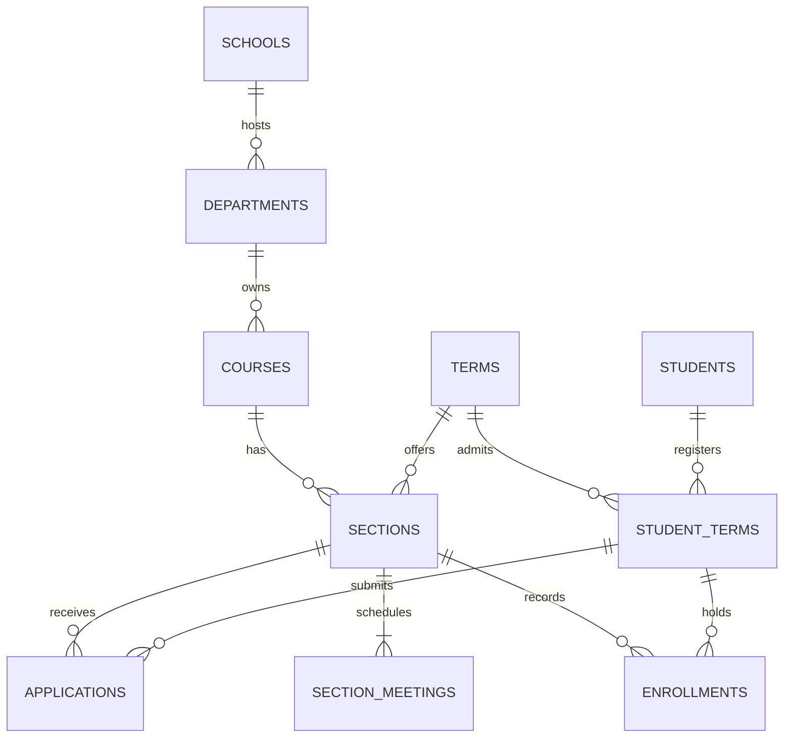
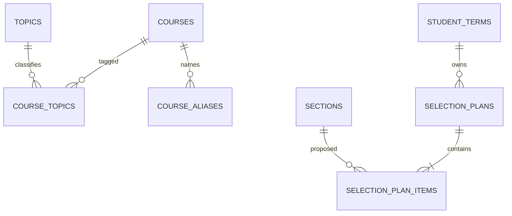
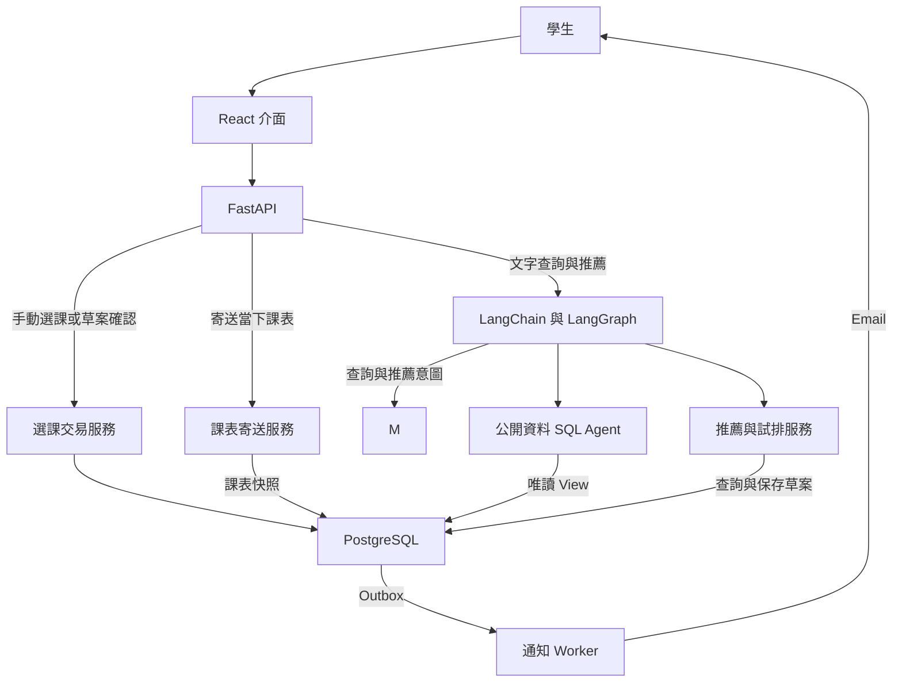

# 大學選課與課程推薦系統專題計畫書

| 項目 | 內容 |
|---|---|
| 專題 | 國立臺灣科技大學 資料庫設計期末專題 |
| 版本 | 3.2｜電資研究方向與多階段修課路徑 |
| 日期 | 2026-11-23（Asia/Taipei） |
| 實作基準 | [CourseFlow `main` 提交 `5db2f3e`](https://github.com/programmerKB/CourseFlow/commit/5db2f3e063a7428846a82e61bdb1b0de5e64e6f2)，同 [交付標籤 `v1.0.0`](https://github.com/programmerKB/CourseFlow/tree/v1.0.0) |
| 交付目標 | 以 Docker Compose 展示初選、分發、研究導向推薦、完整課表 Email 及 PostgreSQL 交易。後續加入三校電資課庫、文字與語音直接加選，以及 16 條電資研究修課路徑。 |
| 技術與協作 | React、FastAPI、PostgreSQL、LangChain、LangGraph、Gemini API、Docker、Git、GitHub |

## 1. 系統目標與設計依據

CourseFlow 提供公開查課、初選登記、分發、每週課表與教務管理。學生可依研究方向或系所取得推薦，調整試排後一次送出。在「我的課表」可寄送當下的完整課表至本人帳號信箱，分發公布時由系統另寄結果摘要。

後續加入三校電資課庫與單門加選指令。學生可以文字或語音指定一門課，後端確認班別唯一且符合即時加選規則後提交。選課助理另提供各研究方向的基礎、進階與專題進程，並依選定學期查出可供選課的班別。

| 官方參考 | 公開系統或文件呈現的做法 | 本專題採用的設計 | 來源 |
|---|---|---|---|
| 臺灣科技大學 | 課程查詢可依系別和年級查課表，也可查課程大綱。教務處說明額滿與調整人數上限的處理方式。 | 課程頁顯示開課系所、課程大綱、上課時段及名額。管理員可調整容量，受已選人數約束。 | [台科大教務處課務組](https://www.academic.ntust.edu.tw/p/404-1048-78759.php?Lang=zh-tw) |
| 臺灣師範大學 | 選課注意事項公開額滿課程的分發比序，部分同順位者以亂數分發。 | 公開本專題的分發規則，分發結果附可讀原因。以固定種子計算順序，方便重現測試。 | [臺師大 115-1 各學制選課注意事項](https://www.aa.ntnu.edu.tw/uploads/asset/data/6a38a689843f750599985637/115%E5%AD%B8%E5%B9%B4%E5%BA%A6%E7%AC%AC1%E5%AD%B8%E6%9C%9F_%E5%90%84%E5%AD%B8%E5%88%B6%E9%81%B8%E8%AA%B2%E6%B3%A8%E6%84%8F%E4%BA%8B%E9%A0%85-1150609%E5%AE%9A%E7%A8%BF%E7%89%88.pdf) |
| 臺灣大學 | 課程網顯示預選、初選、分發、結果公布、加退選及結果確認等時程。 | 統一顯示目前階段及截止時間，明確標示待分發、分發結果與即時加退選。 | [臺大課程網](https://course.ntu.edu.tw/) · [學生選課流程極簡版簡介](https://www.aca.ntu.edu.tw/WebUPD/aca/UAADForms/%E5%AD%B8%E7%94%9F%E9%81%B8%E8%AA%B2%E6%B5%81%E7%A8%8B%E6%A5%B5%E7%B0%A1%E7%89%88%E7%B0%A1%E4%BB%8B.pdf) |
| Harvard University | my.harvard 的 Course Search Tool 支援探索課程、收藏及選課。 | 採用先規劃再選課的操作方式。首版提供 Agent 試排，後續可加上手動收藏與多方案比較。 | [Harvard College Course Registration](https://firstyear.college.harvard.edu/course-registration) |

**專題規則。** 虛構資料共用同一套模擬選課規則。班別、時段、資格、名額及加退選紀錄供專題展示。每位學生每學期對同一課程主檔只能保留一筆待分發登記，以及至多一筆有效選課。

### 1.1 國立臺灣大學系統電資研究所課程

FR-14 擴充課程名稱參考國立臺灣大學、國立臺灣師範大學及國立臺灣科技大學的官方課程地圖、研究所課程表或已公開的大綱。學校及系所欄位用於搜尋、推薦與辨別同名課。系統頁面應標示「模擬選課」，並在班別詳情提供原始課程資料連結。[國立臺灣大學系統三校簡介](https://triangle.ntu.edu.tw/about.html)

下表列出擴充批次的 **40 筆課程主檔**。同名課依學校與開課系所各自建檔。每門至少標註一個主題，並在三校展示學期建立至少一班。所有課號採專題代碼。時段、學分、先修、教師與其餘名額等供展示使用，現行校方開課資訊以表內連結為準。

| 學校與研究所課程來源 | 筆數 | 納入專題的課名 | 官方參考 |
|---|---:|---|---|
| 臺大｜電機工程學研究所 | 4 | 適應控制系統、最佳控制、電力系統控制與穩定度、嵌入式系統與軟體工程 | [電機所碩士班課程地圖](https://coursemap.aca.ntu.edu.tw/course_map_all/class.php?code=921M) |
| 臺大｜電子工程學研究所 | 5 | 類比積體電路、電腦輔助積體電路系統設計、數位訊號處理架構設計、高等數位系統設計、半導體元件物理 | [IC 與系統組](https://giee.ntu.edu.tw/tw/courses/ics/) · [奈米電子組](https://giee.ntu.edu.tw/tw/courses/ne/) |
| 臺大｜資訊工程學研究所 | 5 | 自然語言處理、分散式系統、高等作業系統、深度學習之應用、資料庫系統設計 | [自然語言處理](https://nol.ntu.edu.tw/nol/coursesearch/print_table.php?class=&course_id=922+U0670&dpt_code=9220&lang=CH&semester=114-2&ser_no=10508) · [分散式系統](https://nol.ntu.edu.tw/nol/coursesearch/print_table.php?class=&course_id=922+U1580&dpt_code=9220&semester=114-2&ser_no=48414) · [高等作業系統](https://nol.ntu.edu.tw/nol/coursesearch/print_table.php?class=&course_id=922+M1360&dpt_code=9220&semester=110-2&ser_no=80197) · [深度學習之應用](https://nol.ntu.edu.tw/nol/coursesearch/print_table.php?class=&course_id=922+U4340&dpt_code=9220&semester=114-1&ser_no=26131) · [資料庫系統設計](https://nol.ntu.edu.tw/nol/coursesearch/print_table.php?class=&course_id=922+M1440&dpt_code=9220&semester=96-1&ser_no=16911) |
| 臺大｜電信工程學研究所 | 1 | 大型語言與語音模型技術 | [臺大課程網大綱](https://nol.ntu.edu.tw/nol/coursesearch/print_table.php?class=&course_id=921+U3580&dpt_code=9420&semester=115-1&ser_no=12317) |
| 臺師大｜電機工程學系碩士班 | 6 | 高等數位信號處理、數位通訊系統、控制系統設計、類比積體電路設計、射頻與微波積體電路、嵌入式系統 | [碩士班課程架構表](https://course.ntnu.edu.tw/coursemapdata/couHM75.pdf) |
| 臺師大｜資訊工程學系碩士班 | 5 | 分散式處理系統、高等計算機結構、機器學習、電腦視覺、高等資料庫系統 | [碩士班課程資訊](https://www.csie.ntnu.edu.tw/index.php/course_ms/) · [課程規劃](https://www.csie.ntnu.edu.tw/index.php/course_ms/course/) |
| 臺科大｜電機工程系研究所 | 4 | 電力系統分析與實務、電力電子建模與分析、數位控制系統、先進行動通訊系統 | [115 學年度研究所專業選修科目課程規劃表](https://www.ee.ntust.edu.tw/var/file/27/1027/img/3406/ElectiveCourses_Graduate.pdf) |
| 臺科大｜電子工程系研究所 | 7 | 高等計算機結構、資料庫設計、計算機演算法、智慧型視訊監控系統、嵌入式深度神經網路處理、類比積體電路設計與佈局、儲存系統架構與應用 | [研究所課程分類表](https://ece.ntust.edu.tw/p/412-1017-90.php?Lang=zh-tw) · [北區 AI 資源中心課程](https://ai-center.ntust.edu.tw/courses/schools?school=0022&term=1151) |
| 臺科大｜資訊工程系研究所 | 3 | 機器學習、高等計算機結構、強化學習於人機互動系統開發 | [高等計算機結構大綱](https://www.csie.ntust.edu.tw/var/file/38/1038/img/2176/344112436.pdf) · [北區 AI 資源中心課程](https://ai-center.ntust.edu.tw/courses/schools?school=0022&term=1151) |

主題至少涵蓋大型語言模型與語音、機器學習與電腦視覺、資料庫與分散式系統、計算機結構與嵌入式、半導體與 IC 設計、訊號與通訊、控制與電力。可用「記憶體系統」尋找高等計算機結構、儲存系統架構與應用。「邊緣 AI」可連到嵌入式深度神經網路處理。課號示例 `NTUST-ET-001` 代表專題內的臺科大電子系高等計算機結構。

### 1.2 CourseFlow `v1.0.0` 功能基準

| 功能 | GitHub 版本行為 | 需求位置與程式依據 |
|---|---|---|
| 學生選課 | 預設入口只公開 115-1 初選，提供公開查課、初選登記、取消及分發結果。多學期展示模式可操作即時加退選。 | FR-01–07、FR-18。[README 的 115-1 流程](https://github.com/programmerKB/CourseFlow/blob/5db2f3e063a7428846a82e61bdb1b0de5e64e6f2/README.md#L83-L100) |
| 週課表與郵件 | 並列正式選課與待分發時段，正式學分獨立統計。學生可手動寄送當下課表，管理員可查看郵件狀態。分發公布另寄摘要。 | FR-06、FR-08、FR-17。[課表與 Outbox 程式](https://github.com/programmerKB/CourseFlow/blob/5db2f3e063a7428846a82e61bdb1b0de5e64e6f2/backend/app/registration.py#L369-L388) |
| 選課助理 | 提供課程及個人選課查詢、研究方向或系所推薦、產生草案、一次確認與整批提交。助理提供單門加退選入口。 | FR-09、FR-12–13、FR-19。[助理分流程式](https://github.com/programmerKB/CourseFlow/blob/5db2f3e063a7428846a82e61bdb1b0de5e64e6f2/backend/app/chat.py#L304-L359) |
| 部署與驗收 | `deploy.sh` 支援首次初始化及保留資料的更新，並提供區網來源設定、SMTP 與 Gemini 診斷，以及 GitHub 標籤可重現驗收。 | §8–11。[README 部署指引](https://github.com/programmerKB/CourseFlow/blob/5db2f3e063a7428846a82e61bdb1b0de5e64e6f2/README.md#L9-L81) · [驗證報告](https://github.com/programmerKB/CourseFlow/blob/5db2f3e063a7428846a82e61bdb1b0de5e64e6f2/docs/verification.md) |
| 三校課庫及直接加選 | 40 筆三校課庫、文字直接加選、麥克風輸入與朗讀列為下一版實作。 | FR-14–16、§1.1、§7.5–7.6。[現行 API 路由](https://github.com/programmerKB/CourseFlow/blob/5db2f3e063a7428846a82e61bdb1b0de5e64e6f2/backend/app/main.py#L123-L149) · [現行助理路由](https://github.com/programmerKB/CourseFlow/blob/5db2f3e063a7428846a82e61bdb1b0de5e64e6f2/backend/app/main.py#L316-L324) |
| 研究修課路徑 | 現行版推薦回應包含研究延伸建議。16 條完整路徑、已修課對照與學期開課標示為 3.2 版新增需求。 | FR-20、§7.7、§12.1。[現行推薦回應](https://github.com/programmerKB/CourseFlow/blob/5db2f3e063a7428846a82e61bdb1b0de5e64e6f2/backend/app/recommendation.py#L281-L289) |

## 2. 角色與主要畫面

| 角色 | 可執行的操作 | 主要畫面 |
|---|---|---|
| 訪客 | 讀取已公開學期、課程名錄、班別、時段、名額與選課公告。 | 課程查詢、班別詳情、登入 |
| 學生 `STUDENT` | 登記、取消登記、查看結果與課表、寄送本人課表、詢問助理及確認多門試排。在即時加退選學期可加選或退選。 | 課程查詢、我的選課、我的課表、助理對話、推薦與試排確認 |
| 教務管理員 `ADMIN` | 管理學期、選課時段、開課班、容量，執行分發，查看批次摘要及通知狀態。 | 學期與開課管理、分發與通知 |
| 通知服務 | 讀取待寄送的通知及收件資訊，更新寄送狀態。 | 管理員可查看寄送結果 |

所有學生寫入及個人資料查詢皆由 FastAPI 依登入身分取得 `student_id`。管理端與學生端在 API 層獨立授權。介面預設繁體中文，時段以 `Asia/Taipei` 顯示。

## 3. 功能需求與優先順序

| 編號 | 優先 | 系統應提供 |
|---|---|---|
| FR-01 | P0 | 虛構學生及管理員帳號登入、登出、查詢登入身分。頁面重新整理後可辨識登入狀態。 |
| FR-02 | P0 | 依學期、系所、課程代碼或名稱、教師與星期篩選班別。列表分頁，詳情顯示學分、大綱、先修、時段及名額。學校、主題篩選及官方課程來源屬 FR-14。 |
| FR-03 | P0 | 公告學期選課階段與起訖時間。開放初選時可登記或取消，關閉後可查待分發狀態。 |
| FR-04 | P0 | 初選截止後由管理員執行「分發並公布」。產生每筆登記的錄取與未錄取結果，並對未錄取提供可理解的原因。 |
| FR-05 | P0 | 於即時加退選期間提供加選及退選確認。FastAPI 檢查資格與名額，成功後重新整理剩餘名額、學分及個人課表。 |
| FR-06 | P0 | 「我的選課」呈現待分發與分發結果。「我的課表」同時呈現正式選課與待分發班別的完整時段，以文字標示狀態，總學分只計正式選課。取消初選後立即刷新兩頁。 |
| FR-07 | P0 | 管理員可設定及公開學期、維護開課班、時段、先修條件與容量。課程主檔、教師、學生、學期修課資格及歷史通過科目可先由測試種子建立。 |
| FR-08 | P0 | 分發公布時，為每位有結果的學生建立一封摘要，列出錄取、未錄取原因及該學期的結果頁連結。 |
| FR-09 | P0 | 使用 LangChain 與 Gemini API 提供簡易對話、公開課程 SQL Agent 查詢及個人課表或選課條件查詢。每筆具體課程結果提供前端可開啟的連結。 |
| FR-10 | P1 | 手動收藏課程、儲存多份試排課表並比較方案。 |
| FR-11 | P1 | 候補排隊、授權碼加選及按志願順位分發。各項流程須有獨立的期限、狀態與驗收規則。 |
| FR-12 | P0 | Agent 依研究方向搜尋指定學期的課程，說明課程與主題的關聯及可延伸的研究方向，顯示班別、上課時間、名額、先修資格與連結。 |
| FR-13 | P0 | Agent 自動挑選符合限制的班別並試排。學生可刪減建議項目，一次確認後由系統批次初選登記或即時加選，逐筆顯示提交結果。 |
| FR-14 | P0 | 提供 §1.1 的三校電資研究所課程主檔與示範班別。可依校系和主題查詢，也可辨識跨校及跨系同名課。 |
| FR-15 | P0 | 加退選期間，登入學生輸入「我要加選某門課」時，Agent 對唯一能辨識的班別直接送出。多筆命中時顯示待選班別。 |
| FR-16 | P0 | 助理支援華語錄音輸入與可選的語音朗讀。明確的語音加選指令與文字指令使用相同的課程辨識、選課規則及結果。 |
| FR-17 | P0 | 學生從「我的課表」一鍵將當下課表寄到本人帳號信箱。信件含正式及待分發班別、上課時段、教室、學分與課表入口。管理員可查寄送狀態。 |
| FR-18 | P0 | 提供預設 115-1 單學期初選入口，以及可由設定切換的多學期與加退選展示情境。 |
| FR-19 | P0 | 支援以系所取得修課建議，以及「我剛剛選了什麼？」等明確問題查本人待分發與正式選課。兩種問法可由後端直接解析與查庫。 |
| FR-20 | P0 | 學生可輸入電資研究方向，取得基礎、進階、研究專題三階段路徑。助理應標示已修課、當期有班別的課、後續修課參考及可驗證的專題成果。 |

P0 為專題驗收需求。FR-14–16 與 FR-20 對應三校課庫、直接加選及研究修課路徑的擴充。課程查詢頁應提供載入中、查無資料及失敗重試的畫面。課程與課表支援鍵盤操作及行動裝置，並以文字標籤呈現選課狀態。

## 4. 選課流程與商業規則

### 4.1 階段與狀態

多學期模式的選課學期依序安排 `INITIAL` 與 `ADD_DROP`，各窗口互不重疊。115-1 單學期設定見 §4.4。所有期限以資料庫時間及半開區間 `[starts_at, ends_at)` 判定。公開學期後固定時段與分發種子。設定、公開與分發操作皆留稽核紀錄。

| 對學生顯示的階段 | 判定條件 | 可執行的選課操作 |
|---|---|---|
| `UPCOMING` 初選未開放 | 已公開且早於初選開始。 | 查詢課程與時程。 |
| `INITIAL` 初選登記 | 初選時間窗內。 | 登記、取消登記、查詢個人登記，確認 Agent 批次登記。 |
| `AWAITING_ALLOCATION` 待分發 | 初選已截止、分發尚未公布，且為單學期模式或早於加退選截止。 | 查詢登記與時程。 |
| `RESULTS` 結果已公布 | 分發已公布，且為單學期模式或早於加退選開始。 | 查看分發結果與正式課表。 |
| `ADD_DROP` 即時加退選 | 多學期模式中，分發已公布且在加退選時間窗內。 | 手動加選、退選、查看課表、確認 Agent 批次加選。文字或語音直接加選依 FR-15–16 擴充。 |
| `CLOSED` 已截止 | 多學期模式中，到達加退選截止時間。 | 查看已有結果與課表。未公布時顯示待公布提示。 |

- **登記狀態** `PENDING` 可於初選期間轉成 `CANCELLED`，取消後可重新登記原班或其他班。分發時，仍為 `PENDING` 的紀錄轉為 `ACCEPTED` 或 `REJECTED`。同一課程的另一班已有 `PENDING` 時，使用者須先取消該筆登記。
- **課表與學分** 錄取或即時加選建立 `ENROLLED`，退選轉為 `DROPPED`。每週課表呈現 `ENROLLED` 與 `PENDING` 全部時段，`PENDING` 標為「待分發」，總學分只計 `ENROLLED`。取消後，該筆登記移出「我的選課」與週課表。`REJECTED` 可在「我的選課」查原因。加退選期內可依資格與餘額重選已退班次。
- **登記與錄取時點** 初選登記確認階段、學期修課資格及班別有效性。分發及即時加選執行全部錄取規則。登記畫面須標示「待分發」，選課助理的試查結果須標明查詢時間。
- **行政維護** 班別的課程、學分、教師、時段、先修條件與是否開放選課在學期公開前設定。公開後可調整容量，且新容量須大於或等於當前有效選課人數。保留使用過的學期及班別資料，以及結果與稽核的關聯。

### 4.2 錄取規則

依下表順序判斷，回傳遇到的第一個業務錯誤。學生的註冊身分與操作階段由 API 先行檢查。分發共用下列規則，逐筆以該批次前面已錄取的選課為基準。

| 順序 | 規則 | 失敗代碼 |
|---|---|---|
| 1 | 班別屬於指定學期且開放選課。課程名錄可顯示未開放選課的班別及其狀態。 | `SECTION_UNAVAILABLE` |
| 2 | 同學期對該課程尚無有效選課，跨班別也適用。 | `ALREADY_ENROLLED` |
| 3 | 目標班別的所有先修科目，均已在先前學期通過。 | `PREREQUISITE_MISSING` |
| 4 | 任兩個每週時段在同一星期幾時，以 `start_a < end_b AND start_b < end_a` 判定重疊。比對目標班別的全部時段與現有課表。 | `TIME_CONFLICT` |
| 5 | 加選後的有效總學分小於或等於該生本學期學分上限。 | `CREDIT_LIMIT_EXCEEDED` |
| 6 | 班別有效選課人數小於容量。 | `SECTION_FULL` |

P0 每班至少有一個固定的每週上課時段，開始早於結束，同班的時段互不重疊。時段使用星期一至日 `1`–`7` 和本地時間。兩節首尾相接可同時選。學分採十進位儲存與比較。畫面名額標示查詢時間，最終錄取以成功提交的交易為準。

### 4.3 初選分發

1. 管理員在初選截止後執行一次「分發並公布」。系統在取得學期鎖後檢查截止時間與既有分發紀錄。若已公布，回傳既有批次與摘要。測試資料可用固定種子，多次請求仍對應同一批次。
2. 擷取全部 `PENDING` 登記。以固定格式 `v1|seed|student_id|section_id` 的 UTF-8 字串計算 SHA-256，按小寫十六進位摘要升冪排序。摘要相同時依 UUID 的字串值排序，先比 `student_id` 再比 `section_id`。登記時間不作為排序鍵。
3. 逐筆依 §4.2 審核，寫入結果與原因。錄取者同時產生正式選課。以學生為單位建立分發摘要通知事件。分發批次、全部結果、選課、稽核與通知事件在同一交易提交，該時點即為公布時間。沒有待分發紀錄時，可正常公布零筆結果。
4. 任一步驟失敗時回滾整批，管理員可再次送出分發。若管理員在排定的加退選時間過後才完成分發，系統依照原截止時間判定是否還能加退選，並公布結果供查詢。

### 4.4 115-1 單學期初選與多學期展示

- **預設 115-1。** `PUBLIC_INITIAL_TERM_ID` 指定學生與訪客入口使用的 115-1 學期。使用全新預設資料時，初選開放至初始化後第 7 天。學生學期清單、助理及個人選課讀寫都遵守同一公開學期。初選截止後待分發，公布後進入 `RESULTS`。此模式只呈現初選時段，加退選寫入須由多學期模式下的 `ADD_DROP` 受理。[學期查詢與階段程式](https://github.com/programmerKB/CourseFlow/blob/5db2f3e063a7428846a82e61bdb1b0de5e64e6f2/backend/app/registration.py#L41-L93)
- **多學期模式。** 將 `PUBLIC_INITIAL_TERM_ID` 設為空值後重建應用服務，公開入口可選各公開學期。全新示範資料可選 `initial`、`awaiting`、`add-drop` 或 `short`。`awaiting` 預放兩筆最後一席競爭的登記。`short` 縮短初選及加退選窗口，初選截止後仍由管理員分發。研究推薦用 115-4 示範加退選、115-5 示範初選。[示範情境與推薦流程](https://github.com/programmerKB/CourseFlow/blob/5db2f3e063a7428846a82e61bdb1b0de5e64e6f2/README.md#L115-L145)
- **從先前示範資料更新。** Seed 使用固定 UUID5，可補齊缺少的資料。單學期模式只會在辨識出舊版零結果示範批次，且查無實際分發結果、公布稽核與分發郵件時，重新開啟一次初選。正式分發與原有選課紀錄受保留。[Seed 更新規則](https://github.com/programmerKB/CourseFlow/blob/5db2f3e063a7428846a82e61bdb1b0de5e64e6f2/backend/app/seed.py#L98-L150)

## 5. PostgreSQL 資料設計

### 5.1 核心關聯





### 5.2 資料字典

`id` 採 UUID，事件時間採 `timestamptz`。CourseFlow `v1.0.0` 的 `0001` 定義選課主體與公開 View，`0002` 增加主題、試排及確認所需約束。校系分層、課程官方來源及課程別名配合 FR-14–16 於下一版 migration 新增。[資料模型](https://github.com/programmerKB/CourseFlow/blob/5db2f3e063a7428846a82e61bdb1b0de5e64e6f2/backend/app/models.py) · [推薦 migration](https://github.com/programmerKB/CourseFlow/blob/5db2f3e063a7428846a82e61bdb1b0de5e64e6f2/backend/alembic/versions/0002_recommendation.py)

| 資料表 | 主要欄位與鍵 | 資料用途 |
|---|---|---|
| `users`、`auth_sessions` | `users(id, login, email, password_hash, role, is_active)`，正規化 `login` 唯一。`auth_sessions(token_hash PK, user_id FK, expires_at, revoked_at)`。 | 登入帳號及可撤銷的 Session。 |
| `departments`、`schools` | `v1.0.0` 的 `departments(id, code UNIQUE, name)` 以系所分類。擴充新增 `schools(id, code UNIQUE, name)`、`departments.school_id FK` 及 `UNIQUE (school_id, code)`。 | 校系分層與來源辨識，三校代碼採 `NTU`、`NTNU`、`NTUST`。 |
| `students`、`instructors` | `students.user_id` 唯一且為 FK，另有 `student_no` 唯一及 `department_id`。教師包含顯示名稱與系所 FK。 | 學生身分與教師。 |
| `terms`、`registration_periods` | `terms(id, code UNIQUE, start_date, end_date, catalog_published_at, allocation_seed)`。`registration_periods(term_id, kind, starts_at, ends_at)` 以 `(term_id, kind)` 為 PK。 | 學期及選課窗口。 |
| `student_terms` | `(student_id, term_id)` 複合 PK 及 FK，`credit_limit numeric(4,1)`。 | 學期修課資格與學分上限，亦為個人併發加退選的鎖定點。 |
| `courses`、`sections` | `courses(id, code UNIQUE, department_id FK, title, description)`。`sections(id, term_id, course_id, section_no, instructor_id, credits numeric(4,1), capacity, is_selectable)`，`UNIQUE (term_id, course_id, section_no)`。 | 課程主檔與開課班。FR-14 增加 `catalog_origin`（`UNIVERSITY_REFERENCE` 或 `PROJECT_DEMO`）與官方 `source_url`。 |
| `course_aliases` | FR-15–16 擴充，`(course_id, normalized_alias)` 為 PK，`course_id` 為 FK。 | 文字和語音加選共用的課程簡稱。一個簡稱可對應多個課程，須依學期與校系辨別。 |
| `topics`、`course_topics` | `topics(id, code UNIQUE, label)`。`course_topics(course_id, topic_id)` 為複合 PK，兩欄皆為 FK。 | 課程與研究主題的多對多標籤。P0 由種子資料建立。 |
| `section_meetings` | `id, section_id, weekday, start_time, end_time, room`。同一班的同日相同區間唯一。 | 一班可多時段上課。至少一個時段為班別公開的條件。 |
| `section_prerequisites`、`course_completions` | 前者 `(section_id, required_course_id)` 為 PK。後者 `(student_id, course_id, completed_term_id)` 為 PK。各識別碼有 FK。 | 依班別設定直接先修條件。修課歷史只收錄已通過的科目，其學期結束日須早於目標學期開始日才可用於擋修檢查。 |
| `applications` | `id, student_id, term_id, course_id, section_id, status, submitted_at, decided_at, reason_code, allocation_run_id`，`UNIQUE (student_id, term_id, section_id)`。 | 初選登記與分發結果。`allocation_run_id` 可由 `(term_id, allocation_run_id)` 複合 FK 約束在同一學期。 |
| `enrollments` | `id, student_id, term_id, course_id, section_id, status, source, updated_at`，`UNIQUE (student_id, term_id, section_id)`，`source` 為 `INITIAL` 或 `ADD_DROP`，表示最近一次成功錄取來源。 | 當前正式選課及退選狀態。各次異動留存在稽核紀錄。 |
| `allocation_runs` | `id, term_id UNIQUE, algorithm_version, seed, published_at, accepted_count, rejected_count`。 | 初選分發單次性、可重現性與結果摘要。 |
| `selection_plans` | `id, student_id, term_id, phase, status, created_at, expires_at, confirmed_at`。`(student_id, term_id)` 為 FK，`(id, term_id)` 為唯一鍵。 | Agent 試排草案及單次確認狀態。`phase` 為 `INITIAL` 或 `ADD_DROP`，`status` 為 `DRAFT` 或 `SUBMITTED`，草案是否逾時由 `expires_at` 判定。 |
| `selection_plan_items` | `plan_id, term_id, section_id, course_id, position`。`(plan_id, section_id)` 為 PK，`(plan_id, position)` 及 `(plan_id, course_id)` 皆唯一。 | 限定可確認的班別與原試排順序，供選課稽核追查。 |
| `audit_events` | `id, actor_user_id FK, term_id FK, action, target_type, target_id, occurred_at, payload`。 | 追查選課、退選、初選分發與管理異動。批次選課記 `plan_id`，預計擴充的文字或語音加選記錄操作來源。 |
| `idempotency_keys` | `(student_id, term_id, request_key)` 為 PK，含 `request_fingerprint, response_status, response_body, created_at`。 | 即時加退選、Agent 批次確認與寄送課表共用。原鍵原請求可重播成功回應。文字及語音加選依 §7.5 沿用。 |
| `notification_outbox` | `id, event_key UNIQUE, term_id FK, recipient_user_id FK, type, payload, status, attempt_count, next_attempt_at, lease_until, claim_token, sent_at, last_error`。 | 分發摘要 `ALLOCATION` 與手動課表信 `TIMETABLE` 的工作佇列。課表信保存寄送當下的課表快照，並支援去重、重試與狀態查詢。 |

### 5.3 約束、索引及查詢

- `applications`、`enrollments` 以 `(student_id, term_id)` 參照 `student_terms`，並以 `(section_id, term_id, course_id)` 參照 `sections` 的對應唯一鍵。複合外鍵確保兩張表帶入的 `term_id` 與 `course_id` 和班別一致，供跨班別唯一性約束使用。
- 為 `applications` 建立 `(student_id, term_id, course_id)` 的 partial unique index，條件為 `status = 'PENDING'`。`enrollments` 對相同鍵建立條件為 `status = 'ENROLLED'` 的 partial unique index。
- 使用 `NOT NULL`、`CHECK` 與 FK 保護必要欄位、狀態值、非負容量、正學分、非負學分上限、日期先後和時段合法性。時段交疊、學期時段順序及容量與總學分等跨列規則，由交易服務檢查。歷史關聯採受限制的刪除策略。
- 開課查詢與班別時段查詢利用既有唯一鍵索引的前綴。另建查有效名額的 `enrollments(section_id) WHERE status = 'ENROLLED'`、待分發的 `applications(term_id) WHERE status = 'PENDING'` 與通知輪詢索引 `(status, next_attempt_at)`。
- 以 `JOIN` 連接學期、課程、班別、教師與時段。查名額時先依班別彙總有效選課，再和課程時段關聯，避免多個上課時段造成重複計數。提供 `v_section_availability`、`v_public_section_catalog`、`v_public_section_meetings`。公開 View 只返回已公開學期的公開欄位，供課程查詢及 Agent 使用。
- 推薦查詢使用 `course_topics(topic_id, course_id)` 索引，並提供 `v_public_section_topics`，只公開已公開班別的主題代碼與標籤。以 `EXISTS` 或先彙總主題命中，維持每班一筆候選。
- FR-20 的修課路徑以版本化設定維護 `track_code`、別名、相關主題、各階段目標與課程來源。已納入課庫的課程連到既有課程主檔，並以現有課程、班別和主題關聯取得學期資料。
- 課表在同一查詢讀取正式選課及待分發班別識別碼，再組裝班別的完整時段，避免分發公布時分次取資料造成狀態不一致。排程信件時保存這份快照。[課表查詢程式](https://github.com/programmerKB/CourseFlow/blob/5db2f3e063a7428846a82e61bdb1b0de5e64e6f2/backend/app/registration.py#L167-L186)
- FR-14–16 擴充公開課程 View，以校系外鍵提供 `school_code`、`school_name`、`department_name` 與 `source_url`。索引 `course_aliases(normalized_alias, course_id)` 支援精確別名查找。正式加選使用後端解析出的班別 ID。
- `selection_plan_items` 透過 `(plan_id, term_id)` 和 `(section_id, term_id, course_id)` 分別參照草案與班別。草案、選課與稽核的關聯保留在 PostgreSQL。草案內容只儲存班別與確認所需資料。

### 5.4 交易與併發控制

手動加退選採 PostgreSQL `READ COMMITTED` 搭配列鎖。Agent 批次選課沿用共同條件並依 §7.4 加上草案鎖與多班別檢查。§7.5–7.6 的文字及語音加選共用單筆加選服務。

1. 以 `FOR SHARE` 鎖住目標 `terms` 列，接著以 `FOR UPDATE` 鎖住 `student_terms`。同一學生的同一學期選課請求依序執行。初選登記及取消也使用此鎖定順序，維持申請唯一性並和分發互斥。
2. 即時加退選要求帶 `Idempotency-Key`。在學生學期鎖內先查已提交的鍵值，同一請求指紋重送時回傳原成功結果。同鍵異指紋回 `409 IDEMPOTENCY_KEY_REUSED`。指紋包含方法、路徑和正規化請求內容。
3. 以 `FOR UPDATE` 取得目標班別列鎖。取得鎖後讀取 `clock_timestamp()` 判定階段，再用新的 SQL statement 讀取有效選課人數、個人課表、學分等。加選執行 §4.2，退選確認該生確有目標班別的 `ENROLLED`。容量以 `COUNT` 自有效選課推導，可讓最後一席與退選釋出在鎖內計算。
4. 成功時將選課異動、稽核及成功回應的鍵值一併提交。個人加退選對應更新課表與名額，郵件由 §7.2 的寄送操作或分發公布觸發。成功回應遺失時，學期仍公開即可以原鍵值跨選課期限重送。
5. 管理操作若修改學期選課條件，包含設定、公開、容量變更與分發，先取得 `terms` 的 `FOR UPDATE`。因此批次分發與容量異動會等待該學期進行中的選課交易完成。分發以單一交易逐筆處理。異動服務均使用共同鎖定順序，交易內只做資料庫作業。

## 6. REST API 與介面契約

所有路徑以 `/api/v1` 開頭。文字請求與回應採 JSON，語音請求使用 `multipart/form-data`。欄位採 `snake_case`，學期及班別以 ID 定位。前端從 FastAPI 的 OpenAPI schema 取得欄位定義。錯誤回應包含 `code`、`message`、`request_id`，必要時帶 `details`。`401` 為未登入，`403` 為身分或學期資格不符，`404` 為資源不可得，`409` 為業務狀態衝突，`422` 為輸入欄位格式不符。

| 方法與路徑 | 權限 | 契約摘要 |
|---|---|---|
| `POST /auth/login`、`POST /auth/logout`、`GET /auth/me` | 登入公開，其餘需登入 | 登入接收 `login`、`password`，登入與身分查詢回傳角色及顯示名稱，登出撤銷 Session。 |
| `GET /departments` | 公開 | 回傳系所的 `id, code, name`，供查課篩選。 |
| `GET /schools` | 公開 | FR-14 擴充路由，回傳三校代碼、名稱及各自的公開系所。 |
| `GET /terms`、`GET /terms/{term_id}/registration` | 公開 | 查詢公開學期、目前階段、選課時段、分發公布時間。 |
| `GET /terms/{term_id}/sections` | 公開 | `q, department_id, instructor, weekday, page, page_size`，多條件取交集。預設每頁 20 筆、最多 50 筆。回傳 `items, total, page, page_size, as_of`。FR-14 再加 `school_code, topic_code`。 |
| `GET /terms/{term_id}/sections/{section_id}` | 公開 | 回班別、時段、大綱、先修科目及 `is_selectable, capacity, enrolled_count, remaining`。FR-14 再加 `school_code, catalog_origin, source_url`。 |
| `PUT /me/terms/{term_id}/applications/{section_id}` | 學生 | 初選登記，已是 `PENDING` 時回傳同一筆結果。先為同課程另一班登記時回 `409 APPLICATION_EXISTS`。成功回 `200`。 |
| `DELETE /me/terms/{term_id}/applications/{section_id}` | 學生 | 初選期內取消登記。沒有有效登記時亦回 `204`。 |
| `GET /me/terms/{term_id}/applications` | 學生 | 回傳本人待分發、錄取及未錄取登記、原因與時間。取消的登記由清單隱藏。 |
| `POST /me/terms/{term_id}/enrollments` | 學生 | Body 為 `section_id`，須附 `Idempotency-Key`。成功回 `201` 和選課、剩餘名額、總學分及查詢時間。 |
| `DELETE /me/terms/{term_id}/enrollments/{section_id}` | 學生 | 須附 `Idempotency-Key`。成功回 `204`。查無本人有效選課時回 `404 ENROLLMENT_NOT_FOUND`。 |
| `GET /me/terms/{term_id}/timetable` | 學生 | 回 `items`（正式選課）、`pending_items`（待分發）、各班完整時段、`total_credits, credit_limit, as_of`。 |
| `POST /me/terms/{term_id}/timetable/email` | 學生 | 以 `Idempotency-Key` 將本人當下課表排入寄送佇列。成功 `201` 回 `notification_id`。相同鍵重送可取回相同結果。 |
| `GET /me/terms/{term_id}/sections/{section_id}/eligibility` | 學生 | 選課條件試查。回傳 `phase, eligible, reason_code, as_of`，同 §4 規則，`eligible` 代表此刻可即時加選。 |
| `POST /me/terms/{term_id}/selection-plans/{plan_id}/confirm` | 學生 | 接收 `section_ids`，須附 `Idempotency-Key`。成功回 `200`、`plan_id, phase, items, submitted_at`，其中 `items` 的每列包含 `section_id, status`。狀態為 `PENDING` 或 `ENROLLED`，依當次階段判定。 |
| `GET /admin/catalog` | 管理員 | 回傳開課表單可選擇的課程、系所與教師，供選項或搜尋使用。 |
| `GET/POST /admin/terms`、`PUT /admin/terms/{term_id}/registration-periods` | 管理員 | 瀏覽公開及草稿學期。建立學期、初選與加退選時段，並設定分發種子。 |
| `GET /admin/terms/{term_id}/registration` | 管理員 | 讀取可管理學期的選課階段、時程及分發摘要，含草稿學期。 |
| `GET/POST /admin/terms/{term_id}/sections`、`PATCH /admin/terms/{term_id}/sections/{section_id}` | 管理員 | 瀏覽、設定班別、時段、先修條件與容量。低於有效選課人數的容量回 `409 CAPACITY_BELOW_ENROLLED`。 |
| `GET /admin/terms/{term_id}/sections/{section_id}` | 管理員 | 讀取指定學期的班別詳情。管理介面可使用此路由查閱尚未公開的班別。 |
| `POST /admin/terms/{term_id}/publish` | 管理員 | 驗證學期、選課時段及班別資料，公開課程目錄。 |
| `POST /admin/terms/{term_id}/allocation` | 管理員 | 分發並公布。回傳 `run_id, published_at, accepted_count, rejected_count`。既有批次回相同結果。 |
| `GET /admin/terms/{term_id}/notifications` | 管理員 | 依學期分頁查通知類型、狀態、嘗試次數、預計重試、寄出時間與錯誤代碼。 |
| `POST /chat` | 學生 | 接受 `message`、選填 `term_id`。回傳 `mode, answer, sources, as_of, request_id`，推薦時另回 `recommendation`。FR-20 增加選填的 `recommendation.roadmap`。FR-15 擴充直接加選回應 `action`。 |
| `POST /chat/voice` | 學生 | FR-16 擴充路由，上傳 `audio` 和選填 `term_id`，附 `Idempotency-Key`。回文字助理結果及 `transcript`，規格見 §7.6。 |

選課窗口外的登記、取消、加退選及草案確認回 `409 REGISTRATION_CLOSED`。學期已公開且學生具修課資格時，可隨時寄送本人課表。初選截止前執行分發回 `409 ALLOCATION_NOT_READY`。已公開班別未開放選課時回 `409 SECTION_UNAVAILABLE`，識別碼不存在或跨學期時回 `404`。錄取失敗碼沿用 §4.2。衝堂的 `details` 可含衝突班別，超學分可含計算後總學分與上限。必要的 `Idempotency-Key` 缺少、訊息過長或參數無效時回 `422`。

## 7. 選課助理與 Email

FastAPI 提供 Web API。LangChain 與 LangGraph 編排 Gemini 意圖解析、PostgreSQL 課程查詢及試排。學生確認試排後，由 FastAPI 的選課服務提交。課表寄送及分發摘要由 Outbox 交給 Worker。



### 7.1 Agent 行為

| 模式 | 使用情境 | 工具及資料來源 |
|---|---|---|
| `simple_chat` | 「初選登記完會立刻選上嗎？」 | 以版本化專題規則回答。問到實際日期時由 `get_registration_status` 查學期時段。 |
| `sql_query` | 「找這學期星期二還有空位的電子系課。」 | `query_public_courses`。後端可從固定問法取得星期、系所和空位條件。其他問法由 Gemini 產生符合 schema 的查詢計畫。工具執行對應的參數化 SQL。 |
| `student_query` | 「我星期三有課嗎？」、「我剛剛選了什麼？」或「我現在能加選資料庫設計嗎？」 | 查本人課表、初選結果或資格。「我剛剛選了什麼？」以後端句型解析，分列待分發及正式選課，附本人頁面連結。 |
| `recommendation` | 「我的研究方向是大型語言模型，幫我選三門相關課。」或「我是電子系學生，給我修課建議。」 | 從公開課程依研究主題或系所找候選。後端依登入者的課表與限制產生可確認草案。 |
| `recommendation`（FR-20 擴充） | 「我想做 RF，這學期先修什麼，以後能做什麼專題？」 | 辨識研究方向，讀取 §12.1 的路徑。查詢選定學期班別與本人修課紀錄，回傳分階段建議，詳見 §7.7。 |
| `add_course`（FR-15 擴充） | 「我要加選臺科大電子系的高等計算機結構。」 | 待補後端唯一班別比對與單筆提交。`v1.0.0` 提供班別選課入口或草案確認，詳見 §7.5。 |
| `clarify` | 問題缺少必要學期或查到多個同名班別。 | 優先使用畫面選定的學期。其他情形請學生指定學期或從查得班別中選擇。 |
| `unavailable` | Gemini 未設定、限流、逾時或中斷。 | 回 `503 CHAT_UNAVAILABLE`、可追查原因及一般課程／課表入口。語音擴充依 §7.6 提供獨立降級路徑。 |

- **LLM 與資料來源。** 使用 `langchain-google-genai` 呼叫具結構化輸出的 Gemini，模型及憑證由 `GEMINI_MODEL`、`GEMINI_API_KEY` 設定。後端將回應轉為 Pydantic 查詢計畫，取用 PostgreSQL 的選課階段、名額、課表與結果，再用班別 ID 建立可點選的來源。系所修課建議及本人目前選課的固定問法走後端解析。`CHAT_STUB` 提供測試用意圖，沿用同一查詢及試排流程。[Agent 程式碼](https://github.com/programmerKB/CourseFlow/blob/5db2f3e063a7428846a82e61bdb1b0de5e64e6f2/backend/app/chat.py)
- **公開唯讀查詢。** 模型計畫支援學期、關鍵字、系所、星期、餘額、排序和查詢筆數。服務端驗證後執行參數化 `SELECT`，專用帳號只查公開 View。星期篩選維持每班一列。`has_seats=true` 要求班別開放且有剩餘名額。每次最多 20 筆，SQL timeout 2 秒。校別與主題篩選配合 FR-14 擴充。
- **身分與隱私。** FastAPI 從 Session 取得登入學生及擁有權。模型接收遮罩後問題及公開學期和系所資料，課表與選課結果由應用服務查詢。使用者登出、切換帳號、學期或班別時，畫面應忽略或撤銷已過時的助理回應及資格查詢。[前端端到端紀錄](https://github.com/programmerKB/CourseFlow/blob/5db2f3e063a7428846a82e61bdb1b0de5e64e6f2/docs/playwright-results.txt)
- **診斷與降級。** 文字訊息上限 1,000 字元，整次助理上限 15 秒。診斷以 `request_id` 與固定 `reason_code` 標示缺金鑰、認證、額度、模型不可用、逾時及供應端暫時錯誤。遇 Gemini 500、502 或 503，在總時限內重試一次。部署者可用 `app.verify_gemini --connection-only` 測試連通，再用完整驗證與 PostgreSQL 比對查課及研究推薦。[Gemini 驗收及錯誤說明](https://github.com/programmerKB/CourseFlow/blob/5db2f3e063a7428846a82e61bdb1b0de5e64e6f2/README.md#L227-L273)

### 7.2 寄送課表與分發通知

| 郵件 | 觸發 | 內容 |
|---|---|---|
| `TIMETABLE` 每週課表 | 學生在「我的課表」按「寄送課表」。收件人取自本人帳號 `users.email`。 | 學期、正式選課、待分發班別、班號、所有上課時段與教室、各課學分、正式總學分及上限、帶學期的課表連結。 |
| `ALLOCATION` 初選分發摘要 | 初選分發公布後，每位有分發結果的學生建立一封。 | 錄取與未錄取班別、未錄取原因、帶學期的結果連結。 |

- 寄送課表時，在學期與本人學期資格鎖內取得課表快照。`TIMETABLE` 事件及 `201` 成功回應同一交易提交。同一 `Idempotency-Key` 重送回相同 `notification_id`。前端顯示「課表已排入寄送」。管理頁的 `SENT` 表示 Worker 已確認 SMTP 接受。登記、取消登記與即時加退選只更新選課資料，學生可在課表變動後再次按「寄送課表」。[寄送及加退選交易](https://github.com/programmerKB/CourseFlow/blob/5db2f3e063a7428846a82e61bdb1b0de5e64e6f2/backend/app/registration.py#L369-L430)
- Worker 以 `FOR UPDATE SKIP LOCKED` 領取工作，使用 60 秒租約及 claim token，領取交易提交後呼叫 SMTP。狀態包含 `PENDING`、`PROCESSING`、`SENT` 與 `FAILED`。失敗後間隔 1 分鐘、5 分鐘，最多三次嘗試。每事件使用固定 `Message-ID`。SMTP 接受郵件後的 `QUIT` 錯誤獨立記錄。SMTP 接受的回應若在網路上遺失，仍有重複投遞的可能。[信件 Worker](https://github.com/programmerKB/CourseFlow/blob/5db2f3e063a7428846a82e61bdb1b0de5e64e6f2/backend/app/worker.py)
- 開發以 Mailpit 收信。可設定外部 SMTP 寄至學生帳號信箱，例如 README 的 Gmail SMTP 設定。管理員可查看類型、狀態、嘗試次數、預計重試與錯誤。要求 STARTTLS 或帳密驗證時，若伺服器缺相應能力，Worker 以固定錯誤碼回報，日誌以安全的診斷欄位呈現。[SMTP 設定與排查](https://github.com/programmerKB/CourseFlow/blob/5db2f3e063a7428846a82e61bdb1b0de5e64e6f2/README.md#L147-L190)

### 7.3 依研究方向或系所推薦課程與試排

FR-20 的分階段修課諮詢依 §7.7 回傳路徑。這類諮詢在收到試排或代選請求時，才從符合下列條件的班別建立草案。

1. **解析需求。** 研究方向模式以 Gemini 解析主題、關鍵字、目標門數及可上課時段。門數預設 3，接受 1–5 門。學生可只指定系所，例如「我是電子系學生，給我修課建議」，此時從該系的公開班別取候選。學期優先採畫面選擇或預設 115-1，班別所有時段均須符合學生提出的時段限制。指定學校屬 FR-14 擴充。
2. **查詢並排序。** 以參數化 SQL 從該學期已公開班別找候選。版本化主題對照表將「大語言模型」「大型語言模型」「LLM」對應至 `llm`，並以 `nlp`、`retrieval`、`deep_learning`、`ml_systems` 為關聯主題。每班依直接標籤命中 6 分、任一關聯標籤命中 3 分、課名或大綱任一關鍵字命中 1 分加總。已知主題使用其共用關鍵字，並納入學生另行指定的關鍵字。只保留正分候選，按分數降序，同分按課程代碼、班號、班別 ID 升序，取前 20 筆。未登錄主題可用關鍵字查課名或大綱，查無資料時提示放寬條件或換學期。
3. **試排及原因。** 後端依排序逐一挑班，對照個人課表、先修紀錄、學分上限、時段限制與本方案已挑班別，直到達到目標門數或候選用完。即時加選另檢查最新名額。同課異班只挑一班。初選將該生原有 `PENDING` 登記一併納入試排，用來避免重複、衝堂或超修的登記組合。標示相關但未選入的課程及可判定的原因，如衝堂、額滿、先修未過。剩餘門數不足時回傳目前可行組合與原因。
4. **前端顯示。** 建議卡顯示班別連結、課名、班號、推薦證據、學分、所有時段、教室、名額、先修條件及資格。試排區顯示原有正式選課、初選時已有的待分發登記、建議班別及預估總學分。條件合格才建立草案。其他情況顯示可查課程、適用時程與未建立草案的原因。FR-14 再加入學校與官方課程來源。
5. **研究延伸。** 依主題對照表和實際命中的課程，附上最多兩個研究或修課方向。每個方向列出對應課程與一個可以繼續做的題目，例如修讀資訊檢索與 RAG 後，比較不同向量檢索方法對回答正確率的影響。

`recommendation` 回 `topic, target_count, candidates, learning_extensions, plan, baseline, registration, plan_unavailable_reason`。候選有 `section_id, course_code, course_title, section_no, credits, meetings, remaining, is_selectable, prerequisites, eligibility, score, match_reason, selected, reason_code`。`baseline` 以 `enrolled, pending, considered_credits, credit_limit` 呈現試排依據。`plan` 含 `plan_id, term_id, phase, as_of, expires_at, section_ids, projected_credits`，無可提交方案時為 `null`。FR-14 與 FR-16 分別擴充校系欄位及語音入口。[推薦程式碼](https://github.com/programmerKB/CourseFlow/blob/5db2f3e063a7428846a82e61bdb1b0de5e64e6f2/backend/app/recommendation.py#L195-L289)

#### 大語言模型方向示範

學生輸入「我的研究方向是大語言模型，請推薦這學期相關的課，幫我選三門。」示範設定為即時加退選開放，學生已有 9 學分、上限 18 學分，已通過所需先修。下列名稱及資料皆用於專題測試。

| 示範班別 | 與研究方向的關聯 | 上課時間、學分與名額 | Agent 試排結果 |
|---|---|---|---|
| `DEMO-501` 大型語言模型專題 | 語言模型微調、對齊與評估 | 週二 13:20–16:20，3 學分，剩 4 席 | 建議加入 |
| `DEMO-502` 自然語言處理 | 語言表示、序列建模及 NLP 評估 | 週一 09:10–12:10，3 學分，剩 6 席 | 建議加入 |
| `DEMO-503` 資訊檢索與 RAG | 文件檢索、排序及檢索增強生成 | 週三 10:10–13:10，3 學分，剩 2 席 | 建議加入 |
| `DEMO-504` AI 系統與模型部署 | 推論延遲、模型量化與服務部署 | 週四 13:20–16:20，3 學分，剩 3 席 | 與目前課表衝堂 |
| `DEMO-505` 向量資料庫與語意搜尋 | Embeddings、向量索引與語意搜尋 | 週五 10:10–13:10，3 學分，已額滿 | 顯示為相關課程及額滿狀態 |

115-4 加退選示範預估總學分為 18。取消勾選其中一班後為 15，按「確認加選」提交。預設 115-1 或多學期模式下的 115-5 初選使用「確認初選登記」，成功顯示「待分發」。FR-14 完成後，三校展示學期可推薦臺大電信所「大型語言與語音模型技術」等參考課程，試排依當時的示範時段與資格判定。

### 7.4 Agent 批次選課與一次確認

| 階段 | 確認後的動作 | 成功狀態 |
|---|---|---|
| `INITIAL` | 批次建立或恢復登記紀錄，適用一般初選規則與 §7.3 試排條件。名額由正式分發決定。 | `PENDING`，出現在「我的選課」。 |
| `ADD_DROP` | 批次執行 §4.2 的即時加選規則並更新有效課表。 | `ENROLLED`，出現在「我的課表」。 |
| 其他 | 顯示可提交的階段及起訖時間，停用確認按鈕。 | `409 REGISTRATION_CLOSED` 適用於送到伺服器的窗口外確認。 |

- **草案與確認。** 依研究方向推薦及試排時，先建立草案。草案屬於發起學生和指定學期，有效期到建立後 15 分鐘或當前選課窗口截止時間，以較早者為準。一次確認可送出草案內的 1–5 個不同班別。可在畫面刪減班別，加入其他班須重新產生草案。單門直接加選依 §7.5 執行。
- **交易。** 依 `terms FOR SHARE`、`student_terms FOR UPDATE`、草案列 `FOR UPDATE`、目標班別依 ID 升序 `FOR UPDATE` 鎖定。驗證本人草案後查冪等鍵。需要提交時先鎖住所有選定班別，再用資料庫時間重查階段、期限和最新選課資料。初選套用目前有效課表及待分發登記的衝堂和累計學分檢查。加退選依 §4.2。兩階段均將本批已通過審查的班別一併計入，確保同批組合也符合限制。
- **提交或回滾。** 全部成立時，一個交易寫入登記或正式選課、稽核與冪等回應，並將草案標記為 `SUBMITTED`。稽核保留 `plan_id`。任一班不符合時整批回滾，回傳原因及 `details.section_id`，畫面提供「更新試排」。成功後學生可在「我的課表」寄送更新後的課表。
- **確認錯誤與重送。** 找不到本人草案回 `404 PLAN_NOT_FOUND`。階段已切換或已過期回 `409 PLAN_EXPIRED`，目前窗口已關閉時回 `409 REGISTRATION_CLOSED`。選了草案外的班別回 `409 PLAN_SELECTION_MISMATCH`。已確認的草案以新鍵值提交回 `409 PLAN_ALREADY_SUBMITTED`。相同鍵值、相同計畫與班別集合重送時，重播原成功回應，即使草案已過期。相同鍵值搭配其他班別集合時回 `409 IDEMPOTENCY_KEY_REUSED`。

### 7.5 文字與語音指令直接加選

本節為 FR-15–16 的擴充。`v1.0.0` 的文字助理提供查詢、試排及前往選課入口，由學生介面送出選課。

學生在助理選好學期後，可打字或說「我要加選資料庫設計」。在即時加退選期間，助理找到唯一一班且學生符合規則時，當次請求完成加選並更新「我的課表」。初選期間由學生確認登記。

| 輸入或情況 | 助理的動作 |
|---|---|
| 「我要加選臺科大電子系的高等計算機結構」 | 在選定學期比對臺科大電子系、課名與班別。唯一且符合資格時立即加選。 |
| 「我要加選高等計算機結構」 | 有多校或多班符合時，列出校系、班號、上課時間和名額。學生點選「加選此班」或重新說出完整指令即可提交。 |
| 「這門課可以加選嗎？」或「我不要加選這門課」 | 回傳查詢或說明，維持現有課表。 |
| 「我的研究方向是大語言模型，幫我選三門」 | 回傳推薦與可確認的試排草案，依 §7.3–7.4 處理。 |
| 唯一班別但額滿、衝堂、先修不足、超學分或已選 | 回傳對應錯誤及學生可檢查的資訊。 |
| 目前是初選 | 回傳候選班別與時程。學生點「登記此班」並確認後，透過初選登記介面提交。 |
| 目前待分發或已截止 | 回 `409 REGISTRATION_CLOSED`，並顯示目前階段及選課時程。 |

1. **辨識指令。** 後端用明確的指令式樣，例如「我要加選」「幫我加選」「請加選」，搭配一門課的名稱或課號進入直接加選。引用、疑問、否定、含糊代詞或一次提及多門課時，回查詢、釐清或試排。登入學生及畫面選定的 `term_id` 決定操作範圍。缺少學期時請學生選學期。只有完成比對的後端節點會呼叫交易服務。
2. **指定班別。** 正規化全半形、空白和英文字母大小寫。以別名表把「台科大」「NTUST」對應至臺科大，把「電子系」對應至指定學校的電子工程系。依課號、完整課名或已建置的課程別名查找，再套用指令明示的校系、班號。比對涵蓋選定學期全部公開候選。多筆命中時回 `mode=clarify` 與 `choices`。部分字串結果也可供挑選，待學生指定班別後提交。`choices` 含班別 ID、校系、名稱、班號、時段及剩餘名額，依課程代碼與班號排序，最多回 5 筆及查詢入口。
3. **提交與防止重複。** 文字或語音加選須有 `term_id` 與 `Idempotency-Key`，走 §5.4 的同一筆加選交易，於鎖內重查資格與名額。請求指紋含路徑、學期及文字或上傳音訊的 SHA-256。重送已提交的請求可在轉寫或查課前重播，交易內再次檢查冪等鍵。選課、操作來源稽核與成功回應於同一交易提交。寄送課表適用 §7.2 的按鈕。
4. **顯示結果。** 成功回 `200` 與 `mode=add_course`。`action` 包含 `status=ENROLLED, term_id, enrollment_id, section_id, school_code, course_title, section_no, total_credits, remaining, submitted_at`。前端顯示「已加選」、所選校系與班號，並更新課表。業務拒絕沿用 §4.2 錯誤代碼與 §6 形式。失敗及等待釐清時皆維持原課表。

### 7.6 語音互動

本節為 FR-16 的擴充，使用 §7.5 的班別辨識與加選交易。

| 操作或技術 | 首版要求 |
|---|---|
| 麥克風介面 | 助理提供「開始錄音」、「停止並送出」與「取消」。錄音時顯示圖示與秒數。只有送出的最終錄音進入辨識。送出時也支援鍵盤操作。 |
| 瀏覽器錄音 | React 在受信任的 HTTPS 或 localhost 透過 `getUserMedia` 與 `MediaRecorder` 擷取音訊。用 `MediaRecorder.isTypeSupported()` 選用 WebM/Opus、MP4/AAC 或 Ogg/Opus。錄滿 20 秒時停止收音，等學生送出或取消。也可從裝置選擇 WebM、M4A、MP4、Ogg、WAV 或 MP3 音檔，區網 HTTP 同樣可用。 |
| 上傳與轉寫 | 每次至多 20 秒、5 MiB。FastAPI 驗證後以 FFmpeg 轉成 16 kHz 單聲道 WAV，送至支援音訊輸入的 `GEMINI_AUDIO_MODEL`，以繁體中文轉寫並保留英文縮寫、課號及班號。轉寫上限 20 秒，整次語音請求上限 30 秒。 |
| 共享指令流程 | 顯示辨識到的指令或問題。初選期間顯示可確認登記的班別。加退選期間清楚的單門加選轉入 §7.5。辨識後可把文字放回輸入框修正。語音試排可帶入前一個研究方向。 |
| 朗讀回覆 | 可按「朗讀回覆」。瀏覽器支援 `SpeechSynthesis` 時，以 `zh-TW` 朗讀加選成功訊息、候選或失敗原因。畫面始終顯示完整文字結果。 |
| 權限及故障 | 麥克風未授權或瀏覽器不支援時，可選擇音檔或使用文字輸入。靜音或不清楚回 `422 VOICE_UNCLEAR`。檔案太大回 `413`，不支援格式回 `415`，辨識服務異常回 `503 VOICE_UNAVAILABLE`。 |

錄音介面顯示錄音會送往 Gemini 辨識。轉寫回傳 `transcript` 與清晰、含糊或靜音狀態，保留能辨識到的課名及班號。前端在結束錄音或離開頁面時釋放麥克風。系統處理完畢即清除音訊與轉寫暫存。可重播的成功回應保存選課結果及辨識到的加選指令所對應的標準化校系、課名與班號。

### 7.7 研究方向與分階段修課建議

1. **辨識研究方向。** 以版本控管的主題及同義詞對照 §12.1 的 16 條路徑。Gemini 可協助辨識方向，後端驗證 `track_code`，對應既有、可查證的主題標籤和課程參考。方向太廣或同時命中多條路徑時，請學生選擇。例如「IC 設計」可選「數位 IC」或「類比與混合訊號 IC」。「NVM」可先確認重點在記憶體架構或元件與製程。
2. **將路徑對上課庫。** 依課程代碼或已驗證的校系與課名關聯查找。使用學生選定的學期或公開預設學期，由公開班別取得當期開課資訊、時段與名額，再依 §4.2、§7.3 判定是否適合試排。同名課保留校系及班別連結，示範班別標示「模擬選課」。學生可指定學校、時段及門數。若尚無適用學期，先回路徑並提供選擇學期的入口。
3. **依本人修課進度建議。** 由 FastAPI 查登入者的已通過課程，保留整條路徑並標示已完成的課。依目前缺少的基礎、實際先修及該學期開課，預設優先推薦下一步的 1–3 門。學生自述的背景可用來調整解說。正式資格以資料庫紀錄判定，外部模型只接收 §7.1 允許的資料。
4. **給出研究進程。** 畫面依序顯示基礎、進階與專題。每條路徑至少提供一項可做的專題、一個可重現的產物及評估指標。課程為校方規劃參考或本期查無公開班別時，顯示來源或相應狀態，供未來修課規劃。
5. **接到選課流程。** 純修課建議可回當期候選與完整路徑，`plan` 為 `null`。學生另外要求試排時，沿用 §7.3–7.4 建立草案和一次確認。明確單門加選指令仍依 §7.5 判定。

`recommendation.roadmap` 建議使用 `track_code, title, stages`。`stages` 依序回 `FOUNDATION`（基礎）、`SPECIALIZATION`（進階）、`RESEARCH`（研究），各項包含 `goals, courses, milestone`。研究階段的 `milestone` 應含 `project, deliverable, metrics`。課程可有 `title, course_code, school_code, department_name, source_url, availability, completed, sections`。`completed` 只依本人紀錄標示，未知可回 `null`。`sections` 的每筆資料須能以系統班別 ID 連回同一學期的公開課程，並可附既有的資格結果。

| `availability` | 建議畫面標籤與判定 |
|---|---|
| `OFFERED` | 本期有公開班別。是否開放、剩餘名額與學生資格由各班資訊呈現。 |
| `NO_PUBLIC_SECTION` | 在系統課庫中，所選學期查無公開班別。 |
| `CURRICULUM_REFERENCE` | 來自已查證的課程規劃，附原始資料網址，供後續修課參考。 |
| `TERM_NOT_SELECTED` | 已有可對照的系統課程，待選擇學期後確認班別。 |

例如學生問「我修過資料庫設計，想做 AI Agent，這學期先修什麼？」後端先核對是否已有通過紀錄，再列出當期查得的自然語言處理或分散式系統班別。研究階段可用 CourseFlow 做工具選擇與結果回覆的實驗，交付測試題集、執行紀錄、工具選對率與端到端成功率。

## 8. 技術與部署需求

| 層級 | 首版規格 |
|---|---|
| Frontend | React＋TypeScript＋Vite，透過 Nginx 代理同源 `/api/v1`。提供公開查課、學期狀態、週課表、寄送按鈕和推薦卡。為需要冪等的異動產生重送鍵，遇暫時錯誤保留原鍵。三校篩選及錄音依 FR-14–16 擴充。 |
| Backend | Python 3.12、FastAPI、Pydantic、SQLAlchemy 2.x、Alembic。登入、選課、試排與寄送共用授權和交易服務。語音擴充由 `python-multipart` 收檔並以 FFmpeg 轉檔。 |
| Database | PostgreSQL 16，獨立 DB volume。migration、應用與 Agent 使用用途對應的資料庫權限。公開 View 用於 Agent 查課，正式選課使用交易服務。 |
| Authentication | 密碼採 Argon2id，Session 使用 `HttpOnly`、`SameSite=Lax` Cookie，儲存 Token 雜湊。本機回環與區網私有 IPv4 支援同源寫入，自訂網域透過 `APP_ORIGIN` 與 `APP_ALLOWED_ORIGINS` 設定。HTTPS 以 `COOKIE_SECURE=true` 啟用 Secure Cookie。 |
| Docker Compose | `db` 通過 TCP 健康檢查後由一次性 `migrate` 執行 migration。API 就緒後，前端服務代理 API。`worker` 背景處理 Email，`mailpit` 供本機測試。選用的 `https` 服務與其他服務共用同一份 `compose.yaml`。PostgreSQL 以 `course_db` volume 保存。 |
| 設定 | `.env.example` 提供 115-1 的 `INITIAL_START_AT` 與 `INITIAL_END_AT`，以及資料庫角色、`PUBLIC_INITIAL_TERM_ID`、瀏覽器來源、Gemini 模型及 SMTP。部署時驗證初選日期並套用至 PostgreSQL。Gemini 暫時不可用時，公開查課、手動選課、課表寄送及固定的本人查詢仍可運作。 |
| 故障與效能 | 提供存活及資料庫就緒端點。使用結構化 log 和 `request_id`。一般課程搜尋在 1,000 個班別、20 個並行查詢下，以本機暖機後 p95 ≤ 500 ms 作為驗證目標，測試報告記錄機器與資料規模。 |

### 8.1 部署、更新與區網使用

- `deploy.sh` 依序驗證 Compose 設定、建置服務、等待資料庫就緒、執行 migration、啟動及檢查 API、執行選定 seed，最後啟動前端與 Worker。首次部署以 `.env.example` 補上缺少的環境檔。既有部署可用 `--skip-seed` 更新並沿用資料庫 volume，另提供 `--scenario`、`--no-build`、`--env-file` 和 `--timeout`。更新時服務在 migration 階段短暫停止。[部署腳本](https://github.com/programmerKB/CourseFlow/blob/5db2f3e063a7428846a82e61bdb1b0de5e64e6f2/deploy.sh) · [部署指引](https://github.com/programmerKB/CourseFlow/blob/5db2f3e063a7428846a82e61bdb1b0de5e64e6f2/README.md#L9-L69)
- 預設服務入口為選課系統 `8080`、API 文件 `8000/docs`、Mailpit `8025`。API 提供 `/health/live` 與 `/health/ready`。`APP_ORIGIN` 用於 Email 連結。前端的冪等鍵及音檔上傳支援區網 HTTP。可用 `deploy.sh --https` 加開 HTTPS 入口供網頁錄音。[區網設定](README.md#從區網登入) · [區網 HTTPS 設定](README.md#讓區網使用網頁麥克風)
- Linux 本機開發也可用 `scripts/setup-local.sh`、`scripts/run-local.sh` 啟動前後端與本機 PostgreSQL。示範資料含一位管理員、二十位虛構學生、固定課程與完整時段。以多學期示範驗證額滿、最後一席、同課不同班、先修、衝堂及選課階段。三校展示學期另依 FR-14 補上 §1.1 的 40 筆資料。[種子與展示資料](https://github.com/programmerKB/CourseFlow/blob/5db2f3e063a7428846a82e61bdb1b0de5e64e6f2/README.md#L90-L126) · [本機開發](https://github.com/programmerKB/CourseFlow/blob/5db2f3e063a7428846a82e61bdb1b0de5e64e6f2/README.md#L305-L318)

## 9. 驗收測試

API 與併發測試必須連接 PostgreSQL。使用固定測試時間、學期、容量與種子，並在交易後查資料表驗證容量、唯一性和狀態。測試報告涵蓋下表結果，附上一筆課程查詢與一筆有效名額查詢的 SQL 和 `EXPLAIN (ANALYZE, BUFFERS)` 結果。

| 編號 | 測試情境 | 預期結果 |
|---|---|---|
| AT-01 | 匿名查課，學生登入，使用學生身分呼叫管理 API。 | 公開查課成功。個人課表要求登入。學生取得 `403`，與其他學生資料隔離。 |
| AT-02 | 依課程、教師或星期查詢含兩個時段的班別。 | 每班一筆，詳情顯示全部時段，名額計算等於容量減有效選課。 |
| AT-03 | 在初選開始時間登記，在截止時間再次登記。初選中重送相同登記、嘗試再登記同課另一班、取消後改登記另一班。 | 開始時刻受理、截止時刻回 `409`。同班保留一筆待分發。另一班先被拒絕，取消後成功。 |
| AT-04 | 兩學生競爭一席的初選班。以相同資料與 seed 在乾淨測試環境分發，並重送同學期分發請求。 | 兩個環境錄取同一學生，另一人為 `SECTION_FULL`。原環境重送回相同批次，該批次的選課與通知各只建立一次。 |
| AT-05 | 有意讓分發過程中的一筆寫入拋出資料庫錯誤，再重試。 | 失敗批次的選課、結果、稽核與通知全數回滾。重試可完整公布。 |
| AT-06 | 20 位學生同時加選同一班的最後一席。 | 恰有一筆 `201`，其餘為 `409 SECTION_FULL`。查詢資料庫有效人數等於容量。 |
| AT-07 | 同一學生同時加選兩班，分別測試時段相衝、同課另一班、合計學分超上限，以及首尾相接且學分合規的班別。 | 前三組各一班成功，另一筆回對應錯誤。首尾相接的合規兩班皆成功。 |
| AT-08 | 先修未過時加選，退選釋出一席後由另一位合格學生加選，管理員嘗試把容量降到已選人數以下。 | 分別得到 `PREREQUISITE_MISSING`、有效人數先減後增，以及 `CAPACITY_BELOW_ENROLLED`。 |
| AT-09 | 加退選成功後模擬網路斷線，送出相同鍵值。另以同一鍵送不同班別。 | 原請求回原狀態碼與資料，選課異動及稽核各只執行一次。異指紋回 `409 IDEMPOTENCY_KEY_REUSED`。 |
| AT-10 | 問選課規則、自然語言查剩餘名額、查個人課表、請助理退選、請助理查他人課表。 | 前三項以正確來源回答。退選請求轉至操作入口。查他人課表回權限說明。驗證 SQL 帳號只有公開 View 查詢權限。 |
| AT-11 | 用真實 Gemini API 驗收查課、研究方向推薦，再模擬未設定、逾時或限流。 | 查課結果與推薦候選可核對 PostgreSQL。故障時回 `503` 與可用入口，Web 選課可繼續操作。 |
| AT-12 | 按「寄送課表」，模擬 SMTP 拒絕連線再恢復。 | API 先回 `201`。Outbox 進入重試，恢復後 Mailpit 收到課表信，管理頁顯示 `SENT` 與嘗試次數。 |
| AT-13 | 在全新環境依 README 啟動 Compose、執行 seed，再以相同設定重啟。 | migration 執行成功，核心情境可操作，既有選課資料由 volume 保留。 |
| AT-14 | 在即時加退選環境用「大語言模型」及「LLM」各查一次，再測試無關主題，以及未開放、額滿、衝堂、缺先修及超學分的班別。 | 同義詞查得一致排序結果。推薦與研究延伸皆對應資料庫班別。無命中時回空結果。各不可選班皆未進入可提交草案。 |
| AT-15 | 在初選及加退選環境各要求 Agent 選三門。先查資料庫，再於畫面取消勾選一班並確認。 | 確認前只有草案。兩階段各提交兩班，分別回 `PENDING` 或 `ENROLLED`，並更新週課表的對應狀態。 |
| AT-16 | 試排兩班後，由其他學生先拿走其中一班的最後名額，或以人工加選造成衝堂。 | 確認回 `409` 與對應的班別及原因。整批選課、稽核與通知維持零筆新增，原草案可供檢視。 |
| AT-17 | 批次確認成功後模擬斷線，以相同鍵值重送，再以同鍵搭配不同班別、以新鍵重送及用他人帳號確認。 | 相同請求重播原回應。其他情境分別回 `409 IDEMPOTENCY_KEY_REUSED`、`409 PLAN_ALREADY_SUBMITTED`、`404 PLAN_NOT_FOUND`，成功紀錄各建立一次。 |
| AT-18 | 嘗試確認逾時草案、窗口外草案或加送草案外班別。 | 分別回 `PLAN_EXPIRED`、`REGISTRATION_CLOSED` 或 `PLAN_SELECTION_MISMATCH`，皆無選課異動。 |
| AT-19 | 從 GitHub 全新 clone 並 checkout 最終版本標籤，依 README 使用虛構資料啟動。檢查追蹤檔案與提交歷史。 | 標籤、文件、migration、seed、測試與環境範例齊備。核心展示可從該版本重現。金鑰、憑證及真實個資的檢查結果為零。 |
| AT-20 | 載入 §1.1 三校課程，以校別、系所與主題交叉查詢，再查同名的高等計算機結構。 | 40 筆參考課程主檔均有校系、標籤及官方連結。各校系同名課具有不同代碼，三校課程可被推薦查詢取得。 |
| AT-21 | 即時加退選期間輸入「我要加選臺科大電子系的高等計算機結構」。另用專題課號測試。 | 授權學生在原請求內完成加選，課表新增該班、扣一個名額並增加學分。 |
| AT-22 | 輸入未限定校系的同名課、同課兩班、部分課名，或輸入「我可以加選資料庫設計嗎？」與否定句。 | 依情況顯示校系及班號讓學生指定，或只回答問題。選課紀錄維持原狀，學生明確選定候選後才提交。 |
| AT-23 | 對唯一可辨識班別分別測試額滿、衝堂、缺先修、學分超限、重複選課，以及初選或截止時段。 | 即時加選回對應原因。初選可從候選班別確認登記，確認後課表顯示待分發。 |
| AT-24 | 用瀏覽器麥克風說出 AT-21 的指令，按「停止並送出」。用真實 Gemini 驗證一次，並使用清楚錄音 fixture 做自動化回歸。 | 顯示辨識文字與加選成功班別，課表新增該班。支援朗讀的瀏覽器可播放結果。 |
| AT-25 | 取消錄音、拒絕麥克風權限、上傳靜音或超限檔，或模擬辨識逾時。 | 取消時無 API 寫入。其餘情境顯示失敗原因與重錄或文字入口，課表維持原狀。音訊資料沒有寫入資料庫或日誌。 |
| AT-26 | 用文字、語音和手動操作同時競爭最後一席。重送勝出請求。另用相同鍵值和不同音訊重送曾成功的語音加選。 | 一次錄取及一筆選課稽核。其他有效競爭請求回 `SECTION_FULL`。原鍵原內容重播成功結果，改用不同內容回 `409 IDEMPOTENCY_KEY_REUSED`。 |
| AT-27 | 以預設配置啟動 115-1。測試公開學期清單、其他學期直連與初選截止後分發。 | 公開入口只列 115-1，其他學期讀取回 `404`。初選後依 `AWAITING_ALLOCATION` 與 `RESULTS` 顯示狀態。 |
| AT-28 | 初選登記含兩次上課時段的班別，查看「我的選課」及「我的課表」，再取消登記。 | 課表兩個時段都標示待分發，正式總學分只計錄取或加選。取消後兩頁皆移除該班。 |
| AT-29 | 同時有已選及待分發班別時按「寄送課表」，重送同一鍵，再調整選課後寄送一次。 | 同鍵回同一筆通知。第一封含快照中的全部時段與狀態。第二次主動寄送對應更新後的課表。 |
| AT-30 | 輸入「我是電子系學生，給我修課建議」與「我剛剛選了什麼？」。 | 系所問題返回公開電子系候選與本人可試排的草案。本人問題分列正式選課與待分發，來源連到同一學期。 |
| AT-31 | 從已列入允許來源的區網 HTTP 入口登入並執行可用的學生操作。另測未列入允許清單的來源。 | 合法來源可登入與產生重送鍵。其他來源回 `403 ORIGIN_FORBIDDEN`。 |
| AT-32 | 逐一輸入 §12.1 的 16 個研究方向，再測 RTOS、LLM、AI Agent、RTL、RF 等稱呼及「我想找進階課」等方向未定的問題。 | 各方向與別名對應正確路徑。順序為基礎、進階、研究。缺少研究方向時請學生補充。 |
| AT-33 | 分別輸入「IC 設計」與「NVM」。從助理提供的選項確認興趣。 | 助理先釐清數位／類比 IC、記憶體架構／元件製程，再回所選方向的課程與專題。 |
| AT-34 | 推薦資料含本期公開班別、已建檔但本期無公開班別、僅見於官方規劃的課，以及兩校同名課。另測沒有可用學期。 | 開課狀態符合 §7.7。班別連結指向正確學期及校系。官方規劃課顯示資料來源及參考狀態。無適用學期時顯示路徑及學期選擇入口。 |
| AT-35 | 兩學生用相同問題取得 AI Agent 修課建議，其中一人已通過資料庫先修，另一人僅在問題中自述修過。 | 各自顯示本人的已修課進度。正式先修資格依資料庫判定。自述背景只影響解說。 |
| AT-36 | 先問 RF 修課與未來專題，再要求試排當期符合條件的班別。 | 修課諮詢回三階段、研究成果與評估指標，`plan` 為 `null`。試排僅納入符合條件的本期公開班別，並依 §7.4 確認後提交。 |

### 9.1 GitHub 交付版本的驗證紀錄

| 項目 | `v1.0.0` 已發布的結果 | 證據 |
|---|---|---|
| PostgreSQL 與 Python | pytest 120 項通過，涵蓋 migration、選課與分發交易、草案、冪等性及課表寄送。 | [pytest 紀錄](https://github.com/programmerKB/CourseFlow/blob/5db2f3e063a7428846a82e61bdb1b0de5e64e6f2/docs/pytest-results.txt) |
| 前端與部署腳本 | Playwright 9 項、部署腳本 8 項通過，前端建置成功。Compose 設定已驗，完整容器冷啟與重啟列為部署驗證。 | [Playwright 紀錄](https://github.com/programmerKB/CourseFlow/blob/5db2f3e063a7428846a82e61bdb1b0de5e64e6f2/docs/playwright-results.txt) · [驗證報告](https://github.com/programmerKB/CourseFlow/blob/5db2f3e063a7428846a82e61bdb1b0de5e64e6f2/docs/verification.md) |
| 課表 Email | 本機 Mailpit 驗證包含待分發完整時段。另一封模擬 TCP 連線失敗後，第二次嘗試為 `SENT`。 | [SMTP 紀錄](https://github.com/programmerKB/CourseFlow/blob/5db2f3e063a7428846a82e61bdb1b0de5e64e6f2/docs/mailpit-verification.json) · [驗證報告](https://github.com/programmerKB/CourseFlow/blob/5db2f3e063a7428846a82e61bdb1b0de5e64e6f2/docs/verification.md) |
| 公開課程查詢 | 1,000 班、20 並行、25 次暖機及 200 次量測，p50 為 201.34 ms，p95 為 275.20 ms。 | [效能紀錄](https://github.com/programmerKB/CourseFlow/blob/5db2f3e063a7428846a82e61bdb1b0de5e64e6f2/docs/performance.json) |
| Gemini | 測試 stub 的助理流程已通過。真實 Gemini 的查課及研究推薦在發布紀錄中標為 `not_run`，以 AT-11 完成部署驗收。 | [Gemini 驗收紀錄](https://github.com/programmerKB/CourseFlow/blob/5db2f3e063a7428846a82e61bdb1b0de5e64e6f2/docs/gemini-verification.json) |

## 10. 交給 Codex 的實作順序與交付清單

1. **重現既有交付。** 從 CourseFlow `v1.0.0` 或後續工作分支啟動，使用 `deploy.sh` 和原有 Alembic。驗證 115-1 初選、待分發課表、手動寄送、分發摘要、學期限制與批次確認。
2. **擴充三校課庫。** 在現有資料上新增 Alembic migration、官方課程映射與種子資料。補齊三校課庫及校系選項，維持歷史學期、先修、選課與通知關聯的相容性。依 AT-20 驗證校系、同名及課程來源。
3. **實作分階段修課建議。** 依 §12.1 建立 16 條路徑及別名，沿用課程主題、公開班別與先修查詢。實作 §7.7 的回應欄位及畫面，依 AT-32 至 AT-36 驗證。
4. **實作文字與語音直接加選。** 先完成單門指令、同名班釐清與共用加選交易，再加入錄音、Gemini 轉寫與朗讀。使用多學期模式的 `ADD_DROP` 驗證 AT-21 至 AT-26。
5. **回歸驗收及交付。** 驗證既有推薦、兩階段試排、冪等寄送、權限及併發。於部署環境完成真實 Gemini 查課、研究推薦和語音驗收，記錄完整 Compose 冷啟與重啟。README 更新展示流程及設定，依 §11 提交驗收結果和版本標籤。

可將本文件放在專案根目錄，給 Codex 下列起始指令。

> 以 CourseFlow `v1.0.0` 和 `Course_Registration_SRS.md` 3.2 為基礎。先跑現有 PostgreSQL 與瀏覽器測試。依 FR-14–16 及 FR-20 實作三校課庫、文字與語音加選、分階段修課建議。沿用現有計畫確認、加選服務與課表寄送交易，驗證 AT-20 至 AT-36 並更新 README。依第 11 節交付驗證後的版本。

## 11. Git 版本管理與 GitHub 交付

### 11.1 版本規則與儲存庫內容

| 項目 | 做法 |
|---|---|
| 遠端儲存庫 | [programmerKB/CourseFlow](https://github.com/programmerKB/CourseFlow)，公開儲存庫，預設分支 `main`。 |
| `main` | 維持可啟動、可展示的版本。以 Pull Request 合併功能分支，附測試結果及資料庫異動摘要。 |
| 功能分支與提交 | 使用 `feat/schema`、`feat/registration`、`feat/course-recommendation` 或 `fix/selection-race` 等明確名稱。依功能分次 commit，如 `feat: add course recommendation`。 |
| 追蹤內容 | 提交原始碼、依賴鎖定檔、Docker 設定、Alembic migration、虛構種子、測試、README、`.env.example` 和本計畫書。 |
| 本機資料與憑證 | `.gitignore` 包含 `.env`、`.env.*`，以 `!.env.example` 保留無金鑰的範例。另忽略 DB dump、資料庫資料目錄、依賴目錄及產生檔。首次 push 與正式交付前檢查暫存差異和 Git 歷史。 |
| 交付版本 | `v1.0.0` 指向 `5db2f3e`。後續交付採新的版本標籤，README 記錄啟動方法、展示資料、驗收及目前限制。 |

### 11.2 下載、推送更新與交付

在新工作目錄取得目前的 `main`。已有工作副本可先以 `git remote -v` 核對來源，再按部署指引更新。

```bash
git clone https://github.com/programmerKB/CourseFlow.git
cd CourseFlow
git log -1 --oneline
```

新增三校課庫等功能時，先從最新 `main` 開功能分支。修改與驗收後提交並推送，在 GitHub 開 Pull Request，附功能、migration 及驗收結果。

```bash
git switch main
git pull --ff-only origin main
git switch -c feat/three-school-catalog
# 完成此分支的修改與驗收後，再執行下列命令
git add -- backend/ frontend/ Course_Registration_SRS.md README.md
git diff --cached --check
git commit -m "feat: add three-school course catalog"
git push -u origin feat/three-school-catalog
```

下個版本完成驗收後建立新標籤，例如 `v1.1.0`。

```bash
git switch main
git pull --ff-only origin main
git tag -a v1.1.0 -m "CourseFlow v1.1.0"
git push origin v1.1.0
```

重現這份需求書的 GitHub 基準時，可將 `v1.0.0` 下載到獨立目錄，再依 README 啟動及驗收。

```bash
git clone --branch v1.0.0 https://github.com/programmerKB/CourseFlow.git courseflow-v1.0.0
```

## 12. 電資修課路徑、研究進程與系統擴充

### 12.1 十六種研究方向的修課路徑

每列可作為 §7.7 的一條建議路徑。「基礎」列出適合先補的能力。「進階選修」列出具體的課程參考，通常可選兩三門與研究題目直接相關的課。「研究專題」提供可動手驗證的下一步。正式先修、學期是否開課與選課資格以公開課程及校方資料為準。

#### 資工、人工智慧與運算系統

| 研究方向與別名 | 基礎能力 | 進階選修參考 | 研究專題、成果與評估 |
|---|---|---|---|
| **嵌入式系統** `embedded_systems`。MCU、RTOS、STM32 | C／C++、數位邏輯、計算機結構、作業系統、中斷與周邊介面 | 嵌入式系統（臺師大電機）、嵌入式系統與軟體工程（臺大電機）、嵌入式即時作業系統（臺科大電子） | 在開發板實作感測器採樣、即時排程與資料傳輸。交付韌體與量測腳本，比較事件延遲、採樣抖動及記憶體用量。 |
| **計算機結構與記憶體系統** `memory_systems`。快取、記憶體階層、NVM 架構 | 計算機結構、數位邏輯、作業系統、C／C++ | 高等計算機結構（臺科大電子或臺師大資工）、儲存系統架構與應用（臺科大電子） | 比較快取替換、記憶體管理或 NVM 控制器策略。交付模擬設定與工作負載，評估快取命中率、平均存取延遲、吞吐量或寫入次數。 |
| **邊緣 AI 與模型部署** `edge_ai`。Edge AI、TinyML、邊緣推論 | 機器學習、深度學習、訊號處理、模型評估與嵌入式基礎 | 嵌入式深度神經網路處理、智慧型視訊監控系統（臺科大電子）、深度學習之應用（臺大資工） | 在 Jetson 或 MCU 比較同一模型的原始與量化版本。交付部署流程與量測結果，比較準確率、推論延遲、記憶體與能耗。 |
| **大型語言模型** `llm`。大語言模型、LLM | Python、線性代數、機率統計、機器學習、深度學習 | 自然語言處理、深度學習之應用（臺大資工）、大型語言與語音模型技術（臺大電信）。視題目選擇 §7.3 的資訊檢索與 RAG 示範 | 用固定題集比較直接回答、檢索增強或不同檢索策略。交付測試集與實驗程式，計算回答正確率、引用與證據一致性、延遲及 Token 用量。 |
| **AI Agent 與工具呼叫** `ai_agent`。AI 代理人、Agentic AI、AI 智慧代理 | Python、API 設計、資料庫、軟體測試、LLM 基礎 | 資料庫設計（臺科大電子）、自然語言處理、分散式系統（臺大資工）。自學工具呼叫、工作流程與狀態管理 | 在 CourseFlow 實作查詢、規劃與工具呼叫。交付測試題集及流程紀錄，比較工具選對率、任務成功率、重送一致性及操作錯誤率。 |
| **機器學習與電腦視覺** `ml_vision`。ML、CV、影像辨識 | 線性代數、機率統計、Python、影像處理、模型驗證 | 機器學習（臺師大資工或臺科大資工）、電腦視覺（臺師大資工）、智慧型視訊監控系統（臺科大電子） | 建立瑕疵偵測或影像辨識模型。交付資料切分與基準模型，比較 F1 或 mAP，並分析光照、場景變化與推論速度。 |
| **資料庫與分散式系統** `data_systems`。SQL、DBMS、資料工程 | 資料結構、作業系統、關聯模型、SQL、網路 | 資料庫設計（臺科大電子）、高等資料庫系統（臺師大資工）、分散式系統（臺大資工） | 以 CourseFlow 等服務研究索引、交易隔離、併發重送或快取。交付基準負載與 SQL 執行計畫，評估 p95 查詢延遲、吞吐量和一致性。 |

#### 積體電路、半導體與光電

| 研究方向與別名 | 基礎能力 | 進階選修參考 | 研究專題、成果與評估 |
|---|---|---|---|
| **數位 IC 與 VLSI** `digital_ic`。RTL、FPGA 設計、數位晶片 | 數位邏輯、計算機結構、電子學、Verilog／SystemVerilog | 高等數位系統設計、電腦輔助積體電路系統設計（臺大電子所）、FPGA 系統設計實務（臺科大電子） | 以 RTL 實作運算模組。交付 RTL、測試平台、綜合與時序報告，比較資源用量、可達時脈和估計功耗，延伸至 SoC 或 AI 加速。 |
| **類比與混合訊號 IC** `analog_ic`。Analog IC、Mixed-Signal、ADC、DAC | 電路學、電子學、MOS 元件、小訊號模型、回授與雜訊 | 類比積體電路（臺大電子所）、類比積體電路設計（臺師大電機）、類比積體電路設計與佈局（臺科大電子） | 模擬放大器、資料轉換器或電源電路。交付電路圖與變異分析，依電路量測增益、頻寬、雜訊、耗電或轉換誤差。 |
| **半導體元件與製程** `semiconductor_process`。半導體製程、製程整合、元件物理、TCAD | 普通物理、固態物理、半導體物理與元件特性 | 半導體元件物理、積體電路工程、薄膜工程專題（臺大電子所） | 用公開資料或 TCAD 比較元件尺寸及製程變異對電性影響。交付模擬與比較報告，分析臨界電壓、漏電或電流特性，再延伸至記憶體元件或可靠度。 |
| **光電與光子元件** `photonics`。積體光學、光子元件、Photonic IC | 電磁學、波動光學、半導體物理、數值方法 | 積體光學、光電半導體技術、半導體雷射原理（臺大電子所） | 比較波導或耦合器的幾何設計。交付場分布及參數掃描，比較插入損耗、耦合效率或工作頻寬。 |

#### 通訊、訊號與電機應用

| 研究方向與別名 | 基礎能力 | 進階選修參考 | 研究專題、成果與評估 |
|---|---|---|---|
| **通訊系統** `communications`。數位通訊、無線通訊、OFDM | 訊號與系統、機率與隨機程序、通訊原理、線性代數 | 數位通訊系統（臺師大電機）、先進行動通訊系統（臺科大電機） | 在模擬鏈路比較調變、通道估測或等化方法。交付可重現的通道設定及 BER 對 SNR 曲線，延伸至 MIMO 或新一代行動通訊。 |
| **射頻與微波電路** `rf_microwave`。RF、射頻、微波、RFIC | 電路學、電磁學、傳輸線、Smith 圖與 S 參數 | 微波工程、射頻與微波積體電路（臺師大電機） | 模擬阻抗匹配網路、低雜訊放大器或濾波器。交付頻率響應與設計報告，依元件比較反射係數、增益、頻寬或雜訊指數。 |
| **訊號處理與智慧感測** `signal_sensing`。DSP、振動分析、感測器訊號 | 訊號與系統、取樣、傅立葉分析、線性代數、機率統計 | 高等數位信號處理（臺師大電機）、數位訊號處理架構設計（臺大電子所） | 用振動或超音波資料比較濾波、頻譜特徵與異常偵測。交付分析程式與測試資料，評估訊雜比、偵測召回率及運算量。 |
| **控制與機器人** `control_robotics`。控制系統、狀態空間、機器人控制 | 線性代數、微分方程、訊號與系統、回授控制 | 控制系統設計（臺師大電機）、最佳控制、先進機器人感測與控制（臺大電機） | 用模擬平台或低功率實驗平台比較 PID 或狀態回授。交付模型與軌跡報告，評估追蹤誤差、穩定時間及干擾下的表現。 |
| **電力電子與能源系統** `power_electronics`。電力系統、電力轉換、能源系統 | 電路與電子學、控制、電力電路模型 | 電力電子建模與分析、電力系統分析與實務（臺科大電機）、電力系統控制與穩定度（臺大電機） | 以模擬比較轉換器控制或電力系統穩定性。交付模型、負載情境及波形，分析穩態誤差、暫態響應或損耗。 |

課名主要對照 §1.1。補充的嵌入式即時作業系統、FPGA 系統設計實務、微波工程、積體電路工程、薄膜工程專題、積體光學、光電半導體技術、半導體雷射原理及先進機器人感測與控制，依官方課程表建立規劃參考。系統須讀到公開班別後才提供當期選課連結。[臺科大電子所課程分類](https://ece.ntust.edu.tw/p/412-1017-90.php?Lang=zh-tw) · [臺師大電機碩士課程架構](https://course.ntnu.edu.tw/coursemapdata/couHM75.pdf) · [臺大電子所奈米電子組課程](https://giee.ntu.edu.tw/tw/courses/ne/) · [臺大電機所課程地圖](https://coursemap.aca.ntu.edu.tw/course_map_all/class.php?code=921M)

### 12.2 建議的研究進程

| 建議進程 | 學習與研究任務 | 階段成果 |
|---|---|---|
| 第 1 學期｜基礎與選題 | 依已修課補一至兩項核心能力。讀主要論文、確認資料集或硬體，定義一個可衡量的研究問題。 | 基礎小作業、文獻整理、研究題目與初始評估指標。 |
| 第 2 學期｜進階修課與原型 | 選和題目直接相關的進階課。做出可運作的最小原型，重現至少一個比較基準。 | 原型程式或電路、資料或工作負載、可重現的基準結果。 |
| 第 3 學期｜比較實驗 | 固定資料、條件和測量方式，比較自己的方法與基準。針對結果進行消融或誤差分析。 | 測試腳本、結果表與圖、代表性失敗案例。 |
| 第 4 學期｜論文與交付 | 整理研究結論、限制及可擴充的題目。完成論文、簡報與可重跑的專案。 | 論文稿、技術展示與可重現的程式、設定或模擬檔。 |

可依研究年限和基礎調整學期順序。例如「嵌入式系統＋Edge AI」可做工業振動異常偵測，先完成感測與資料流，再量化部署並測延遲。「LLM＋AI Agent」可先做課程檢索與問答，再加入工具選擇及選課確認，評估工具與任務成功率。「記憶體系統＋數位 IC」可先用模擬器比較快取策略，再以 RTL 驗證簡化的控制器。

### 12.3 系統擴充

| 系統延伸 | 可增加的能力 | 驗證方式 |
|---|---|---|
| 課程語意推薦 | 加入課程大綱的向量檢索，和首版標籤、關鍵字推薦比較。 | 以人工標註的研究問題和相關課程計算 Precision@5，另記錄各方案可實際選課的比例。 |
| 進階課表規劃 | 儲存和比較多個候選課表，同時考慮研究相關性、學分需求、可上課時段與校區移動。 | 用同一組題目比較各方案的相關性、可用門數和預估空堂。 |
| 跨學期自動排課 | 將 FR-20 的建議進程與已公開的開課資料、學分及先修條件配對。 | 利用多個測試學期與學生紀錄，比較排程是否符合先修，並驗證缺課時能重排或提示。 |
| 即時語音對話 | 評估 Gemini Live API 的串流轉寫、語音回覆及可打斷的對話。 | 比較短錄音上傳與串流的延遲、課名辨識及同名班釐清成功率。選課仍依 §7.5 的指令及規則。 |
| 實際校際選課 | 在取得各校正式介接後，評估單一登入、各校開課同步、校際修課資格與學分認列。 | 使用各校提供的測試環境比對課程、名額與確認結果。 |
| 選課機制 | 加入候補、授權碼及志願排序。 | 驗證候補遞補順序、授權資格及志願分發結果。 |
| 持續整合 | 在 GitHub Actions 對 Pull Request 執行 API、migrations、PostgreSQL 整合測試與前端建置。 | 每次修改以可重現的測試報告檢查合併條件。 |

## 13. 技術文件

- CourseFlow `v1.0.0` 的部署、畫面、資料完整性及測試結果。[專題 README](https://github.com/programmerKB/CourseFlow/blob/5db2f3e063a7428846a82e61bdb1b0de5e64e6f2/README.md) · [架構](https://github.com/programmerKB/CourseFlow/blob/5db2f3e063a7428846a82e61bdb1b0de5e64e6f2/docs/architecture.md) · [驗證報告](https://github.com/programmerKB/CourseFlow/blob/5db2f3e063a7428846a82e61bdb1b0de5e64e6f2/docs/verification.md)。
- Gemini 連線與工具介面參考 [LangChain ChatGoogleGenerativeAI](https://docs.langchain.com/oss/python/integrations/chat/google_generative_ai)、[Gemini 模型文件](https://ai.google.dev/gemini-api/docs/models)及 [LangGraph overview](https://docs.langchain.com/oss/python/langgraph/overview)。
- SQL Agent 的查詢流程參考 [LangChain Build a SQL agent](https://docs.langchain.com/oss/python/langchain/sql-agent)。本專題使用結構化查詢計畫、參數化模板與公開 View 權限。
- 列鎖、交易隔離及部分索引參考 [PostgreSQL 16 Explicit Locking](https://www.postgresql.org/docs/16/explicit-locking.html)、[Transaction Isolation](https://www.postgresql.org/docs/16/transaction-iso.html)及 [Partial Indexes](https://www.postgresql.org/docs/16/indexes-partial.html)。
- API 契約與容器啟動順序參考 [FastAPI Features](https://fastapi.tiangolo.com/features/)及 [Docker Compose startup order](https://docs.docker.com/compose/how-tos/startup-order/)。
- Agent 人工確認流程參考 [LangGraph Interrupts](https://docs.langchain.com/oss/python/langgraph/interrupts)。本專題將草案存於 PostgreSQL，透過學生確認 API 完成提交。
- GitHub 上傳、Pull Request、排除檔案及標籤參考 [Adding locally hosted code to GitHub](https://docs.github.com/en/migrations/importing-source-code/using-the-command-line-to-import-source-code/adding-locally-hosted-code-to-github)、[Pull Requests](https://docs.github.com/en/pull-requests/reference/pull-requests)、[Ignoring files](https://docs.github.com/en/get-started/git-basics/ignoring-files)及 [git tag](https://git-scm.com/docs/git-tag)。
- 麥克風、錄音格式及朗讀參考 [MDN getUserMedia](https://developer.mozilla.org/en-US/docs/Web/API/MediaDevices/getUserMedia)、[MediaRecorder](https://developer.mozilla.org/en-US/docs/Web/API/MediaRecorder)、[SpeechSynthesis](https://developer.mozilla.org/en-US/docs/Web/API/SpeechSynthesis)及 [FastAPI Request Forms and Files](https://fastapi.tiangolo.com/tutorial/request-forms-and-files/)。
- 語音轉寫與未來串流對話分別參考 [Gemini Audio understanding](https://ai.google.dev/gemini-api/docs/audio)及 [Gemini Live API](https://ai.google.dev/gemini-api/docs/live)。
