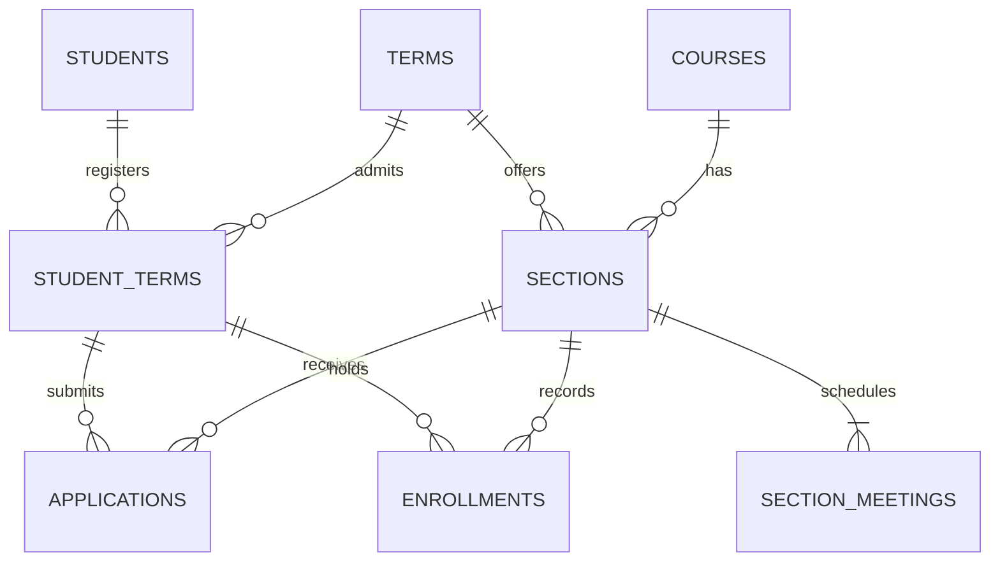
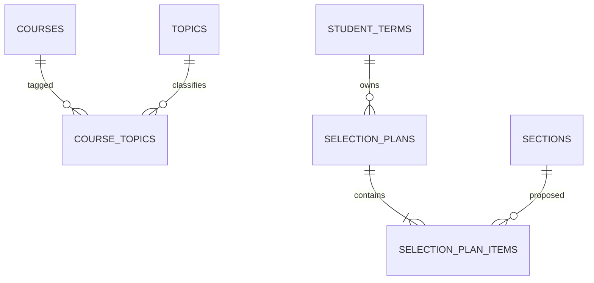
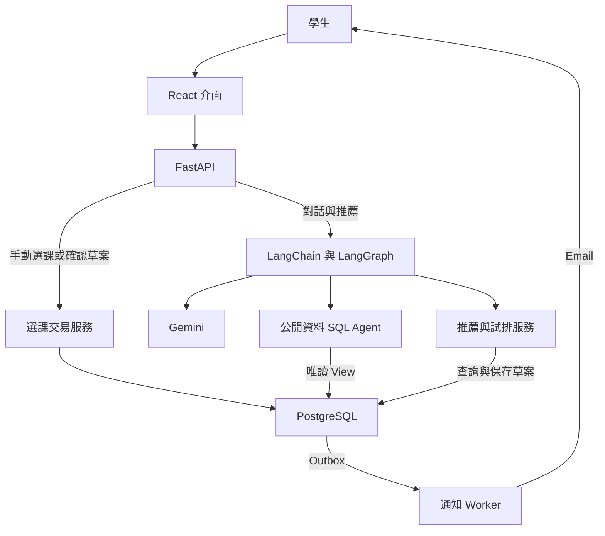

# 大學選課與課程推薦系統專題計畫書

| 項目 | 內容 |
|---|---|
| 專題 | 國立臺灣科技大學 資料庫設計期末專題 |
| 版本 | 2.0｜需求與實作基準 |
| 日期 | 2026-11-21 |
| 交付目標 | 以 Docker Compose 重現選課系統，展示研究導向課程推薦、Agent 批次送出選課及 PostgreSQL 交易控制，並以 GitHub 交付專題版本 |
| 技術與協作 | React、FastAPI、PostgreSQL、LangChain、LangGraph、Gemini API、Docker、Git、GitHub |

## 1. 系統目標與設計依據

學生可以查詢某學期的課程與開課班，參加初選、查看分發結果，並於加退選期間即時加選或退選。教務管理員可設定選課時程、班別及容量，並執行初選分發。學生可手動寄送自己的課表。分發公布時，系統寄送分發結果。

學生可用繁體中文查課、查個人課表或描述研究方向。Agent 依照本學期實際開出的班別提出推薦，說明推薦理由與選課限制，再自動組合可修的班別。學生檢視試排課表並一次確認後，系統依目前階段整批登記或加選。專題重點包含推薦證據、選課規則共用、交易的一致性及可重現的版本交付。

| 官方參考 | 公開系統或文件呈現的做法 | 本專題採用的設計 | 來源 |
|---|---|---|---|
| 臺灣科技大學 | 課程查詢可依系別和年級查課表，也可查課程大綱。教務處說明額滿與調整人數上限的處理方式。 | 課程頁顯示開課系所、課程大綱、上課時段及名額。管理員可調整容量，受已選人數約束。 | [台科大教務處課務組](https://www.academic.ntust.edu.tw/p/404-1048-78759.php?Lang=zh-tw) |
| 臺灣師範大學 | 選課注意事項公開額滿課程的分發比序，部分同順位者以亂數分發。 | 公開本專題的分發規則，分發結果附可讀原因。以固定種子計算順序，方便重現測試。 | [臺師大 115-1 各學制選課注意事項](https://www.aa.ntnu.edu.tw/uploads/asset/data/6a38a689843f750599985637/115%E5%AD%B8%E5%B9%B4%E5%BA%A6%E7%AC%AC1%E5%AD%B8%E6%9C%9F_%E5%90%84%E5%AD%B8%E5%88%B6%E9%81%B8%E8%AA%B2%E6%B3%A8%E6%84%8F%E4%BA%8B%E9%A0%85-1150609%E5%AE%9A%E7%A8%BF%E7%89%88.pdf) |
| 臺灣大學 | 課程網顯示預選、初選、分發、結果公布、加退選及結果確認等時程。 | 統一顯示目前階段及截止時間，明確標示待分發、分發結果與即時加退選。 | [臺大課程網](https://course.ntu.edu.tw/) · [學生選課流程極簡版簡介](https://www.aca.ntu.edu.tw/WebUPD/aca/UAADForms/%E5%AD%B8%E7%94%9F%E9%81%B8%E8%AA%B2%E6%B5%81%E7%A8%8B%E6%A5%B5%E7%B0%A1%E7%89%88%E7%B0%A1%E4%BB%8B.pdf) |
| Harvard University | my.harvard 的 Course Search Tool 支援探索課程、收藏及選課。 | 採用先規劃再選課的操作方式。首版提供 Agent 試排，後續可加上手動收藏與多方案比較。 | [Harvard College Course Registration](https://firstyear.college.harvard.edu/course-registration) |

**專題規則。** 第一版採單校、虛構資料、一輪初選及一輪即時加退選。每位學生每學期對同一課程只能保留一筆待分發的班別登記，以及至多一筆有效選課。所有初選登記使用共同的分發規則。校務單一登入、實際跨校選課、授權碼、候補遞補與多志願順位可作為後續延伸。

## 2. 角色與主要畫面

| 角色 | 可執行的操作 | 主要畫面 |
|---|---|---|
| 訪客 | 讀取已公開學期、課程名錄、班別、時段、名額與選課公告。 | 課程查詢、班別詳情、登入 |
| 學生 `STUDENT` | 登記、取消登記、加退選，查看自己的結果及課表，提出研究方向、檢查 Agent 試排並一次確認選課。 | 課程查詢、我的選課、我的課表、助理對話、推薦與試排確認 |
| 教務管理員 `ADMIN` | 管理學期、選課時段、開課班、容量，執行分發，查看批次摘要及通知狀態。 | 學期與開課管理、分發與通知 |
| 通知服務 | 讀取待寄送的通知及收件資訊，更新寄送狀態。 | 管理員可查看寄送結果 |

所有學生寫入及個人資料查詢皆由 FastAPI 依登入身分取得 `student_id`。管理端與學生端在 API 層獨立授權。介面預設繁體中文，時段以 `Asia/Taipei` 顯示。

## 3. 功能需求與優先順序

| 編號 | 優先 | 系統應提供 |
|---|---|---|
| FR-01 | P0 | 虛構學生及管理員帳號登入、登出、查詢登入身分。頁面重新整理後可辨識登入狀態。 |
| FR-02 | P0 | 依學期、課程代碼或名稱、教師、開課系所與星期篩選班別。列表分頁，詳情顯示學分、大綱、先修條件、多個上課時段、容量、已選人數及剩餘名額。 |
| FR-03 | P0 | 公告學期選課階段與起訖時間。開放初選時可登記或取消，關閉後可查待分發狀態。 |
| FR-04 | P0 | 初選截止後由管理員執行「分發並公布」。產生每筆登記的錄取與未錄取結果，並對未錄取提供可理解的原因。 |
| FR-05 | P0 | 於即時加退選期間提供加選及退選確認。FastAPI 檢查資格與名額，成功後重新整理剩餘名額、學分及個人課表。 |
| FR-06 | P0 | 「我的選課」呈現待分發登記與初選結果，取消的班別會移出清單。「我的課表」同時顯示正式選課與待分發時段，總學分只計正式選課。 |
| FR-07 | P0 | 管理員可設定及公開學期、維護開課班、時段、先修條件與容量。課程主檔、教師、學生、學期修課資格及歷史通過科目可先由測試種子建立。 |
| FR-08 | P0 | 學生可從「我的課表」將當下課表寄到本人帳號信箱。課表信由寄送按鈕觸發。分發公布時，每位有分發結果的學生收到一封摘要。 |
| FR-09 | P0 | 使用 LangChain 與 Gemini API 提供簡易對話、公開課程 SQL Agent 查詢及個人課表或選課條件查詢。每筆具體課程結果提供前端可開啟的連結。 |
| FR-10 | P1 | 手動收藏課程、儲存多份試排課表並比較方案。 |
| FR-11 | P1 | 候補排隊、授權碼加選及按志願順位分發。各項流程須有獨立的期限、狀態與驗收規則。 |
| FR-12 | P0 | Agent 依研究方向搜尋指定學期的課程，說明課程與主題的關聯及可延伸的研究方向，顯示班別、上課時間、名額、先修資格與連結。 |
| FR-13 | P0 | Agent 自動挑選符合限制的班別並試排。學生可刪減建議項目，一次確認後由系統批次初選登記或即時加選，逐筆顯示提交結果。 |

P0 為結案驗收範圍。課程查詢頁應提供載入中、查無資料及失敗重試的畫面。課程與課表支援鍵盤操作及行動裝置，並以文字標籤呈現選課狀態。

## 4. 選課流程與商業規則

### 4.1 階段與狀態

每學期有 `INITIAL` 和 `ADD_DROP` 兩種選課時段。兩者依序設定、互不重疊，且開放時間早於截止時間。所有期限以資料庫時間及半開區間 `[starts_at, ends_at)` 判定。公開學期後固定時段與分發種子，方便學生據此安排選課。設定、公開與分發操作皆留稽核紀錄。

| 對學生顯示的階段 | 判定條件 | 可執行的選課操作 |
|---|---|---|
| `UPCOMING` 初選未開放 | 已公開且早於初選開始。 | 查詢課程與時程。 |
| `INITIAL` 初選登記 | 初選時間窗內。 | 登記、取消登記、查詢個人登記，確認 Agent 批次登記。 |
| `AWAITING_ALLOCATION` 待分發 | 初選已截止，分發尚未公布，且早於加退選截止。 | 查詢登記與時程。 |
| `RESULTS` 結果已公布 | 分發已公布且早於加退選開始。 | 查看分發結果與正式課表。 |
| `ADD_DROP` 即時加退選 | 分發已公布，且在加退選時間窗內。 | 即時加選、退選、查看課表，確認 Agent 批次加選。 |
| `CLOSED` 已截止 | 到達加退選截止時間。 | 查看已有結果與課表。未公布時顯示待公布提示。 |

- **登記狀態** `PENDING` 可於初選期間轉成 `CANCELLED`，取消後可重新登記原班或其他班。分發時，仍為 `PENDING` 的紀錄轉為 `ACCEPTED` 或 `REJECTED`。同一課程的另一班已有 `PENDING` 時，使用者須先取消該筆登記。
- **正式選課狀態** 錄取或即時加選建立 `ENROLLED`，成功退選轉為 `DROPPED`。加退選期內可依當下資格與餘額重新加選已退的班次。正式課表與總學分只計 `ENROLLED`。原始初選結果保留供日後查閱。
- **登記與錄取時點** 初選登記確認階段、學期修課資格及班別有效性。分發及即時加選執行全部錄取規則。登記畫面須標示「待分發」，選課助理的試查結果須標明查詢時間。
- **行政維護** 班別的課程、學分、教師、時段、先修條件與是否開放選課在學期公開前設定。公開後可調整容量，且新容量須大於或等於當前有效選課人數。保留使用過的學期及班別資料，以及結果與稽核的關聯。

### 4.2 錄取規則

依下表順序判斷，回傳遇到的第一個業務錯誤。學生的註冊身分與操作階段由 API 先行檢查。分發共用下列規則，逐筆以該批次前面已錄取的選課為基準。

| 順序 | 規則 | 失敗代碼 |
|---|---|---|
| 1 | 班別屬於指定學期且開放選課。課程名錄可顯示未開放選課的班別及其狀態。 | `SECTION_UNAVAILABLE` |
| 2 | 同學期對該課程尚無有效選課，跨班別也適用。 | `ALREADY_ENROLLED` |
| 3 | 目標班別的所有先修科目，均已在先前學期通過。 | `PREREQUISITE_MISSING` |
| 4 | 任兩個每週時段在同一星期幾時，以 `start_a < end_b AND start_b < end_a` 判定重疊。比對目標班別的全部時段與現有課表。 | `TIME_CONFLICT` |
| 5 | 加選後的有效總學分小於或等於該生本學期學分上限。 | `CREDIT_LIMIT_EXCEEDED` |
| 6 | 班別有效選課人數小於容量。 | `SECTION_FULL` |

P0 每班至少有一個固定的每週上課時段，開始早於結束，同班的時段互不重疊。時段使用星期一至日 `1`–`7` 和本地時間。兩節首尾相接可同時選。學分採十進位儲存與比較。畫面名額標示查詢時間，最終錄取以成功提交的交易為準。

### 4.3 初選分發

1. 管理員在初選截止後執行一次「分發並公布」。系統在取得學期鎖後檢查截止時間與既有分發紀錄。若已公布，回傳既有批次與摘要。測試資料可用固定種子，多次請求仍對應同一批次。
2. 擷取全部 `PENDING` 登記。以固定格式 `v1|seed|student_id|section_id` 的 UTF-8 字串計算 SHA-256，按小寫十六進位摘要升冪排序。摘要相同時依 UUID 的字串值排序，先比 `student_id` 再比 `section_id`。登記時間不作為排序鍵。
3. 逐筆依 §4.2 審核，寫入結果與原因。錄取者同時產生正式選課。以學生為單位建立分發摘要通知事件。分發批次、全部結果、選課、稽核與通知事件在同一交易提交，該時點即為公布時間。沒有待分發紀錄時，可正常公布零筆結果。
4. 任一步驟失敗時回滾整批，管理員可再次送出分發。若管理員在排定的加退選時間過後才完成分發，系統依照原截止時間判定是否還能加退選，並公布結果供查詢。

## 5. PostgreSQL 資料設計

### 5.1 核心關聯





### 5.2 資料字典

`id` 採 UUID。各事件時間採 `timestamptz`。主檔、開課、上課時段、登記、選課與通知各自有實體。以 Alembic migration 建立 schema、約束、索引與公開查詢 View。

| 資料表 | 主要欄位與鍵 | 資料用途 |
|---|---|---|
| `users`、`auth_sessions` | `users(id, login, email, password_hash, role, is_active)`，正規化 `login` 唯一。`auth_sessions(token_hash PK, user_id FK, expires_at, revoked_at)`。 | 登入帳號及可撤銷的 Session。 |
| `departments`、`students`、`instructors` | 各有 `id`。`departments.code` 唯一。`students.user_id` 唯一且為 FK，另有 `student_no` 唯一及 `department_id`。教師包含顯示名稱與系所 FK。 | 系所、學生身分、教師。 |
| `terms`、`registration_periods` | `terms(id, code UNIQUE, start_date, end_date, catalog_published_at, allocation_seed)`。`registration_periods(term_id, kind, starts_at, ends_at)` 以 `(term_id, kind)` 為 PK。 | 學期及選課窗口。 |
| `student_terms` | `(student_id, term_id)` 複合 PK 及 FK，`credit_limit numeric(4,1)`。 | 學期修課資格與學分上限，亦為個人併發加退選的鎖定點。 |
| `courses`、`sections` | `courses(id, code UNIQUE, department_id, title, description)`。`sections(id, term_id, course_id, section_no, instructor_id, credits numeric(4,1), capacity, is_selectable)`，`UNIQUE (term_id, course_id, section_no)`。 | 課程主檔與各學期實際開課班。 |
| `topics`、`course_topics` | `topics(id, code UNIQUE, label)`。`course_topics(course_id, topic_id)` 為複合 PK，兩欄皆為 FK。 | 課程與研究主題的多對多標籤。P0 由種子資料建立。 |
| `section_meetings` | `id, section_id, weekday, start_time, end_time, room`。同一班的同日相同區間唯一。 | 一班可多時段上課。至少一個時段為班別公開的條件。 |
| `section_prerequisites`、`course_completions` | 前者 `(section_id, required_course_id)` 為 PK。後者 `(student_id, course_id, completed_term_id)` 為 PK。各識別碼有 FK。 | 依班別設定直接先修條件。修課歷史只收錄已通過的科目，其學期結束日須早於目標學期開始日才可用於擋修檢查。 |
| `applications` | `id, student_id, term_id, course_id, section_id, status, submitted_at, decided_at, reason_code, allocation_run_id`，`UNIQUE (student_id, term_id, section_id)`。 | 初選登記與分發結果。`allocation_run_id` 可由 `(term_id, allocation_run_id)` 複合 FK 約束在同一學期。 |
| `enrollments` | `id, student_id, term_id, course_id, section_id, status, source, updated_at`，`UNIQUE (student_id, term_id, section_id)`，`source` 為 `INITIAL` 或 `ADD_DROP`，表示最近一次成功錄取來源。 | 當前正式選課及退選狀態。各次異動留存在稽核紀錄。 |
| `allocation_runs` | `id, term_id UNIQUE, algorithm_version, seed, published_at, accepted_count, rejected_count`。 | 初選分發單次性、可重現性與結果摘要。 |
| `selection_plans` | `id, student_id, term_id, phase, status, created_at, expires_at, confirmed_at`。`(student_id, term_id)` 為 FK，`(id, term_id)` 為唯一鍵。 | Agent 試排草案及單次確認狀態。`phase` 為 `INITIAL` 或 `ADD_DROP`，`status` 為 `DRAFT` 或 `SUBMITTED`，草案是否逾時由 `expires_at` 判定。 |
| `selection_plan_items` | `plan_id, term_id, section_id, course_id, position`。`(plan_id, section_id)` 為 PK，`(plan_id, position)` 及 `(plan_id, course_id)` 皆唯一。 | 限定可確認的班別與原試排順序，供選課稽核追查。 |
| `audit_events` | `id, actor_user_id FK, term_id FK, action, target_type, target_id, occurred_at, payload`。 | 追查選課、退選、初選分發與管理異動。`payload` 保存必要的狀態或容量異動。 |
| `idempotency_keys` | `(student_id, term_id, request_key)` 為 PK，含 `request_fingerprint, response_status, response_body, created_at`。 | 即時加退選及 Agent 批次確認共用。重送時重播已提交的成功回應。 |
| `notification_outbox` | `id, event_key UNIQUE, term_id FK, recipient_user_id FK, type, payload, status, attempt_count, next_attempt_at, lease_until, claim_token, sent_at, last_error`。 | 寄信工作佇列，支援去重、重試與失敗查詢。 |

### 5.3 約束、索引及查詢

- `applications`、`enrollments` 以 `(student_id, term_id)` 參照 `student_terms`，並以 `(section_id, term_id, course_id)` 參照 `sections` 的對應唯一鍵。複合外鍵確保兩張表帶入的 `term_id` 與 `course_id` 和班別一致，供跨班別唯一性約束使用。
- 為 `applications` 建立 `(student_id, term_id, course_id)` 的 partial unique index，條件為 `status = 'PENDING'`。`enrollments` 對相同鍵建立條件為 `status = 'ENROLLED'` 的 partial unique index。
- 使用 `NOT NULL`、`CHECK` 與 FK 保護必要欄位、狀態值、非負容量、正學分、非負學分上限、日期先後和時段合法性。時段交疊、學期時段順序及容量與總學分等跨列規則，由交易服務檢查。歷史關聯採受限制的刪除策略。
- 開課查詢與班別時段查詢利用既有唯一鍵索引的前綴。另建查有效名額的 `enrollments(section_id) WHERE status = 'ENROLLED'`、待分發的 `applications(term_id) WHERE status = 'PENDING'` 與通知輪詢索引 `(status, next_attempt_at)`。
- 以 `JOIN` 連接學期、課程、班別、教師與時段。查名額時先依班別彙總有效選課，再和課程時段關聯，避免多個上課時段造成重複計數。提供 `v_section_availability`、`v_public_section_catalog`、`v_public_section_meetings`。公開 View 只返回已公開學期的公開欄位，供課程查詢及 Agent 使用。
- 推薦查詢使用 `course_topics(topic_id, course_id)` 索引，並提供 `v_public_section_topics`，只公開已公開班別的主題代碼與標籤。以 `EXISTS` 或先彙總主題命中，維持每班一筆候選。
- `selection_plan_items` 透過 `(plan_id, term_id)` 和 `(section_id, term_id, course_id)` 分別參照草案與班別。草案、選課與稽核的關聯保留在 PostgreSQL。草案內容只儲存班別與確認所需資料。

### 5.4 交易與併發控制

即時加退選走同一服務層，建議採 PostgreSQL `READ COMMITTED` 搭配列鎖。下列為單筆異動的鎖定與交易規則，Agent 批次選課沿用共同規則並依 §7.4 加上草案鎖與多班別檢查。

1. 以 `FOR SHARE` 鎖住目標 `terms` 列，接著以 `FOR UPDATE` 鎖住 `student_terms`。同一學生的同一學期選課請求依序執行。初選登記及取消也使用此鎖定順序，維持申請唯一性並和分發互斥。
2. 即時加退選要求帶 `Idempotency-Key`。在學生學期鎖內先查已提交的鍵值，同一請求指紋重送時回傳原成功結果。同鍵異指紋回 `409 IDEMPOTENCY_KEY_REUSED`。指紋包含方法、路徑和正規化請求內容。
3. 以 `FOR UPDATE` 取得目標班別列鎖。取得鎖後讀取 `clock_timestamp()` 判定階段，再用新的 SQL statement 讀取有效選課人數、個人課表、學分等。加選執行 §4.2，退選確認該生確有目標班別的 `ENROLLED`。容量以 `COUNT` 自有效選課推導，可讓最後一席與退選釋出在鎖內計算。
4. 成功時將選課異動、稽核及成功回應的鍵值一併提交。業務拒絕回傳錯誤代碼，選課、稽核與成功鍵值寫入件數皆為零。成功回應遺失時，原鍵值可跨選課期限重送。
5. 管理操作若修改學期選課條件，包含設定、公開、容量變更與分發，先取得 `terms` 的 `FOR UPDATE`。因此批次分發與容量異動會等待該學期進行中的選課交易完成。分發以單一交易逐筆處理。異動服務均使用共同鎖定順序，交易內只做資料庫作業。

## 6. REST API 與介面契約

所有路徑以 `/api/v1` 開頭。請求與回應採 JSON 和 `snake_case`。學期及班別以 ID 定位。前端從 FastAPI 的 OpenAPI schema 取得欄位定義。錯誤回應包含 `code`、`message`、`request_id`，必要時帶 `details`。`401` 為未登入，`403` 為身分或學期資格不符，`404` 為資源不可得，`409` 為業務狀態衝突，`422` 為輸入欄位格式不符。

| 方法與路徑 | 權限 | 契約摘要 |
|---|---|---|
| `POST /auth/login`、`POST /auth/logout`、`GET /auth/me` | 登入公開，其餘需登入 | 登入接收 `login`、`password`，登入與身分查詢回傳角色及顯示名稱，登出撤銷 Session。 |
| `GET /terms`、`GET /terms/{term_id}/registration` | 公開 | 查詢公開學期、目前階段、選課時段、分發公布時間。 |
| `GET /terms/{term_id}/sections` | 公開 | `q, department_id, instructor, weekday, page, page_size`。課程代碼、名稱與教師支援部分字串比對，多條件取交集。以課程代碼、班別序號與 ID 穩定排序，每頁預設 20 筆、最多 50 筆。回傳 `items, total, page, page_size, as_of`。 |
| `GET /terms/{term_id}/sections/{section_id}` | 公開 | 班別詳情、上課時段、課程大綱、先修科目、`is_selectable, capacity, enrolled_count, remaining, as_of`。 |
| `PUT /me/terms/{term_id}/applications/{section_id}` | 學生 | 初選登記，已是 `PENDING` 時回傳同一筆結果。先為同課程另一班登記時回 `409 APPLICATION_EXISTS`。成功回 `200`。 |
| `DELETE /me/terms/{term_id}/applications/{section_id}` | 學生 | 初選期內取消登記。沒有有效登記時亦回 `204`。 |
| `GET /me/terms/{term_id}/applications` | 學生 | 回傳本人的待分發登記、初選結果及原因。 |
| `POST /me/terms/{term_id}/enrollments` | 學生 | Body 為 `section_id`，須附 `Idempotency-Key`。成功回 `201` 和選課、剩餘名額、總學分及查詢時間。 |
| `DELETE /me/terms/{term_id}/enrollments/{section_id}` | 學生 | 須附 `Idempotency-Key`。成功回 `204`。查無本人有效選課時回 `404 ENROLLMENT_NOT_FOUND`。 |
| `GET /me/terms/{term_id}/timetable` | 學生 | 回傳本人的正式班別 `items`、待分發班別 `pending_items` 及各班上課時段。`total_credits` 只計正式學分，`credit_limit` 為學期上限。 |
| `POST /me/terms/{term_id}/timetable/email` | 學生 | 附 `Idempotency-Key` 將當下課表排入本人信箱的寄送佇列。回 `201` 及 `notification_id`。 |
| `GET /me/terms/{term_id}/sections/{section_id}/eligibility` | 學生 | 選課條件試查。回傳 `phase, eligible, reason_code, as_of`，同 §4 規則，`eligible` 代表此刻可即時加選。 |
| `POST /me/terms/{term_id}/selection-plans/{plan_id}/confirm` | 學生 | 接收 `section_ids`，須附 `Idempotency-Key`。成功回 `200`、`plan_id, phase, items, submitted_at`，其中 `items` 的每列包含 `section_id, status`。狀態為 `PENDING` 或 `ENROLLED`，依當次階段判定。 |
| `GET /admin/catalog` | 管理員 | 回傳開課表單可選擇的課程、系所與教師，供選項或搜尋使用。 |
| `GET/POST /admin/terms`、`PUT /admin/terms/{term_id}/registration-periods` | 管理員 | 瀏覽公開及草稿學期。建立學期、初選與加退選時段，並設定分發種子。 |
| `GET/POST /admin/terms/{term_id}/sections`、`PATCH /admin/terms/{term_id}/sections/{section_id}` | 管理員 | 瀏覽、設定班別、時段、先修條件與容量。低於有效選課人數的容量回 `409 CAPACITY_BELOW_ENROLLED`。 |
| `POST /admin/terms/{term_id}/publish` | 管理員 | 驗證學期、選課時段及班別資料，公開課程目錄。 |
| `POST /admin/terms/{term_id}/allocation` | 管理員 | 分發並公布。回傳 `run_id, published_at, accepted_count, rejected_count`。既有批次回相同結果。 |
| `GET /admin/terms/{term_id}/notifications` | 管理員 | 查詢寄送狀態、嘗試次數及可公開的錯誤摘要。 |
| `POST /chat` | 學生 | 接受 `message`、選填 `term_id`。回傳 `mode, answer, sources, as_of, request_id`。推薦模式另回 `recommendation`，格式見 §7.3。`sources` 由後端用班別 ID 或規則頁路徑建立。 |

選課窗口外的學生寫入回 `409 REGISTRATION_CLOSED`。初選截止前執行分發回 `409 ALLOCATION_NOT_READY`。已公開班別未開放選課時回 `409 SECTION_UNAVAILABLE`，識別碼不存在或跨學期時回 `404`。錄取失敗碼沿用 §4.2。衝堂的 `details` 可含衝突班別，超學分可含計算後總學分與上限。遺漏 `Idempotency-Key`、訊息過長或無效參數回 `422`。

## 7. 選課助理與 Email

依課堂黑板示意，FastAPI 提供 Web API，LangChain 與 LangGraph 編排 Gemini 及 PostgreSQL 查詢工具。Agent 使用公開課程資料與登入者的選課條件試排。學生確認後，FastAPI 呼叫選課服務提交。寄送課表與分發公布各自建立郵件工作。



### 7.1 Agent 行為

| 模式 | 使用情境 | 工具及資料來源 |
|---|---|---|
| `simple_chat` | 「初選登記完會立刻選上嗎？」 | 以版本化專題規則回答。問到實際日期時由 `get_registration_status` 查學期時段。 |
| `sql_query` | 「找這學期星期二還有空位的電子系課。」 | `query_public_courses`。Gemini 產生符合 schema 的查詢計畫，列出篩選條件及排序，工具執行對應參數化 SQL。 |
| `student_query` | 「我星期三有課嗎？」或「我現在能加選資料庫設計嗎？」 | `get_my_timetable`、`get_my_application_results`、`check_my_eligibility`。透過現有服務讀取本人資料。 |
| `recommendation` | 「我的研究方向是大型語言模型，幫我選三門相關課。」 | `search_related_sections` 查公開課程，`build_selection_plan` 是受 Session 約束的後端節點，比對本人課表及選課規則。結果由後端組成推薦與試排畫面。 |
| `clarify` | 問題缺少必要學期或查到多個同名班別。 | 優先使用畫面選定的學期。其他情形請學生指定學期或從查得班別中選擇。 |
| `unavailable` | Gemini 未設定、限流、逾時或服務中斷。 | 回傳暫時無法使用及前往課程查詢或我的課表的入口。API 回 `503 CHAT_UNAVAILABLE`。 |

- **LLM 與資料來源。** 使用 `langchain-google-genai` 串接 Gemini Developer API。以 `GEMINI_MODEL` 設定支援工具呼叫或結構化輸出的模型，以 `GEMINI_API_KEY` 設定憑證。即時名額、日期、個人課表和錄取狀態取自工具。具體資料查無結果時回覆查無資料。所有課程連結由後端利用工具回傳的 ID 產生。
- **SQL Agent。** 模型計畫支援 `term_id, keyword, department_id, weekday, has_seats, sort, limit`。值經 Pydantic 驗證，排序欄位採列舉，工具把提到的學期與系所對應為資料庫 ID。工具使用預先定義的參數化 `SELECT` 模板和 PostgreSQL 專用唯讀連線，僅授權查詢公開 View。星期過濾用 `EXISTS` 或相同效果的查詢維持每班一列。`has_seats=true` 篩選 `is_selectable` 且剩餘名額大於零的班別。每次最多 20 筆、SQL timeout 2 秒。公開查詢帳號對私有資料表及寫入沒有權限。
- **身分與隱私。** FastAPI 從 Session 綁定登入身分。個人課表、學分、修課紀錄及選課結果在後端查詢和比對。傳給 Gemini 的資料限於遮罩後的問題、公開課程資料及工具規格。對話可建立本人選課草案，選課交易只接受已登入學生送出的確認 API。
- **上限與紀錄。** 單次訊息上限 1,000 字元，整次請求上限 15 秒、最多 3 次工具呼叫。記錄請求 ID、模式、工具名稱、耗時、結果筆數及錯誤類別。前端會話可保留當頁對話，後端以單次請求與頁面選定學期完成 P0 功能。

### 7.2 Email 通知

- 學生點「寄送課表」後，以同一交易儲存課表快照、Outbox 紀錄及冪等回應。課表信列出正式與待分發的班別、學分、上課時間及教室。分發公布另建立摘要信，列出錄取與未錄取結果。收件人取自學生帳號。
- 獨立 Worker 按 `next_attempt_at` 取得待寄送工作，以列鎖領取、增加嘗試次數並設置短期租約，領取完成後才呼叫 SMTP。狀態包含 `PENDING`、`PROCESSING`、`SENT` 與 `FAILED`。SMTP 或程序中斷後可取回逾時工作，重試間隔為 1 分鐘、5 分鐘，最多三次嘗試。達三次仍未確認寄送則標記為 `FAILED`。每次領取有 claim token，避免過期 Worker 回寫新租約的狀態。
- 在提交之後寄送 Email，寄送故障由 Outbox 處理。課表與選課結果頁以 PostgreSQL 的已提交結果為準。以唯一事件鍵確保資料庫每事件一筆，並使用固定 `Message-ID`，SMTP 回應遺失時仍可能重複投遞。

### 7.3 依研究方向推薦課程與試排

1. **解析需求。** Gemini 以結構化輸出擷取研究主題、課程關鍵字、目標門數與可上課時段。目標門數預設 3，接受 1–5 門。學期預設用畫面已選擇的公開學期，語意或學期不明時先詢問。時段限制依使用者明確提供的條件處理，班別的全部時段均須符合條件。
2. **查詢並排序。** 以參數化 SQL 從該學期已公開班別找候選。版本化主題對照表將「大語言模型」「大型語言模型」「LLM」對應至 `llm`，並以 `nlp`、`retrieval`、`deep_learning`、`ml_systems` 為關聯主題。每班依直接標籤命中 6 分、任一關聯標籤命中 3 分、課名或大綱任一關鍵字命中 1 分加總。已知主題使用其共用關鍵字，並納入學生另行指定的關鍵字。只保留正分候選，按分數降序，同分按課程代碼、班號、班別 ID 升序，取前 20 筆。未登錄主題可用關鍵字查課名或大綱，查無資料時提示放寬條件或換學期。
3. **試排及原因。** 後端依排序逐一挑班，對照個人課表、先修紀錄、學分上限、時段限制與本方案已挑班別，直到達到目標門數或候選用完。即時加選另檢查最新名額。同課異班只挑一班。初選將該生原有 `PENDING` 登記一併納入試排，用來避免重複、衝堂或超修的登記組合。標示相關但未選入的課程及可判定的原因，如衝堂、額滿、先修未過。剩餘門數不足時回傳目前可行組合與原因。
4. **前端顯示。** 每筆建議含班別連結、課名、班號、推薦理由、學分、時段、教室、剩餘名額與選入狀態。推薦理由引用課程標籤或大綱的實際文字。試排區同時顯示原有課表、建議新增課程及預估總學分。學生具該學期修課資格、初選或加退選開放且有可行班別時，建立草案。其他情況顯示推薦、選課時程與無法建立草案的原因。
5. **研究延伸。** 依主題對照表和實際命中的課程，附上最多兩個研究或修課方向。每個方向列出對應課程與一個可以繼續做的題目，例如修讀資訊檢索與 RAG 後，比較不同向量檢索方法對回答正確率的影響。

`POST /chat` 的 `recommendation` 包含 `topic`、`candidates`、`learning_extensions`、`plan`。`candidates` 每筆含 `section_id, course_code, course_title, section_no, credits, meetings, remaining, score, match_reason, selected, reason_code`。`learning_extensions` 每筆含 `title, next_step, section_ids`，無適用方向時為空陣列。`plan` 含 `plan_id, term_id, phase, as_of, expires_at, section_ids, projected_credits`，無可提交方案時為 `null`。名額與試排狀態以 `as_of` 標示。

#### 大語言模型方向示範

學生輸入「我的研究方向是大語言模型，請推薦這學期相關的課，幫我選三門。」示範設定為即時加退選開放，學生已有 9 學分、上限 18 學分，已通過所需先修。下列名稱及資料皆用於專題測試。

| 示範班別 | 與研究方向的關聯 | 上課時間、學分與名額 | Agent 試排結果 |
|---|---|---|---|
| `DEMO-501` 大型語言模型專題 | 語言模型微調、對齊與評估 | 週二 13:20–16:20，3 學分，剩 4 席 | 建議加入 |
| `DEMO-502` 自然語言處理 | 語言表示、序列建模及 NLP 評估 | 週一 09:10–12:10，3 學分，剩 6 席 | 建議加入 |
| `DEMO-503` 資訊檢索與 RAG | 文件檢索、排序及檢索增強生成 | 週三 10:10–13:10，3 學分，剩 2 席 | 建議加入 |
| `DEMO-504` AI 系統與模型部署 | 推論延遲、模型量化與服務部署 | 週四 13:20–16:20，3 學分，剩 3 席 | 與目前課表衝堂 |
| `DEMO-505` 向量資料庫與語意搜尋 | Embeddings、向量索引與語意搜尋 | 週五 10:10–13:10，3 學分，已額滿 | 顯示為相關課程及額滿狀態 |

畫面顯示預估總學分為 18，學生可取消勾選任一班，再按「確認加選」。若採初選階段示範，確認按鈕顯示「確認初選登記」，結果顯示「待分發」。

### 7.4 Agent 批次選課與一次確認

| 階段 | 確認後的動作 | 成功狀態 |
|---|---|---|
| `INITIAL` | 批次建立或恢復登記紀錄，適用一般初選規則與 §7.3 試排條件。名額由正式分發決定。 | `PENDING`，出現在「我的選課」。 |
| `ADD_DROP` | 批次執行 §4.2 的即時加選規則並更新有效課表。 | `ENROLLED`，出現在「我的課表」。 |
| 其他 | 顯示可提交的階段及起訖時間，停用確認按鈕。 | `409 REGISTRATION_CLOSED` 適用於送到伺服器的窗口外確認。 |

- **草案與確認。** 草案只屬於發起學生和指定學期，有效期到建立後 15 分鐘或該選課窗口截止時間，以較早者為準。一次確認可送出草案內的 1–5 個不同班別。可在畫面刪減班別，加入其他班須重新產生草案。聊天指令與按下「試排」都只會建立草案。
- **交易。** 依 `terms FOR SHARE`、`student_terms FOR UPDATE`、草案列 `FOR UPDATE`、目標班別依 ID 升序 `FOR UPDATE` 鎖定。驗證本人草案後查冪等鍵。需要提交時先鎖住所有選定班別，再用資料庫時間重查階段、期限和最新選課資料。初選套用目前有效課表及待分發登記的衝堂和累計學分檢查。加退選依 §4.2。兩階段均將本批已通過審查的班別一併計入，確保同批組合也符合限制。
- **提交或回滾。** 全部成立時，一個交易寫入登記或正式選課、稽核與冪等回應，並將草案標記為 `SUBMITTED`。所選班別更新到課表，稽核保留 `plan_id`。任一班不符合時整批回滾，回傳原因及 `details.section_id`，畫面可請學生更新試排。經確認的班別集合以當次請求為準。
- **確認錯誤與重送。** 找不到本人草案回 `404 PLAN_NOT_FOUND`。階段已切換或已過期回 `409 PLAN_EXPIRED`，目前窗口已關閉時回 `409 REGISTRATION_CLOSED`。選了草案外的班別回 `409 PLAN_SELECTION_MISMATCH`。已確認的草案以新鍵值提交回 `409 PLAN_ALREADY_SUBMITTED`。相同鍵值、相同計畫與班別集合重送時，重播原成功回應，即使草案已過期。相同鍵值搭配其他班別集合時回 `409 IDEMPOTENCY_KEY_REUSED`。

## 8. 技術與部署需求

| 層級 | 首版規格 |
|---|---|
| Frontend | React＋TypeScript＋Vite。使用同源 `/api/v1`，依目前階段顯示手動操作及 Agent 草案確認。提交中停用同一操作，重送使用原 `Idempotency-Key`。 |
| Backend | Python 3.12、FastAPI、Pydantic、SQLAlchemy 2.x、Alembic。將選課規則集中在服務層，供手動流程、分發、Agent 試排及批次確認重用。 |
| Database | PostgreSQL 16，獨立 DB volume。migration、應用與 Agent 使用用途對應的資料庫權限。公開 View 用於 Agent 查課，正式選課使用交易服務。 |
| Authentication | 密碼用 Argon2id，Session 使用不可預測的隨機 Token 和 `HttpOnly`、`SameSite=Lax` Cookie，資料庫儲存 Token 雜湊。正式 HTTPS 設 `Secure`。驗證同源 `Origin` 保護瀏覽器寫入，FastAPI 逐路由做角色及所有權檢查。 |
| Docker Compose | 服務為 `db`、`migrate`、`api`、`frontend`、`worker`、`mailpit`。`db` 通過健康檢查後執行 migration。`api` 與 `worker` 在 migration 成功後啟動，前端代理到 API。開發寄信由 Mailpit 接收。 |
| 設定 | 提供無真實金鑰的 `.env.example`。至少包括資料庫連線、公開查詢帳號、`APP_ORIGIN`、`GEMINI_MODEL`、`GEMINI_API_KEY`、SMTP 主機與連接埠等設定。讀取、健康檢查與選課操作可在尚無 Gemini 金鑰時運作。 |
| 故障與效能 | 提供存活及資料庫就緒端點。使用結構化 log 和 `request_id`。一般課程搜尋在 1,000 個班別、20 個並行查詢下，以本機暖機後 p95 ≤ 500 ms 作為驗證目標，測試報告記錄機器與資料規模。 |

依賴套件鎖定可重現的版本。測試用 LLM stub 可走同一個 Agent 流程，並保留以真實 Gemini API 驗收的路徑。種子資料至少含兩個操作階段的學期、兩個系所、一位管理員與二十位虛構學生，另含額滿班、最後一席班、同課不同班、衝堂班、相鄰時段班、先修課及學分上限案例。推薦示範含 §7.3 的五個班別、對照用的無關課程及對應的主題標籤。可重複執行 seed 且維持固定識別碼與既有紀錄。新建示範環境時可選「初選開放」「初選已截止待分發」「加退選開放」。

## 9. 驗收測試

API 與併發測試必須連接 PostgreSQL。使用固定測試時間、學期、容量與種子，並在交易後查資料表驗證容量、唯一性和狀態。測試報告涵蓋下表結果，附上一筆課程查詢與一筆有效名額查詢的 SQL 和 `EXPLAIN (ANALYZE, BUFFERS)` 結果。

| 編號 | 測試情境 | 預期結果 |
|---|---|---|
| AT-01 | 匿名查課，學生登入，使用學生身分呼叫管理 API。 | 公開查課成功。個人課表要求登入。學生取得 `403`，與其他學生資料隔離。 |
| AT-02 | 依課程、教師或星期查詢含兩個時段的班別。 | 每班一筆，詳情顯示全部時段，名額計算等於容量減有效選課。 |
| AT-03 | 在初選開始時間登記，在截止時間再次登記。初選中重送相同登記、嘗試再登記同課另一班、取消後改登記另一班。 | 開始時刻受理、截止時刻回 `409`。同班保留一筆待分發並顯示於課表。取消後原班從「我的選課」與課表移除，此時可登記另一班。 |
| AT-04 | 兩學生競爭一席的初選班。以相同資料與 seed 在乾淨測試環境分發，並重送同學期分發請求。 | 兩個環境錄取同一學生，另一人為 `SECTION_FULL`。原環境重送回相同批次，該批次的選課與通知各只建立一次。 |
| AT-05 | 有意讓分發過程中的一筆寫入拋出資料庫錯誤，再重試。 | 失敗批次的選課、結果、稽核與通知全數回滾。重試可完整公布。 |
| AT-06 | 20 位學生同時加選同一班的最後一席。 | 恰有一筆 `201`，其餘為 `409 SECTION_FULL`。查詢資料庫有效人數等於容量。 |
| AT-07 | 同一學生同時加選兩班，分別測試時段相衝、同課另一班、合計學分超上限，以及首尾相接且學分合規的班別。 | 前三組各一班成功，另一筆回對應錯誤。首尾相接的合規兩班皆成功。 |
| AT-08 | 先修未過時加選，退選釋出一席後由另一位合格學生加選，管理員嘗試把容量降到已選人數以下。 | 分別得到 `PREREQUISITE_MISSING`、有效人數先減後增，以及 `CAPACITY_BELOW_ENROLLED`。 |
| AT-09 | 加退選成功後模擬網路斷線並以相同鍵值重送，再以同一鍵送不同班別。 | 原請求回原狀態碼與資料，選課稽核只新增一筆。異指紋回 `409 IDEMPOTENCY_KEY_REUSED`。 |
| AT-10 | 問選課規則、自然語言查剩餘名額、查個人課表、請助理退選、請助理查他人課表。 | 前三項以正確來源回答。退選請求轉至操作入口。查他人課表回權限說明。驗證 SQL 帳號只有公開 View 查詢權限。 |
| AT-11 | 用真實 Gemini API 驗收查課、研究方向推薦，再模擬未設定、逾時或限流。 | 查課結果與推薦候選可核對 PostgreSQL。故障時回 `503` 與可用入口，Web 選課可繼續操作。 |
| AT-12 | 點「寄送課表」後模擬寄信故障再恢復，並以同一請求鍵重送。 | 只建立一筆課表郵件工作。服務恢復後 Mailpit 收到點擊時的課表，管理頁顯示 `SENT`。 |
| AT-13 | 在全新環境依 README 啟動 Compose、執行 seed，再以相同設定重啟。 | migration 執行成功，核心情境可操作，既有選課資料由 volume 保留。 |
| AT-14 | 在即時加退選環境用「大語言模型」及「LLM」各查一次，再測試無關主題，以及未開放、額滿、衝堂、缺先修及超學分的班別。 | 同義詞查得一致排序結果。推薦與研究延伸皆對應資料庫班別。無命中時回空結果。各不可選班皆未進入可提交草案。 |
| AT-15 | 在初選及加退選環境各要求 Agent 選三門。先查資料庫，再於畫面取消勾選一班並確認。 | 確認前只有草案。兩階段各提交兩班，分別回 `PENDING` 或 `ENROLLED` 並顯示在課表。學生可另從課表提出寄送。 |
| AT-16 | 試排兩班後，由其他學生先拿走其中一班的最後名額，或以人工加選造成衝堂。 | 確認回 `409` 與對應的班別及原因。整批選課、稽核與通知維持零筆新增，原草案可供檢視。 |
| AT-17 | 批次確認成功後模擬斷線，以相同鍵值重送，再以同鍵搭配不同班別、以新鍵重送及用他人帳號確認。 | 相同請求重播原回應。其他情境分別回 `409 IDEMPOTENCY_KEY_REUSED`、`409 PLAN_ALREADY_SUBMITTED`、`404 PLAN_NOT_FOUND`，成功紀錄各建立一次。 |
| AT-18 | 嘗試確認逾時草案、窗口外草案或加送草案外班別。 | 分別回 `PLAN_EXPIRED`、`REGISTRATION_CLOSED` 或 `PLAN_SELECTION_MISMATCH`，皆無選課異動。 |
| AT-19 | 從 GitHub 全新 clone 並 checkout 最終版本標籤，依 README 使用虛構資料啟動。檢查追蹤檔案與提交歷史。 | 標籤、文件、migration、seed、測試與環境範例齊備。核心展示可從該版本重現。金鑰、憑證及真實個資的檢查結果為零。 |

## 10. 交給 Codex 的實作順序與交付清單

1. **基礎與 Schema。** 建立 Git、`frontend/`、`backend/`、`compose.yaml`、`.env.example` 及 README。先完成 Compose 健康檢查、Alembic migration、seed、登入與課程查詢。
2. **初選與即時加退選。** 實作階段判定、分發、有效課表、交易、冪等性及 Outbox Worker。在 PostgreSQL 驗證 AT-03 至 AT-09、AT-12。
3. **Agent 查詢與課程推薦。** 接上 LangChain、LangGraph 與 Gemini。用公開 View 及主題標籤產生推薦，完成「大語言模型」例題與 AT-10、AT-11、AT-14。
4. **自動試排與批次提交。** 綁定學生與學期，完成草案、確認按鈕、選課服務與回滾。通過 AT-15 至 AT-18。
5. **結案與上傳。** 更新 README 的啟動指令、測試帳號、初始化情境、API 與展示步驟。交付 migration、seed、整合測試、ERD、一次去識別化的 Gemini 推薦測試紀錄，以及 GitHub 網址與最終標籤。先在新環境驗證 AT-13、AT-19。展示順序涵蓋公開查課、初選分發、Agent 推薦與確認、加選更新課表、Mailpit 收到通知。

可將本文件放在專案根目錄，給 Codex 下列起始指令。

> 以 `Course_Registration_SRS.md` 2.0 為實作契約，依第 10 節順序完成 P0。先以虛構資料驗證 PostgreSQL 交易、選課規則與 Email，再串接 Gemini。以「我的研究方向是大語言模型，請推薦並幫我選三門」驗證 Agent 推薦、自動試排、一次確認、批次提交和回滾。每階段更新 README，依第 11 節管理分支與版本，設定專題的 GitHub 遠端後交付最終標籤。

## 11. Git 版本管理與 GitHub 交付

### 11.1 版本規則與儲存庫內容

| 項目 | 做法 |
|---|---|
| 遠端儲存庫 | 建議名稱 `course-registration-system`。初期採私人儲存庫，依課程繳交要求授予教師或組員存取權。 |
| `main` | 維持可啟動、可展示的版本。以 Pull Request 合併功能分支，附測試結果及資料庫異動摘要。 |
| 功能分支與提交 | 使用 `feat/schema`、`feat/registration`、`feat/course-recommendation` 或 `fix/selection-race` 等明確名稱。依功能分次 commit，如 `feat: add course recommendation`。 |
| 追蹤內容 | 提交原始碼、依賴鎖定檔、Docker 設定、Alembic migration、虛構種子、測試、README、`.env.example` 和本計畫書。 |
| 本機資料與憑證 | `.gitignore` 包含 `.env`、`.env.*`，以 `!.env.example` 保留無金鑰的範例。另忽略 DB dump、資料庫資料目錄、依賴目錄及產生檔。首次 push 與正式交付前檢查暫存差異和 Git 歷史。 |
| 結案版本 | 合併至 `main` 並用 `v1.0.0` 標記系統交付版本。README 記錄版本、啟動方法、展示帳號、驗收及已知限制。 |

### 11.2 首次上傳與後續更新

全新專題先在 GitHub 建立空儲存庫，再於專案根目錄建立 Git。以下以已準備好計畫書、README、`.gitignore` 與環境範例檔為前提。將 `OWNER` 換成實際帳號或組織，並以具備儲存庫寫入權限的帳號完成 Git 認證。已有儲存庫時，從 clone 或既有工作目錄開始，先用 `git remote -v` 核對目的地。

```bash
git init -b main
git status --short
git add -- .gitignore .env.example Course_Registration_SRS.md README.md
git diff --cached --check
git diff --cached
git commit -m "docs: add course registration project plan"
git remote add origin https://github.com/OWNER/course-registration-system.git
git push -u origin main
```

新增推薦功能時，先從最新 `main` 開新分支。完成修改與驗收後提交並推送，在 GitHub 開 Pull Request。PR 附新增功能、migration 及對應的驗收結果。

```bash
git switch main
git pull --ff-only
git switch -c feat/course-recommendation
# 完成此分支的修改與驗收後，再執行下列命令
git add -- backend/ frontend/
git diff --cached --check
git commit -m "feat: recommend and plan courses from research interests"
git push -u origin feat/course-recommendation
```

正式提交前，在本機取得通過驗收的 `main`，建立並上傳版本標籤。

```bash
git switch main
git pull --ff-only
git tag -a v1.0.0 -m "Course registration final project"
git push origin v1.0.0
```

結案以 GitHub 儲存庫網址及 `v1.0.0` 為繳交依據。以下將標記版本 clone 到新目錄，再依 README 啟動及驗收。

```bash
git clone --branch v1.0.0 https://github.com/OWNER/course-registration-system.git course-registration-check
```

## 12. 未來擴充與研究延伸

| 系統延伸 | 可增加的能力 | 驗證方式 |
|---|---|---|
| 課程語意推薦 | 加入課程大綱的向量檢索，和首版標籤、關鍵字推薦比較。 | 以人工標註的研究問題和相關課程計算 Precision@5，另記錄各方案可實際選課的比例。 |
| 進階課表規劃 | 儲存和比較多個候選課表，同時考慮研究相關性、學分需求、可上課時段與校區移動。 | 用同一組題目比較各方案的相關性、可用門數和預估空堂。 |
| 多學期修課路徑 | 運用先修關聯，將基礎課、進階課、專題課組成跨學期建議。 | 用不同先修及已修課歷史，檢查是否能產生可循序修習的路徑。 |
| 選課通知 | 加入候補、授權碼及志願排序的狀態通知。 | 驗證候補遞補順序與通知內容一致。 |
| 持續整合 | 在 GitHub Actions 對 Pull Request 執行 API、migrations、PostgreSQL 整合測試與前端建置。 | 每次修改以可重現的測試報告檢查合併條件。 |

以大語言模型為研究主軸，可由**自然語言處理 → 資訊檢索與向量資料庫 → LLM 專題**延伸至 RAG 實驗，評估檢索品質與生成結果。偏系統方向可由**深度學習 → AI 系統與模型部署 → Edge AI 專題**延伸至模型量化、推論延遲與邊緣部署，例如驗證 Agent 在邊緣設備查詢工業設備狀態的效果。

## 13. 技術文件

- Gemini 連線與工具介面參考 [LangChain ChatGoogleGenerativeAI](https://docs.langchain.com/oss/python/integrations/chat/google_generative_ai)、[Gemini 模型文件](https://ai.google.dev/gemini-api/docs/models)及 [LangGraph overview](https://docs.langchain.com/oss/python/langgraph/overview)。
- SQL Agent 的查詢流程參考 [LangChain Build a SQL agent](https://docs.langchain.com/oss/python/langchain/sql-agent)。本專題使用結構化查詢計畫、參數化模板與公開 View 權限。
- 列鎖、交易隔離及部分索引參考 [PostgreSQL 16 Explicit Locking](https://www.postgresql.org/docs/16/explicit-locking.html)、[Transaction Isolation](https://www.postgresql.org/docs/16/transaction-iso.html)及 [Partial Indexes](https://www.postgresql.org/docs/16/indexes-partial.html)。
- API 契約與容器啟動順序參考 [FastAPI Features](https://fastapi.tiangolo.com/features/)及 [Docker Compose startup order](https://docs.docker.com/compose/how-tos/startup-order/)。
- Agent 人工確認流程參考 [LangGraph Interrupts](https://docs.langchain.com/oss/python/langgraph/interrupts)。本專題將草案存於 PostgreSQL，透過學生確認 API 完成提交。
- GitHub 上傳、Pull Request、排除檔案及標籤參考 [Adding locally hosted code to GitHub](https://docs.github.com/en/migrations/importing-source-code/using-the-command-line-to-import-source-code/adding-locally-hosted-code-to-github)、[Pull Requests](https://docs.github.com/en/pull-requests/reference/pull-requests)、[Ignoring files](https://docs.github.com/en/get-started/git-basics/ignoring-files)及 [git tag](https://git-scm.com/docs/git-tag)。
