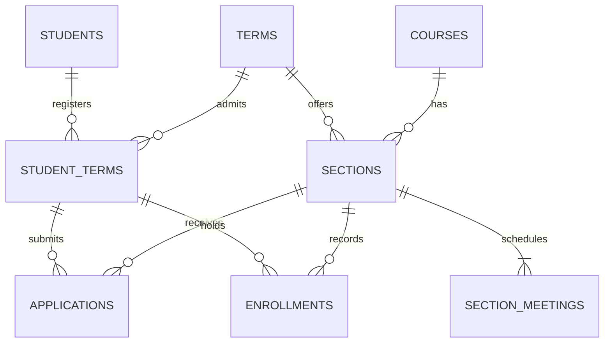
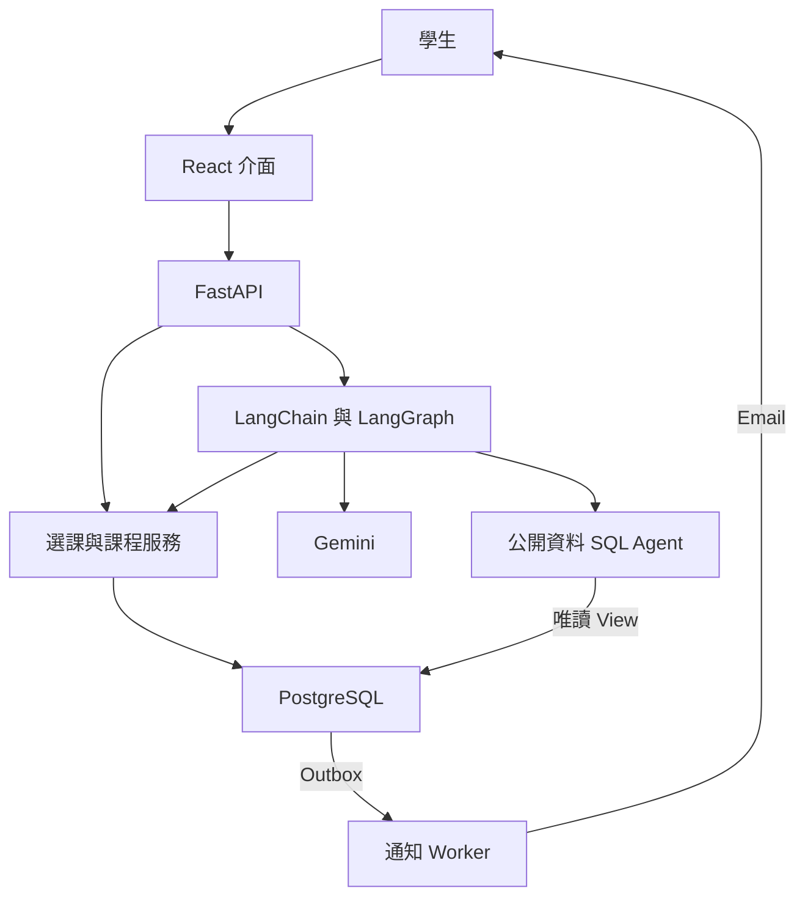

# 大學選課系統需求規格書

| 項目 | 內容 |
|---|---|
| 專題 | 國立臺灣科技大學 資料庫設計期末專題 |
| 版本 | 1.0｜實作基準 |
| 日期 | 2026-11-21 |
| 交付目標 | 以 Docker Compose 啟動可展示的選課系統，驗證 PostgreSQL 資料完整性、併發控制和 Agent 查詢流程 |
| 必用技術 | React、FastAPI、PostgreSQL、LangChain、Gemini API、Docker |

## 1. 系統目標與設計依據

學生可以查詢某學期的課程與開課班，於初選期間登記，於分發後查看結果，並在加退選期間即時加選或退選。正式課表由有效選課紀錄產生。教務管理員可設定選課時程、開課班與容量，並執行初選分發。學生也可用繁體中文向選課助理查詢課程、自己的課表或選課條件。分發公布及即時加退選成功後，系統寄送 Email 通知。

| 官方參考 | 公開系統或文件呈現的做法 | 本專題採用的設計 | 來源 |
|---|---|---|---|
| 臺灣科技大學 | 課程查詢可依系別和年級查課表，也可查課程大綱。教務處說明額滿與調整人數上限的處理方式。 | 課程頁顯示開課系所、課程大綱、上課時段及名額。管理員可調整容量，受已選人數約束。 | [台科大教務處課務組](https://www.academic.ntust.edu.tw/p/404-1048-78759.php?Lang=zh-tw) |
| 臺灣師範大學 | 選課注意事項公開額滿課程的分發比序，部分同順位者以亂數分發。 | 公開本專題的分發規則，分發結果附可讀原因。以固定種子計算順序，方便重現測試。 | [臺師大 115-1 各學制選課注意事項](https://www.aa.ntnu.edu.tw/uploads/asset/data/6a38a689843f750599985637/115%E5%AD%B8%E5%B9%B4%E5%BA%A6%E7%AC%AC1%E5%AD%B8%E6%9C%9F_%E5%90%84%E5%AD%B8%E5%88%B6%E9%81%B8%E8%AA%B2%E6%B3%A8%E6%84%8F%E4%BA%8B%E9%A0%85-1150609%E5%AE%9A%E7%A8%BF%E7%89%88.pdf) |
| 臺灣大學 | 課程網顯示預選、初選、分發、結果公布、加退選及結果確認等時程。 | 統一顯示目前階段及截止時間，明確標示待分發、分發結果與即時加退選。 | [臺大課程網](https://course.ntu.edu.tw/) · [學生選課流程極簡版簡介](https://www.aca.ntu.edu.tw/WebUPD/aca/UAADForms/%E5%AD%B8%E7%94%9F%E9%81%B8%E8%AA%B2%E6%B5%81%E7%A8%8B%E6%A5%B5%E7%B0%A1%E7%89%88%E7%B0%A1%E4%BB%8B.pdf) |
| Harvard University | my.harvard 的 Course Search Tool 支援探索課程、收藏及選課。 | 將課程收藏與試排課表列為後續擴充，讓學生先規劃修課組合。 | [Harvard College Course Registration](https://firstyear.college.harvard.edu/course-registration) |

**專題規則。** 第一版採單校、虛構資料、一輪初選及一輪即時加退選。每位學生每學期對同一課程只能保留一筆待分發的班別登記，以及至多一筆有效選課。所有初選登記使用共同的分發規則。校務單一登入、實際跨校選課、授權碼、候補遞補與多志願順位可作為後續延伸。

## 2. 角色與主要畫面

| 角色 | 可執行的操作 | 主要畫面 |
|---|---|---|
| 訪客 | 讀取已公開學期、課程名錄、班別、時段、名額與選課公告。 | 課程查詢、班別詳情、登入 |
| 學生 `STUDENT` | 登記、取消登記、加退選，查看自己的結果及課表，使用選課助理。 | 課程查詢、我的選課、我的課表、助理對話 |
| 教務管理員 `ADMIN` | 管理學期、選課時段、開課班、容量，執行分發，查看批次摘要及通知狀態。 | 學期與開課管理、分發與通知 |
| 通知服務 | 讀取待寄送的通知及收件資訊，更新寄送狀態。 | 管理員可查看寄送結果 |

所有學生寫入及個人資料查詢皆由 FastAPI 依登入身分取得 `student_id`。管理端與學生端在 API 層獨立授權。介面預設繁體中文，時段以 `Asia/Taipei` 顯示。

## 3. 功能需求與優先順序

| 編號 | 優先 | 系統應提供 |
|---|---|---|
| FR-01 | P0 | 虛構學生及管理員帳號登入、登出、查詢登入身分。頁面重新整理後可辨識登入狀態。 |
| FR-02 | P0 | 依學期、課程代碼或名稱、教師、開課系所與星期篩選班別。列表分頁，詳情顯示學分、大綱、先修條件、多個上課時段、容量、已選人數及剩餘名額。 |
| FR-03 | P0 | 公告學期選課階段與起訖時間。開放初選時可登記或取消，關閉後可查待分發狀態。 |
| FR-04 | P0 | 初選截止後由管理員執行「分發並公布」。產生每筆登記的錄取與未錄取結果，並對未錄取提供可理解的原因。 |
| FR-05 | P0 | 於即時加退選期間提供加選及退選確認。FastAPI 檢查資格與名額，成功後重新整理剩餘名額、學分及個人課表。 |
| FR-06 | P0 | 「我的選課」呈現初選登記與歷史結果，「我的課表」呈現目前正式選上的課程、週課表及總學分。 |
| FR-07 | P0 | 管理員可設定及公開學期、維護開課班、時段、先修條件與容量。課程主檔、教師、學生、學期修課資格及歷史通過科目可先由測試種子建立。 |
| FR-08 | P0 | 分發公布後，每位有分發結果的學生收到一封摘要。每次成功的即時加選或退選產生一筆事件通知。 |
| FR-09 | P0 | 使用 LangChain 與 Gemini API 提供簡易對話、公開課程 SQL Agent 查詢及個人課表或選課條件查詢。每筆具體課程結果提供前端可開啟的連結。 |
| FR-10 | P1 | 收藏候選課程並試排課表。收藏、試排、待分發登記和正式選課各有明確的介面狀態。 |
| FR-11 | P1 | 候補排隊、授權碼加選及按志願順位分發。各項流程須有獨立的期限、狀態與驗收規則。 |

P0 為結案驗收範圍。課程查詢頁應提供載入中、查無資料及失敗重試的畫面。課程與課表支援鍵盤操作及行動裝置，並以文字標籤呈現選課狀態。

## 4. 選課流程與商業規則

### 4.1 階段與狀態

每學期有 `INITIAL` 和 `ADD_DROP` 兩種選課時段。兩者依序設定、互不重疊，且開放時間早於截止時間。所有期限以資料庫時間及半開區間 `[starts_at, ends_at)` 判定。公開學期後固定時段與分發種子，方便學生據此安排選課。設定、公開與分發操作皆留稽核紀錄。

| 對學生顯示的階段 | 判定條件 | 可執行的選課操作 |
|---|---|---|
| `UPCOMING` 初選未開放 | 已公開且早於初選開始。 | 查詢課程與時程。 |
| `INITIAL` 初選登記 | 初選時間窗內。 | 登記、取消登記、查詢個人登記。 |
| `AWAITING_ALLOCATION` 待分發 | 初選已截止，分發尚未公布，且早於加退選截止。 | 查詢登記與時程。 |
| `RESULTS` 結果已公布 | 分發已公布且早於加退選開始。 | 查看分發結果與正式課表。 |
| `ADD_DROP` 即時加退選 | 分發已公布，且在加退選時間窗內。 | 即時加選、退選、查看課表。 |
| `CLOSED` 已截止 | 到達加退選截止時間。 | 查看已有結果與課表。未公布時顯示待公布提示。 |

- **登記狀態** `PENDING` 可於初選期間轉成 `CANCELLED`，取消後可重新登記原班或其他班。分發時，仍為 `PENDING` 的紀錄轉為 `ACCEPTED` 或 `REJECTED`。同一課程的另一班已有 `PENDING` 時，使用者須先取消該筆登記。
- **正式選課狀態** 錄取或即時加選建立 `ENROLLED`，成功退選轉為 `DROPPED`。加退選期內可依當下資格與餘額重新加選已退的班次。正式課表與總學分只計 `ENROLLED`。原始初選結果保留供日後查閱。
- **登記與錄取時點** 初選登記確認階段、學期修課資格及班別有效性。分發及即時加選執行全部錄取規則。登記畫面須標示「待分發」，選課助理的試查結果須標明查詢時間。
- **行政維護** 班別的課程、學分、教師、時段、先修條件與是否開放選課在學期公開前設定。公開後可調整容量，且新容量須大於或等於當前有效選課人數。保留使用過的學期及班別資料，以及結果與稽核的關聯。

### 4.2 錄取規則

依下表順序判斷，回傳遇到的第一個業務錯誤。學生的註冊身分與操作階段由 API 先行檢查。分發共用下列規則，逐筆以該批次前面已錄取的選課為基準。

| 順序 | 規則 | 失敗代碼 |
|---|---|---|
| 1 | 班別屬於指定學期且開放選課。課程名錄可顯示未開放選課的班別及其狀態。 | `SECTION_UNAVAILABLE` |
| 2 | 同學期對該課程尚無有效選課，跨班別也適用。 | `ALREADY_ENROLLED` |
| 3 | 目標班別的所有先修科目，均已在先前學期通過。 | `PREREQUISITE_MISSING` |
| 4 | 任兩個每週時段在同一星期幾時，以 `start_a < end_b AND start_b < end_a` 判定重疊。比對目標班別的全部時段與現有課表。 | `TIME_CONFLICT` |
| 5 | 加選後的有效總學分小於或等於該生本學期學分上限。 | `CREDIT_LIMIT_EXCEEDED` |
| 6 | 班別有效選課人數小於容量。 | `SECTION_FULL` |

P0 每班至少有一個固定的每週上課時段，開始早於結束，同班的時段互不重疊。時段使用星期一至日 `1`–`7` 和本地時間。兩節首尾相接可同時選。學分採十進位儲存與比較。畫面名額標示查詢時間，最終錄取以成功提交的交易為準。

### 4.3 初選分發

1. 管理員在初選截止後執行一次「分發並公布」。系統在取得學期鎖後檢查截止時間與既有分發紀錄。若已公布，回傳既有批次與摘要。測試資料可用固定種子，多次請求仍對應同一批次。
2. 擷取全部 `PENDING` 登記。以固定格式 `v1|seed|student_id|section_id` 的 UTF-8 字串計算 SHA-256，按小寫十六進位摘要升冪排序。摘要相同時依 UUID 的字串值排序，先比 `student_id` 再比 `section_id`。登記時間不作為排序鍵。
3. 逐筆依 §4.2 審核，寫入結果與原因。錄取者同時產生正式選課。以學生為單位建立分發摘要通知事件。分發批次、全部結果、選課、稽核與通知事件在同一交易提交，該時點即為公布時間。沒有待分發紀錄時，可正常公布零筆結果。
4. 任一步驟失敗時回滾整批，管理員可再次送出分發。若管理員在排定的加退選時間過後才完成分發，系統依照原截止時間判定是否還能加退選，並公布結果供查詢。

## 5. PostgreSQL 資料設計

### 5.1 核心關聯

### 5.2 資料字典

`id` 採 UUID。各事件時間採 `timestamptz`。主檔、開課、上課時段、登記、選課與通知各自有實體。以 Alembic migration 建立 schema、約束、索引與公開查詢 View。

| 資料表 | 主要欄位與鍵 | 資料用途 |
|---|---|---|
| `users`、`auth_sessions` | `users(id, login, email, password_hash, role, is_active)`，正規化 `login` 唯一。`auth_sessions(token_hash PK, user_id FK, expires_at, revoked_at)`。 | 登入帳號及可撤銷的 Session。 |
| `departments`、`students`、`instructors` | 各有 `id`。`departments.code` 唯一。`students.user_id` 唯一且為 FK，另有 `student_no` 唯一及 `department_id`。教師包含顯示名稱與系所 FK。 | 系所、學生身分、教師。 |
| `terms`、`registration_periods` | `terms(id, code UNIQUE, start_date, end_date, catalog_published_at, allocation_seed)`。`registration_periods(term_id, kind, starts_at, ends_at)` 以 `(term_id, kind)` 為 PK。 | 學期及選課窗口。 |
| `student_terms` | `(student_id, term_id)` 複合 PK 及 FK，`credit_limit numeric(4,1)`。 | 學期修課資格與學分上限，亦為個人併發加退選的鎖定點。 |
| `courses`、`sections` | `courses(id, code UNIQUE, department_id, title, description)`。`sections(id, term_id, course_id, section_no, instructor_id, credits numeric(4,1), capacity, is_selectable)`，`UNIQUE (term_id, course_id, section_no)`。 | 課程主檔與各學期實際開課班。 |
| `section_meetings` | `id, section_id, weekday, start_time, end_time, room`。同一班的同日相同區間唯一。 | 一班可多時段上課。至少一個時段為班別公開的條件。 |
| `section_prerequisites`、`course_completions` | 前者 `(section_id, required_course_id)` 為 PK。後者 `(student_id, course_id, completed_term_id)` 為 PK。各識別碼有 FK。 | 依班別設定直接先修條件。修課歷史只收錄已通過的科目，其學期結束日須早於目標學期開始日才可用於擋修檢查。 |
| `applications` | `id, student_id, term_id, course_id, section_id, status, submitted_at, decided_at, reason_code, allocation_run_id`，`UNIQUE (student_id, term_id, section_id)`。 | 初選登記與分發結果。`allocation_run_id` 可由 `(term_id, allocation_run_id)` 複合 FK 約束在同一學期。 |
| `enrollments` | `id, student_id, term_id, course_id, section_id, status, source, updated_at`，`UNIQUE (student_id, term_id, section_id)`，`source` 為 `INITIAL` 或 `ADD_DROP`，表示最近一次成功錄取來源。 | 當前正式選課及退選狀態。各次異動留存在稽核紀錄。 |
| `allocation_runs` | `id, term_id UNIQUE, algorithm_version, seed, published_at, accepted_count, rejected_count`。 | 初選分發單次性、可重現性與結果摘要。 |
| `audit_events` | `id, actor_user_id FK, term_id FK, action, target_type, target_id, occurred_at, payload`。 | 追查選課、退選、初選分發與管理異動。`payload` 保存必要的狀態或容量異動。 |
| `idempotency_keys` | `(student_id, term_id, request_key)` 為 PK，含 `request_fingerprint, response_status, response_body, created_at`。 | 重送即時加退選要求時，重播已提交的成功回應。 |
| `notification_outbox` | `id, event_key UNIQUE, term_id FK, recipient_user_id FK, type, payload, status, attempt_count, next_attempt_at, lease_until, claim_token, sent_at, last_error`。 | 寄信工作佇列，支援去重、重試與失敗查詢。 |

### 5.3 約束、索引及查詢

- `applications`、`enrollments` 以 `(student_id, term_id)` 參照 `student_terms`，並以 `(section_id, term_id, course_id)` 參照 `sections` 的對應唯一鍵。複合外鍵確保兩張表帶入的 `term_id` 與 `course_id` 和班別一致，供跨班別唯一性約束使用。
- 為 `applications` 建立 `(student_id, term_id, course_id)` 的 partial unique index，條件為 `status = 'PENDING'`。`enrollments` 對相同鍵建立條件為 `status = 'ENROLLED'` 的 partial unique index。
- 使用 `NOT NULL`、`CHECK` 與 FK 保護必要欄位、狀態值、非負容量、正學分、非負學分上限、日期先後和時段合法性。時段交疊、學期時段順序及容量與總學分等跨列規則，由交易服務檢查。歷史關聯採受限制的刪除策略。
- 開課查詢與班別時段查詢利用既有唯一鍵索引的前綴。另建查有效名額的 `enrollments(section_id) WHERE status = 'ENROLLED'`、待分發的 `applications(term_id) WHERE status = 'PENDING'` 與通知輪詢索引 `(status, next_attempt_at)`。
- 以 `JOIN` 連接學期、課程、班別、教師與時段。查名額時先依班別彙總有效選課，再和課程時段關聯，避免多個上課時段造成重複計數。提供 `v_section_availability`、`v_public_section_catalog`、`v_public_section_meetings`。公開 View 只返回已公開學期的公開欄位，供課程查詢及 Agent 使用。

### 5.4 交易與併發控制

即時加退選走同一服務層，建議採 PostgreSQL `READ COMMITTED` 搭配列鎖。每次異動依下列順序處理。

1. 對目標 `terms` 列取得共享鎖，接著以 `FOR UPDATE` 鎖住 `student_terms`。同一學生的同一學期選課請求依序執行。初選登記及取消也使用此鎖定順序，維持申請唯一性並和分發互斥。
2. 即時加退選要求帶 `Idempotency-Key`。在學生學期鎖內先查已提交的鍵值，同一請求指紋重送時回傳原成功結果。同鍵異指紋回 `409 IDEMPOTENCY_KEY_REUSED`。指紋包含方法、路徑和正規化請求內容。
3. 以 `FOR UPDATE` 取得目標班別列鎖。取得鎖後讀取 `clock_timestamp()` 判定階段，再用新的 SQL statement 讀取有效選課人數、個人課表、學分等。加選執行 §4.2，退選確認該生確有目標班別的 `ENROLLED`。容量以 `COUNT` 自有效選課推導，可讓最後一席與退選釋出在鎖內計算。
4. 成功時將選課異動、稽核、通知 Outbox 及成功回應的鍵值一併提交。業務拒絕回傳錯誤代碼，該次拒絕的選課、稽核異動、通知與成功鍵值寫入件數皆為零。成功回應遺失時，原鍵值可跨選課期限重送。
5. 管理操作若修改學期選課條件，包含設定、公開、容量變更與分發，先取得 `terms` 的 `FOR UPDATE`。因此批次分發與容量異動會等待該學期進行中的選課交易完成。分發以單一交易逐筆處理。異動服務均使用共同鎖定順序，交易內只做資料庫作業。

## 6. REST API 與介面契約

所有路徑以 `/api/v1` 開頭。請求與回應採 JSON 和 `snake_case`。學期及班別以 ID 定位。前端從 FastAPI 的 OpenAPI schema 取得欄位定義。錯誤回應包含 `code`、`message`、`request_id`，必要時帶 `details`。`401` 為未登入，`403` 為身分或學期資格不符，`404` 為資源不可得，`409` 為業務狀態衝突，`422` 為輸入欄位格式不符。

| 方法與路徑 | 權限 | 契約摘要 |
|---|---|---|
| `POST /auth/login`、`POST /auth/logout`、`GET /auth/me` | 登入公開，其餘需登入 | 登入接收 `login`、`password`，登入與身分查詢回傳角色及顯示名稱，登出撤銷 Session。 |
| `GET /terms`、`GET /terms/{term_id}/registration` | 公開 | 查詢公開學期、目前階段、選課時段、分發公布時間。 |
| `GET /terms/{term_id}/sections` | 公開 | `q, department_id, instructor, weekday, page, page_size`。課程代碼、名稱與教師支援部分字串比對，多條件取交集。以課程代碼、班別序號與 ID 穩定排序，每頁預設 20 筆、最多 50 筆。回傳 `items, total, page, page_size, as_of`。 |
| `GET /terms/{term_id}/sections/{section_id}` | 公開 | 班別詳情、上課時段、課程大綱、先修科目、`is_selectable, capacity, enrolled_count, remaining, as_of`。 |
| `PUT /me/terms/{term_id}/applications/{section_id}` | 學生 | 初選登記，已是 `PENDING` 時回傳同一筆結果。先為同課程另一班登記時回 `409 APPLICATION_EXISTS`。成功回 `200`。 |
| `DELETE /me/terms/{term_id}/applications/{section_id}` | 學生 | 初選期內取消登記。沒有有效登記時亦回 `204`。 |
| `GET /me/terms/{term_id}/applications` | 學生 | 只回傳本人登記、分發狀態及原因。 |
| `POST /me/terms/{term_id}/enrollments` | 學生 | Body 為 `section_id`，須附 `Idempotency-Key`。成功回 `201` 和選課、剩餘名額、總學分及查詢時間。 |
| `DELETE /me/terms/{term_id}/enrollments/{section_id}` | 學生 | 須附 `Idempotency-Key`。成功回 `204`。查無本人有效選課時回 `404 ENROLLMENT_NOT_FOUND`。 |
| `GET /me/terms/{term_id}/timetable` | 學生 | 回傳本人有效班別、所有上課時段、`total_credits, credit_limit`。 |
| `GET /me/terms/{term_id}/sections/{section_id}/eligibility` | 學生 | 選課條件試查。回傳 `phase, eligible, reason_code, as_of`，同 §4 規則，`eligible` 代表此刻可即時加選。 |
| `GET /admin/catalog` | 管理員 | 回傳開課表單可選擇的課程、系所與教師，供選項或搜尋使用。 |
| `GET/POST /admin/terms`、`PUT /admin/terms/{term_id}/registration-periods` | 管理員 | 瀏覽公開及草稿學期。建立學期、初選與加退選時段，並設定分發種子。 |
| `GET/POST /admin/terms/{term_id}/sections`、`PATCH /admin/terms/{term_id}/sections/{section_id}` | 管理員 | 瀏覽、設定班別、時段、先修條件與容量。低於有效選課人數的容量回 `409 CAPACITY_BELOW_ENROLLED`。 |
| `POST /admin/terms/{term_id}/publish` | 管理員 | 驗證學期、選課時段及班別資料，公開課程目錄。 |
| `POST /admin/terms/{term_id}/allocation` | 管理員 | 分發並公布。回傳 `run_id, published_at, accepted_count, rejected_count`。既有批次回相同結果。 |
| `GET /admin/terms/{term_id}/notifications` | 管理員 | 查詢寄送狀態、嘗試次數及可公開的錯誤摘要。 |
| `POST /chat` | 學生 | 接受 `message`、選填 `term_id`。回傳 `mode, answer, sources, as_of, request_id`。`sources` 可含查詢得到的 `term_id, section_id`，或選課規則頁路徑，由後端建立。 |

選課窗口外的學生寫入回 `409 REGISTRATION_CLOSED`。初選截止前執行分發回 `409 ALLOCATION_NOT_READY`。已公開班別未開放選課時回 `409 SECTION_UNAVAILABLE`，識別碼不存在或跨學期時回 `404`。錄取失敗碼沿用 §4.2。衝堂的 `details` 可含衝突班別，超學分可含計算後總學分與上限。遺漏 `Idempotency-Key`、訊息過長或無效參數回 `422`。

## 7. 選課助理與 Email

依課堂黑板示意，以 FastAPI 作為 Web Server、PostgreSQL 作為 Database，透過 LangChain 工具將助理接到課程資訊及個人查詢。LangGraph 描述對話的意圖分流、工具呼叫與回應。Email 由選課事件驅動。

### 7.1 Agent 行為

| 模式 | 使用情境 | 工具及資料來源 |
|---|---|---|
| `simple_chat` | 「初選登記完會立刻選上嗎？」 | 以版本化專題規則回答。問到實際日期時由 `get_registration_status` 查學期時段。 |
| `sql_query` | 「找這學期星期二還有空位的電子系課。」 | `query_public_courses`。Gemini 產生符合 schema 的查詢計畫，列出篩選條件及排序，工具執行對應參數化 SQL。 |
| `student_query` | 「我星期三有課嗎？」或「我現在能加選資料庫設計嗎？」 | `get_my_timetable`、`get_my_application_results`、`check_my_eligibility`。透過現有服務讀取本人資料。 |
| `clarify` | 問題缺少必要學期或查到多個同名班別。 | 優先使用畫面選定的學期。其他情形請學生指定學期或從查得班別中選擇。 |
| `unavailable` | Gemini 未設定、限流、逾時或服務中斷。 | 回傳暫時無法使用及前往課程查詢或我的課表的入口。API 回 `503 CHAT_UNAVAILABLE`。 |

- **LLM 與資料來源。** 使用 `langchain-google-genai` 串接 Gemini Developer API。以 `GEMINI_MODEL` 設定支援工具呼叫或結構化輸出的模型，以 `GEMINI_API_KEY` 設定憑證。即時名額、日期、個人課表和錄取狀態取自工具。具體資料查無結果時回覆查無資料。所有課程連結由後端利用工具回傳的 ID 產生。
- **SQL Agent。** 模型計畫支援 `term_id, keyword, department_id, weekday, has_seats, sort, limit`。值經 Pydantic 驗證，排序欄位採列舉，工具把提到的學期與系所對應為資料庫 ID。工具使用預先定義的參數化 `SELECT` 模板和 PostgreSQL 專用唯讀連線，僅授權查詢公開 View。星期過濾用 `EXISTS` 或相同效果的查詢維持每班一列。`has_seats=true` 篩選 `is_selectable` 且剩餘名額大於零的班別。每次最多 20 筆、SQL timeout 2 秒。公開查詢帳號對私有資料表及寫入沒有權限。
- **身分與隱私。** 讀取個人資料的工具由 FastAPI 路由傳入可信的 Session 身分。模型收取去識別化問題以判斷意圖，個人課表及選課結果由後端取得並在本地格式化。帳密、學號、Email、Session 憑證與完整個人紀錄應保留於系統內。聊天輸入先遮罩可辨識的個資與憑證格式。Agent 提供查詢與操作入口，正式加退選由學生在介面確認後透過 §6 的寫入 API 執行。
- **上限與紀錄。** 單次訊息上限 1,000 字元，整次請求上限 15 秒、最多 3 次工具呼叫。記錄請求 ID、模式、工具名稱、耗時、結果筆數及錯誤類別。前端會話可保留當頁對話，後端以單次請求與頁面選定學期完成 P0 功能。

### 7.2 Email 通知

- 選課交易內建立 Outbox 紀錄。`event_key` 以分發批次與學生，或一次成功的選課稽核事件為基礎。批次 Email 含錄取、未錄取及結果頁入口，即時 Email 含學期、課程、異動狀態及查詢入口。收件人取自學生帳號。
- 獨立 Worker 按 `next_attempt_at` 取得待寄送工作，以列鎖領取、增加嘗試次數並設置短期租約，領取完成後才呼叫 SMTP。狀態包含 `PENDING`、`PROCESSING`、`SENT` 與 `FAILED`。SMTP 或程序中斷後可取回逾時工作，重試間隔為 1 分鐘、5 分鐘，最多三次嘗試。達三次仍未確認寄送則標記為 `FAILED`。每次領取有 claim token，避免過期 Worker 回寫新租約的狀態。
- 在提交之後寄送 Email，寄送故障由 Outbox 處理。課表與選課結果頁以 PostgreSQL 的已提交結果為準。以唯一事件鍵確保資料庫每事件一筆，並使用固定 `Message-ID`，SMTP 回應遺失時仍可能重複投遞。

## 8. 技術與部署需求

| 層級 | 首版規格 |
|---|---|
| Frontend | React＋TypeScript＋Vite。使用同源 `/api/v1`，依伺服器回傳的目前階段切換操作。提交中停用同一操作，重送使用原 `Idempotency-Key`。 |
| Backend | Python 3.12、FastAPI、Pydantic、SQLAlchemy 2.x、Alembic。將選課規則集中在服務層，供 REST API、分發及 Agent 查詢重用。 |
| Database | PostgreSQL 16，獨立 DB volume。migration、應用與 Agent 使用用途對應的資料庫權限。公開 View 用於 Agent 查課，正式選課使用交易服務。 |
| Authentication | 密碼用 Argon2id，Session 使用不可預測的隨機 Token 和 `HttpOnly`、`SameSite=Lax` Cookie，資料庫儲存 Token 雜湊。正式 HTTPS 設 `Secure`。驗證同源 `Origin` 保護瀏覽器寫入，FastAPI 逐路由做角色及所有權檢查。 |
| Docker Compose | 服務為 `db`、`migrate`、`api`、`frontend`、`worker`、`mailpit`。`db` 通過健康檢查後執行 migration。`api` 與 `worker` 在 migration 成功後啟動，前端代理到 API。開發寄信由 Mailpit 接收。 |
| 設定 | 提供無真實金鑰的 `.env.example`。至少包括資料庫連線、公開查詢帳號、`APP_ORIGIN`、`GEMINI_MODEL`、`GEMINI_API_KEY`、SMTP 主機與連接埠等設定。讀取、健康檢查與選課操作可在尚無 Gemini 金鑰時運作。 |
| 故障與效能 | 提供存活及資料庫就緒端點。使用結構化 log 和 `request_id`。一般課程搜尋在 1,000 個班別、20 個並行查詢下，以本機暖機後 p95 ≤ 500 ms 作為驗證目標，測試報告記錄機器與資料規模。 |

依賴套件鎖定可重現的版本。測試用 LLM stub 可走同一個 Agent 流程，並保留以真實 Gemini API 驗收的路徑。種子資料至少含兩個操作階段的學期、兩個系所、一位管理員與二十位虛構學生，另含額滿班、最後一席班、同課不同班、衝堂班、相鄰時段班、先修課及學分上限案例。可重複執行 seed 且維持固定識別碼與既有紀錄。新建示範環境時可選「初選開放」「初選已截止待分發」「加退選開放」。初選開放情境可事先設定數分鐘的短窗口，現場完成登記、分發與加退選。

## 9. 驗收測試

API 與併發測試必須連接 PostgreSQL。使用固定測試時間、學期、容量與種子，並在交易後查資料表驗證容量、唯一性和狀態。測試報告涵蓋下表結果，附上一筆課程查詢與一筆有效名額查詢的 SQL 和 `EXPLAIN (ANALYZE, BUFFERS)` 結果。

| 編號 | 測試情境 | 預期結果 |
|---|---|---|
| AT-01 | 匿名查課，學生登入，使用學生身分呼叫管理 API。 | 公開查課成功。個人課表要求登入。學生取得 `403`，與其他學生資料隔離。 |
| AT-02 | 依課程、教師或星期查詢含兩個時段的班別。 | 每班一筆，詳情顯示全部時段，名額計算等於容量減有效選課。 |
| AT-03 | 在初選開始時間登記，在截止時間再次登記。初選中重送相同登記、嘗試再登記同課另一班、取消後改登記另一班。 | 開始時刻受理、截止時刻回 `409`。同班保留一筆待分發。另一班先被拒絕，取消後成功。 |
| AT-04 | 兩學生競爭一席的初選班。以相同資料與 seed 在乾淨測試環境分發，並重送同學期分發請求。 | 兩個環境錄取同一學生，另一人為 `SECTION_FULL`。原環境重送回相同批次，該批次的選課與通知各只建立一次。 |
| AT-05 | 有意讓分發過程中的一筆寫入拋出資料庫錯誤，再重試。 | 失敗批次的選課、結果、稽核與通知全數回滾。重試可完整公布。 |
| AT-06 | 20 位學生同時加選同一班的最後一席。 | 恰有一筆 `201`，其餘為 `409 SECTION_FULL`。查詢資料庫有效人數等於容量。 |
| AT-07 | 同一學生同時加選兩班，分別測試時段相衝、同課另一班、合計學分超上限，以及首尾相接且學分合規的班別。 | 前三組各一班成功，另一筆回對應錯誤。首尾相接的合規兩班皆成功。 |
| AT-08 | 先修未過時加選，退選釋出一席後由另一位合格學生加選，管理員嘗試把容量降到已選人數以下。 | 分別得到 `PREREQUISITE_MISSING`、有效人數先減後增，以及 `CAPACITY_BELOW_ENROLLED`。 |
| AT-09 | 加退選成功後模擬網路斷線，送出相同鍵值；另以同一鍵送不同班別。 | 原請求回原狀態碼與資料，選課稽核及 Outbox 各只新增一筆。異指紋回 `409 IDEMPOTENCY_KEY_REUSED`。 |
| AT-10 | 問選課規則、自然語言查剩餘名額、查個人課表、請助理退選、請助理查他人課表。 | 前三項以正確來源回答。退選請求轉至操作入口。查他人課表回權限說明。驗證 SQL 帳號只有公開 View 查詢權限。 |
| AT-11 | Gemini 正常且使用實際設定驗收，再模擬未設定、逾時或限流。 | 正常情況可透過 Gemini 呼叫工具並核對資料庫結果。故障時回 `503` 與可用入口，Web 選課可繼續操作。 |
| AT-12 | 寄信服務故障後恢復。 | 選課先成功，Outbox 進入重試。服務恢復後可在 Mailpit 收到對應事件，管理頁顯示 `SENT`。 |
| AT-13 | 在全新環境依 README 啟動 Compose、執行 seed，再以相同設定重啟。 | migration 執行成功，核心情境可操作，既有選課資料由 volume 保留。 |

## 10. 交給 Codex 的實作順序與交付清單

1. **基礎與 Schema。** 建立 `frontend/`、`backend/`、`compose.yaml`、`.env.example`，先讓 Compose 健康檢查、Alembic migration、seed、登入與課程查詢可用。
2. **初選與即時加退選。** 實作階段判定、分發、有效課表、交易及冪等性。先在 PostgreSQL 通過 AT-03 至 AT-09，再接上正式頁面。
3. **Agent 與通知。** 實作 LangChain 工具、LangGraph 分流、Gemini 串接、唯讀 View 查詢及 Outbox Worker。驗證問答來源、權限及失效情境。
4. **結案。** 更新 README 的啟動、測試帳號、初始化情境、API 說明與展示步驟。交付可重現的 migration、seed、整合測試、核心 ERD 及一次實際 Gemini 查詢紀錄。展示至少涵蓋公開查課、初選分發、即時退選釋出名額、對話查餘額、Mailpit 收信。

可將本文件放在專案根目錄，給 Codex 下列起始指令。

> 以 `Course_Registration_SRS.md` 為實作契約，在目前 workspace 實作 P0。依第 10 節順序完成，每階段執行可用驗收案例。將選課資格、容量、衝堂、分發與學分上限集中在 PostgreSQL 交易服務。先以種子資料完成端到端流程，再以設定的 `GEMINI_MODEL` 驗證真實 Gemini API。README 應記錄啟動方式、種子資料、展示流程、測試結果與待驗證項目。

### 技術文件

- Gemini 連線與工具介面參考 [LangChain ChatGoogleGenerativeAI](https://docs.langchain.com/oss/python/integrations/chat/google_generative_ai)、[Gemini 模型文件](https://ai.google.dev/gemini-api/docs/models)及 [LangGraph overview](https://docs.langchain.com/oss/python/langgraph/overview)。
- SQL Agent 的查詢流程參考 [LangChain Build a SQL agent](https://docs.langchain.com/oss/python/langchain/sql-agent)。本專題使用結構化查詢計畫、參數化模板與公開 View 權限。
- 列鎖、交易隔離及部分索引參考 [PostgreSQL 16 Explicit Locking](https://www.postgresql.org/docs/16/explicit-locking.html)、[Transaction Isolation](https://www.postgresql.org/docs/16/transaction-iso.html)及 [Partial Indexes](https://www.postgresql.org/docs/16/indexes-partial.html)。
- API 契約與容器啟動順序參考 [FastAPI Features](https://fastapi.tiangolo.com/features/)及 [Docker Compose startup order](https://docs.docker.com/compose/how-tos/startup-order/)。
