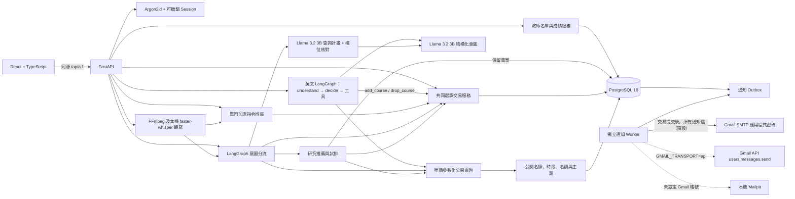
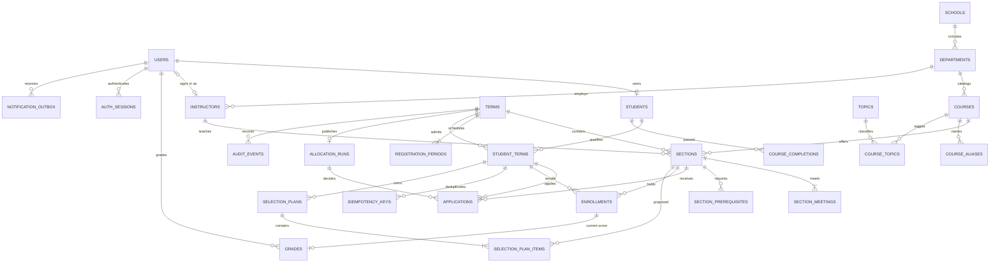

# 架構與資料完整性

## 交易邊界

學生寫入依 `terms FOR SHARE → student_terms FOR UPDATE → sections FOR UPDATE` 鎖定。取得鎖後讀 `clock_timestamp()`，再以新的查詢檢查人數與課表。管理寫入先取得學期 `FOR UPDATE`，與該學期進行中的選課互斥。全部交易使用 PostgreSQL READ COMMITTED。

加退選成功時，選課、稽核與成功回應的冪等鍵一起提交。相同學生學期的相同鍵與指紋會返回原回應，即使操作期限已過。異指紋回 409。業務拒絕不留下上述異動。

批次確認先鎖學期與學生學期，再鎖本人草案，最後依 UUID 升序鎖住所有送出的班別。班別的檢核及結果採草案順序。初選計入原有效課表、待分發與本批已通過班別。即時加選以鎖後名額為準。全部通過時一次提交選課、稽核、冪等回應及草案狀態。

寄送課表沿用學期與學生學期的鎖定順序。寄送請求會將取出的正式選課與待分發班別存為 Outbox 快照，並提交冪等回應。分發公布另建立每位學生的結果摘要。

分發將全部 PENDING 登記以 `SHA-256(v1|seed|student_id|section_id)` 小寫十六進位摘要排序，同摘要再依學生與班別 UUID 字串排序。逐筆使用與加選相同的錄取規則，單一交易公布全部結果；同學期唯一分發批次支援重送。

## Schema 與權限

`0001_schema.sql` 是固定的初版 DDL 快照，由 Alembic 套用。複合 FK 保證登記和選課的學生資格、學期、課程與班別一致；partial unique indexes 保證每課最多一個 PENDING 登記及一個 ENROLLED 選課。所有歷史關聯以 RESTRICT 保護。

`0002_recommendation.py` 增加主題、課程標籤、本人草案與試排項目，擴充已提交成功回應以支援 `200`。草案的學生學期、班別與課程以複合外鍵對應，同一草案中每課僅可有一班。

`0003_university_catalog.py` 將既有系所連到臺科大示範資料，系所代碼改為校內唯一。課程增加來源類型及官方連結，課程別名以正規化名稱索引。公開名錄 View 提供校系及來源，別名原表由應用帳號查詢。

`0004_main_term_catalog.py` 將舊展示學期缺少的班別補入 115-1，保留原班別的時段、教師、名額和先修條件。舊展示及歷史學期以 `archived_at` 歸檔，原有選課與先修紀錄繼續參照原學期。

`course_migrator` 負責 DDL。`course_app` 負責應用資料讀寫。`course_public` 只能查公開 View，包含 `v_public_section_topics`，無主題原表或草案權限。公開 View 限已公開學期，人數先以班別彙總，星期篩選使用 `EXISTS` 保持每班一列。

## 助理與通知

中文查詢計畫與英文意圖使用同一個本機 Llama 3.2 3B 端點，系統不呼叫雲端模型。模型只接收去識別化問題與公開研究方向名稱，回傳的計畫逐欄與學生原句核對：原句沒有的系所、學校、星期、門數與時段一律刪除，工具名稱須在允許清單內。LangGraph 將核對過的計畫交給固定的後端工具，回應與日誌附模型伺服器回報的 token 數與耗時。公開 SQL 採參數綁定、列舉排序、最多 20 筆與 2 秒 statement timeout。推薦以直接主題、關聯主題、文字命中分別計 6、3、1 分。試排由後端逐班依規則選取。草案最多五班，於建立後 15 分鐘或窗口截止時失效。助理試排後，必須由已登入學生呼叫確認 API 才會提交選課。

明確單門加選指令由後端解析。指令須指定課名、課號或別名，並在選定學期辨識唯一班別或由學生明確選擇。操作來源以 `CHAT_TEXT` 或 `CHAT_VOICE` 記於選課稽核。相同學生學期的原請求可以用原鍵重送，成功回應與選課一起提交。文字與音訊以 SHA-256 納入指紋。

語音端點收取通過大小、時長和格式驗證的錄音，先轉為 16 kHz 單聲道 WAV，再於 API 程序內以 faster-whisper（預設 base 模型、int8、VAD 過濾）逐字轉寫，錄音不離開伺服器。提示詞帶入選課常用語，輸出再以 OpenCC 轉成臺灣繁體；平均信心過低、重複或重述提示詞時視為不清楚，不送出指令。辨識結果走和文字相同的指令流程。MP4 解碼使用 FFmpeg 暫存，支援讀取位於音訊資料後方的索引。成功重送紀錄保留標準化指令及班別結果。[FFmpeg 暫存協定](https://ffmpeg.org/ffmpeg-protocols.html#cache)

研究路徑由 `roadmap_data.py` 提供固定的科目對應及專題評估內容。後端依公開的班別與登入者的通過紀錄填入開課、先修和進度狀態。學生要求試排時才建立研究路徑草案。

Worker 以 SKIP LOCKED 領取、60 秒租約與 UUID claim token 防止舊工作回寫。所有通知信（選課確認、課表、初選登記確認、分發結果）都在資料庫交易外寄出：預設經 Gmail SMTP（STARTTLS 與應用程式密碼，訊息 ID 以 `smtp:` 開頭），`GMAIL_TRANSPORT=api` 時改經 Gmail API 並保存 Gmail 訊息 ID，都存回 `provider_message_id`。連線類錯誤間隔 1、5 分鐘，最多三次；帳密或設定錯誤直接記為失敗，修正後以 `manage retry-failed` 重新排入。伺服器回應遺失仍可能重複投遞，資料庫事件不會重複建立。

## 教師規格（0006 與 3.0.1）

`0006_instructor_grades_gmail.py` 接在 `0005` 之後：角色加入 `INSTRUCTOR`；`instructors.user_id` 是可空且唯一的 FK，未啟用登入的教師仍可授課；`grades(enrollment_id PK/FK, score numeric(5,2) CHECK 0–100, graded_by_user_id, created_at, updated_at)` 每筆修課只保留一筆目前成績；`notification_outbox.provider_message_id` 保存 Gmail 訊息 ID；`student_terms.credit_limit` 改為 `CHECK (credit_limit BETWEEN 0 AND 18)`。升級前大於 18 的上限先寫入 `CREDIT_LIMIT_CAPPED` 稽核再改為 18；既有選課已超限者由 `v_credit_limit_overloads` 列出。`ix_sections_instructor_term(instructor_id, term_id)` 支援教師班別查詢。

錄取規則第 5 條以 `min(student_terms.credit_limit, 18)` 計算，網頁、英文與中文助理、批次確認及分發共用同一個 `evaluate_admission`。正式加選（單筆、批次確認或分發錄取）在同一交易建立 `REGISTRATION_CONFIRMATION` Outbox 事件；`event_key` 由學生、學期與本次操作（稽核事件 ID、草案 ID 或分發批次 ID）組成。退選、待分發登記與失敗請求不建立確認信。

英文流程只在模型意圖為加選或退選、學生原句是明確的第一人稱要求，且沒有否定、條件、引述、第二門課或他人時才寫入。模型給的課號必須出現在原句；班別由後端比對課號、課名與 `course_aliases`（含英文別名），退選只比對本人正式選課。寫入在一個交易內依 `terms FOR SHARE → student_terms FOR UPDATE → sections FOR UPDATE` 執行，並與冪等回應一起提交。模型呼叫在交易之外，逾時、錯誤或輸出不符 schema 時回 503，資料不變。

成績寫入依 `terms FOR SHARE → sections FOR SHARE（核對授課教師）→ enrollments FOR UPDATE → grades FOR UPDATE` 鎖定，與退選在選課列上互斥。修改前後分數、課號與教師寫入 `audit_events`。重新加選同班沿用原 `enrollment_id`，原成績保留。

Gmail Worker 以 refresh token 換取 `gmail.send` access token，傳送 base64url RFC 2822 訊息。逾時、429 與 5xx 依原規則重試；未設定、授權失敗或權限不足直接記為 `FAILED`。錯誤欄只存固定代碼。
