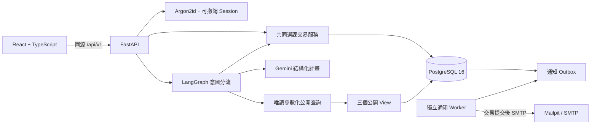
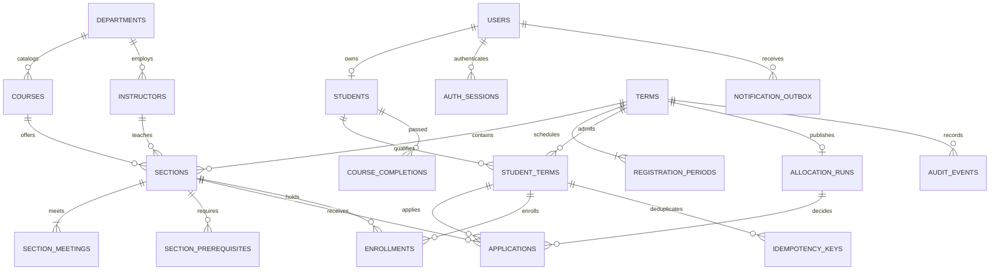

# 架構與資料完整性

## 交易邊界

學生寫入依 `terms FOR SHARE → student_terms FOR UPDATE → sections FOR UPDATE` 鎖定。取得鎖後讀 `clock_timestamp()`，再以新的查詢檢查人數與課表。管理寫入先取得學期 `FOR UPDATE`，與該學期進行中的選課互斥。全部交易使用 PostgreSQL READ COMMITTED。

加退選成功時，選課、稽核、Outbox 與成功回應的冪等鍵一起提交。相同學生學期的相同鍵與指紋會返回原回應，即使操作期限已過；異指紋回 409。業務拒絕不留下上述異動。

分發將全部 PENDING 登記以 `SHA-256(v1|seed|student_id|section_id)` 小寫十六進位摘要排序，同摘要再依學生與班別 UUID 字串排序。逐筆使用與加選相同的錄取規則，單一交易公布全部結果；同學期唯一分發批次支援重送。

## Schema 與權限

`0001_schema.sql` 是固定的初版 DDL 快照，由 Alembic 套用。複合 FK 保證登記和選課的學生資格、學期、課程與班別一致；partial unique indexes 保證每課最多一個 PENDING 登記及一個 ENROLLED 選課。所有歷史關聯以 RESTRICT 保護。

`course_migrator` 負責 DDL；`course_app` 只有既有 schema 的資料讀寫；`course_public` 只能 SELECT 三個公開 View。公開 View 僅含已公布學期；人數先以班別彙總，星期篩選使用 EXISTS，避免多時段重複計數。

## 助理與通知

Gemini 只接收去識別化問題與公開的學期、系所 metadata，回傳 Pydantic 驗證的查詢計畫。SQL 工具採固定模板、參數綁定、列舉排序、最多 20 筆與 2 秒 statement timeout。個人工具使用路由傳入的可信學生身分，本地格式化結果；個人課表不送回模型。LangGraph 固定為意圖節點及唯讀工具節點，最多兩次課務工具呼叫，總請求上限 15 秒。

Worker 以 SKIP LOCKED 領取、60 秒租約與 UUID claim token 防止舊工作回寫。SMTP 位於資料庫交易外，失敗間隔為 1、5 分鐘，最多三次。每個 Outbox 使用固定 Message-ID。SMTP 回應遺失仍可能重複投遞，資料庫事件不會重複建立。
