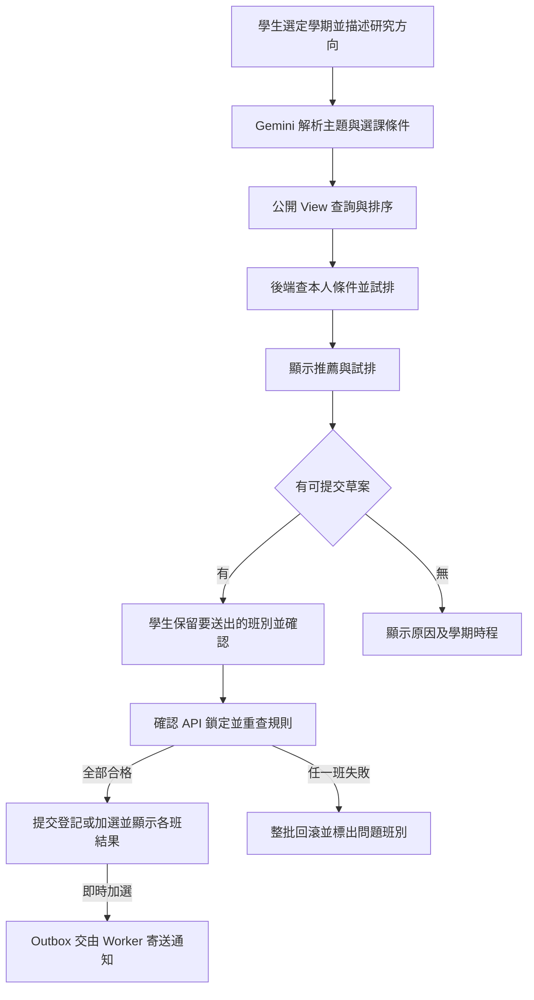
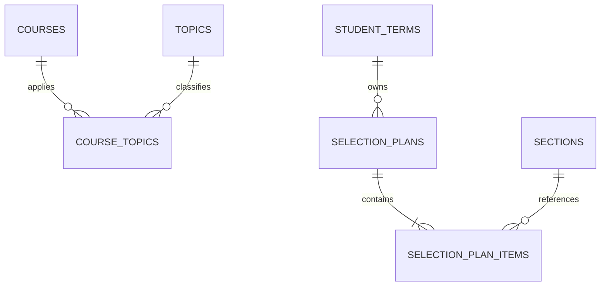

# 選課與課程推薦系統 2.0 設計稿

新版延續現有的課程查詢、初選分發、加退選、正式課表與 Email 通知，增加「按研究方向找課 → 試排 → 學生一次確認」。推薦以指定學期的公開開課資料為依據。學生可以刪減試排項目，確認後由 FastAPI 依選課階段整批登記或加選。任一班不合格，整批不提交。

這份文件記錄實作前的設計，基準為提交 `b7f6f00`。交付版本的功能與驗收結果見 [需求說明書 2.0](../Course_Registration_SRS.md) 及 [驗證報告](verification.md)。

## 範圍與沿用項目

| 需求 | 現有基礎 | 2.0 增量 |
|---|---|---|
| FR-01–08 登入、查課、選課、管理與通知 | FastAPI、PostgreSQL、React、Outbox Worker | 沿用原路由、身分檢查、選課規則與通知契約。批次初選的登記同樣進入原有 SHA-256 分發。 |
| FR-09 選課助理 | `chat.py` 已有 LangGraph、意圖計畫、個資遮罩及公開唯讀查詢。Gemini 現由 `gemini_rest.py` 直呼 | 增加推薦模式。依新版 §7.1 將正式模型介面接到 `langchain-google-genai`，保留現有安全診斷並驗證實際連線。 |
| FR-12 研究方向推薦 | 公開課程名錄與班別時段 View | 加入主題標籤、同義詞、可解釋排序與研究延伸。 |
| FR-13 試排與批次選課 | `registration.py` 有單筆交易、錄取規則與冪等資料 | 加入本人草案、確認 API，多班別共用一筆交易。成功時逐班顯示結果，業務失敗時標出第一個失敗班別。 |

多方案儲存、手動收藏、候補、授權碼、志願順位與向量檢索維持後續範圍。

## 學生操作與資料流



1. 在選課助理加入可直接使用的提示「我的研究方向是大語言模型，請推薦並幫我選三門」。若只問「請給我修課建議」，先請學生補充主題或關鍵字。畫面選定的公開學期優先。
2. 在回答下方顯示推薦卡與班別連結。卡片呈現排行、標籤或大綱證據、學分、所有上課時段與教室、名額、先修條件和本人資格、查詢時間，以及未選入原因。試排並列原正式課表、初選時已有的待分發登記及建議新增的班別，三者各有文字標示。
3. 預設勾選草案所列班別。學生可取消勾選以調整門數，畫面同步更新預估學分，按鈕顯示「確認初選登記」或「確認加選」。零班、過期、窗口關閉或送出中停用首次送出。同學期有多則推薦時，確認操作以按下按鈕的草案為準。
4. 成功時以回應列出每班 `PENDING` 或 `ENROLLED`，並刷新「我的選課」或「我的課表」、階段及名額。確定失敗時顯示原因和第一個有問題的班別，其他項目顯示「未提交」。提供「更新試排」以重送原推薦問題，生成新草案。網路中斷或逾時時保留送出時的草案、班別集合與原鍵，允許相同請求重送，包含草案已過期時取回成功結果的情境。

前端在 `App.tsx` 的對話區增加有型別的推薦卡及確認元件。切換學期或登入身分時清除相關草案，取消舊請求或忽略晚到的結果。確認按鈕、勾選和錯誤提示支援鍵盤與行動裝置。時間採 `Asia/Taipei`。

## 推薦與試排

### 解析與排行

LangGraph 保留一般問答、查課與個人查詢分支，增加 `recommendation` 分支。Gemini 只產生結構化計畫，Pydantic 驗證主題、附加關鍵字、目標門數與明示的可上課時段。門數預設 3，接受 1–5。每個時段由星期 1–7 和本地起訖時間表示，起點須早於終點。跨日需求拆成每天的區間，語意或時段不明時回 `clarify`。完整班別的每一個上課時段都須落在同日某個可上課區間內。未指定時段時採原課表的正常衝堂規則。

主題對照表隨程式版本管理。先對文字做 Unicode 正規化、去首尾空白及英文大小寫折疊，再將「大語言模型」、「大型語言模型」與「LLM」統一為 `llm`，使用同一組關鍵字和關聯標籤 `nlp`、`retrieval`、`deep_learning`、`ml_systems`。從額外關鍵字剔除已用作主題的別名。同一學期及條件的別名查詢使用相同排序資料。未登錄主題以文字關鍵字查課名或大綱。

`search_related_sections` 透過現有公開課程及時段 View 與新增主題 View 查指定學期。以 `EXISTS` 或分組聚合避免一班多時段或多標籤變成多列。使用繫結參數及字面關鍵字搜尋，轉義 `LIKE` 的萬用字元。得分為直接標籤 6 分、任一關聯標籤 3 分、任一課名或大綱命中 1 分，各項只計一次。保留正分，依分數降序、課程代碼、班號及班別 UUID 升序取前 20。名額為零或未開放的班別仍可列入候選，並附狀態。

後端用命中標籤和實際課名或大綱片段組出 `match_reason`，以及最多兩個有對應班別的學習延伸。LLM 示例可用 NLP、資訊檢索與 RAG、LLM 專題串聯一個實驗，對照不同向量檢索策略對答案正確率的影響。每個延伸只引用本次命中的班別 ID。空結果回空陣列並提示調整關鍵字或學期。

### 資格與草案

將 `registration.py` 的錄取判斷拆成「讀取選課資料」和「依資料檢查規則」。後者接收基礎課表與本方案已選班別，沿用原本的開放、同課、先修、衝堂、學分、名額檢查順序。單筆選課和分發保留原行為。時段相交用 `start_a < end_b AND start_b < end_a`，先修只採目標學期開始前已結束的學期，學分以 `Decimal` 累加。

`build_selection_plan` 依排序逐班試排，接受後納入下一班的判斷，直到達到目標或候選用完。初選基礎包含 `ENROLLED` 與 `PENDING`，現有名額供參考，正式分發決定錄取。即時加選基礎為 `ENROLLED`，並檢查當下名額。達到目標後仍列出後續相關課的個別限制，合格而未納入的班別標為 `TARGET_COUNT_REACHED`。為讓同時有多個限制的班別仍看得清楚，卡片分別展示名額狀態、本人條件及加入試排的結果。例題 `DEMO-505` 可直接顯示「額滿」，即使學生加上本方案後也會超修。正式確認的第一錯誤仍由服務層依規則順序決定。

有學期修課資格、窗口開放且選到至少一班時，後端開一個獨立的短交易，依 `terms FOR SHARE`、`student_terms FOR UPDATE` 鎖定後重查資格與階段。階段須與試排時一致，符合才保存草案和班別順序，提交成功後回傳 `plan_id`。草案期限是 `min(建立時間 + 15 分鐘, 該窗口截止時間)`，時間取自 PostgreSQL。草案內只記確認所需的資料，創建草案不佔名額。無修課資格、窗口關閉、階段切換或無可試排班別時，仍回推薦及時程，`plan` 為 `null`。正式確認一律重查即時條件。

### Gemini 與資料界線

模型看到遮罩後的問題、公開學期和課程資料，以及輸出格式。本人課表、學分、先修歷史、草案和選課結果由後端處理。在呼叫模型前完成需要的資料讀取，結束資料庫交易後才等待模型。公開工具使用獨立唯讀角色與參數化 SQL，確認路由使用應用角色及既有 Session 和同源驗證。維持原契約的 1,000 字、最多 3 次工具呼叫、15 秒整體上限及公開 SQL 2 秒上限。

依 §7.1 用 `ChatGoogleGenerativeAI` 的結構化輸出實作正式 provider。以既有模型清單與診斷腳本，在部署環境確認 `GEMINI_MODEL` 所對應的模型可實際完成一次結構化請求。保留目前固定的 `reason_code`、請求 ID 與安全診斷。缺金鑰、模型 404、逾時或限流時回 `503 CHAT_UNAVAILABLE` 及可用入口。測試 stub 替換意圖解析，推薦與選課仍呼叫相同的資料與交易服務。[LangChain Gemini 整合](https://docs.langchain.com/oss/python/integrations/chat/google_generative_ai) · [Gemini 模型清單 API](https://aistudio.google.com/api-reference/models/list-models)

## PostgreSQL 擴充



| 物件 | 欄位與約束 |
|---|---|
| `topics` | UUID `id`、唯一 `code`、繁中 `label`。 |
| `course_topics` | 對課程與主題的 FK。PK `(course_id, topic_id)`，另建 `(topic_id, course_id)` 供主題檢索。 |
| `selection_plans` | UUID `id`，`(student_id, term_id)` FK 指向 `student_terms`，`(id, term_id)` 唯一。`phase` 限 `INITIAL`、`ADD_DROP`，`status` 限 `DRAFT`、`SUBMITTED`。`created_at`、`expires_at`、`confirmed_at` 採 `timestamptz`。限制草案期限晚於建立時間。只有 `SUBMITTED` 才有 `confirmed_at`。 |
| `selection_plan_items` | `plan_id, term_id, section_id, course_id, position`。PK `(plan_id, section_id)`。`(plan_id, position)` 與 `(plan_id, course_id)` 各自唯一，`position` 限 1–5。複合 FK 對應 `(plan_id, term_id)` 與 `(section_id, term_id, course_id)`。 |
| `v_public_section_topics` | 僅曝露公開學期的 `term_id, section_id, topic_code, topic_label`。應用角色取得新增表所需權限，`course_public` 僅新增 View 的 `SELECT`。 |
| `idempotency_keys` | 保留原複合主鍵及 201、204 紀錄，既有 `ck_idempotency_success` 擴為允許 200，以保存批次確認回應。 |

從既有 `0001` 向上新增 Alembic `0002`，同步更新 ORM，保留既有資料與歷史關聯。`0001` 的表權限授予在執行當下生效，`0002` 為新增物件明確設定權限。UUID 外鍵使用受限刪除，已提交計畫與冪等紀錄可以重播及稽核。以既有資料庫副本驗證升級。若須回到前版，採備份還原演練，避免在已有 200 回應或已提交草案的資料庫直接移除新版結構。

## API 與批次交易

### 查詢結果與提交契約

| 路由 | 新版契約 |
|---|---|
| `POST /api/v1/chat` | 保留 `message`、選填 `term_id`，既有回應欄位照常。`mode=recommendation` 時附 `recommendation.topic`、`candidates`、`learning_extensions` 與 `plan`。設計增加 `target_count`、`baseline`、`registration`、`plan_unavailable_reason`，讓前端可呈現門數、原課表及不可確認原因。 |
| `POST /api/v1/me/terms/{term_id}/selection-plans/{plan_id}/confirm` | 登入學生，附 `Idempotency-Key`。Body 為 `section_ids` 陣列，含 1–5 個不同 UUID。成功 `200` 回 `plan_id, phase, items, submitted_at`，`items` 按草案順序列出 `section_id, status`。學生身分從 Session 取得。 |

候選依 §7.3 回傳 `section_id, course_code, course_title, section_no, credits, meetings, remaining, score, match_reason, selected, reason_code`，另帶 `prerequisites`、`is_selectable` 和 `eligibility`。`eligibility` 含 `eligible, reason_code`，反映該班相對於本人現況及當前階段的條件。候選本身的 `reason_code` 描述試排結果，可同時呈現個別資格與組合限制。`meetings` 含 `weekday, start_time, end_time, room`。`learning_extensions` 的每筆包含 `title, next_step, section_ids`。

`baseline` 回傳 `enrolled, pending, considered_credits, credit_limit`。兩種課表的列包含班別、學分及完整時段。無學期資格時 `baseline` 為 `null`，個別資格亦為 `null`。`registration` 沿用學期階段 API 的 `phase, periods, as_of`。`plan_unavailable_reason` 採 `TERM_INELIGIBLE`、`REGISTRATION_CLOSED`、`REGISTRATION_PHASE_CHANGED` 或 `NO_FEASIBLE_SECTIONS`，有草案時為 `null`。草案回傳 `plan_id, term_id, phase, as_of, expires_at, section_ids, projected_credits`。學分使用十進位字串，日期時間使用 ISO 8601。班別連結由後端以查得 ID 生成。

確認請求的 `section_ids` 取自 `POST /chat` 回應的草案。以下範例保留兩班。

```json
{
  "section_ids": [
    "0c517075-b7e6-4dff-8b7b-efb3c4b57b46",
    "90fc33ad-e553-4888-b3ca-f785e06e53e2"
  ]
}
```

### 鎖定、重新檢查與重送

1. 確認路由沿用角色及同源檢查。先驗證 UUID、陣列上限、正規化後的重複項目與冪等鍵。由路由擁有單一 SQLAlchemy 交易，依序鎖 `terms FOR SHARE`、本人 `student_terms FOR UPDATE`、本人同學期 `selection_plans FOR UPDATE`。草案不屬於此學生或學期時統一回 `404 PLAN_NOT_FOUND`。
2. 在鎖內以方法、路徑（含草案 ID）及排序後的 UUID 集合計算指紋，查同一學生學期的 `idempotency_keys`。同鍵同指紋重播原 `200`；同鍵異指紋回 `409 IDEMPOTENCY_KEY_REUSED`。此步在期限與 `SUBMITTED` 檢查之前。新鍵確認已提交草案回 `409 PLAN_ALREADY_SUBMITTED`，草案外項目回 `409 PLAN_SELECTION_MISMATCH`。
3. 對送出的班別按 UUID 升序取 `FOR UPDATE`，取得全部鎖後讀取一次 `clock_timestamp()`，以新的 SQL 查選課資料和名額。窗口外回 `409 REGISTRATION_CLOSED`。當下有可提交窗口，但與草案階段不符或已達草案期限，回 `409 PLAN_EXPIRED`。鎖定順序與業務輸出順序分開，業務判斷按草案 `position`。PostgreSQL 的 `READ COMMITTED` 會為各查詢取得新的快照，等待鎖後再讀可看見先完成的選課。統一鎖序可避免批次以相反順序取得兩個班別鎖。[PostgreSQL 列鎖](https://www.postgresql.org/docs/16/explicit-locking.html) · [PostgreSQL 交易隔離](https://www.postgresql.org/docs/16/transaction-iso.html)
4. 依草案順序重查各班，納入本批前面已通過的班。初選重查班別是否開放、同課登記、先修、衝堂及學分，以本人有效課表與待分發登記為基礎。若同班已由本人手動登記，重查該班與組合相容性時只計一次，保留原 `PENDING` 紀錄。同課另一班已有登記回 `APPLICATION_EXISTS`。即時加選依 §4.2。任一班失敗回 `409` 及 `details.section_id`，需要時帶衝堂班別或超出學分，整個交易回滾。
5. 全部合格時，由共用的班別異動函式寫入或恢復 `PENDING` 或 `ENROLLED`，新增相應稽核並帶 `plan_id`。初選的通知由分發時產生。每筆即時加選新增一筆原有格式的 Outbox 事件。草案轉 `SUBMITTED`、確認時間及冪等回應與選課一起提交。任何資料庫異常同樣回滾，草案可重試。確認交易只執行資料庫操作。

`registration.py` 保留現有單筆與分發入口，抽出可由同一交易重用的判斷、登記、加選稽核及 Outbox 寫入。批次服務共用上述底層函式，避免對每班重複啟動交易或重複使用同一冪等鍵。相同鍵值的重送包含同一草案、同一班別集合的不同排序。

## 示範資料與驗收

新增獨立的虛構示範學期與固定 UUID，準備一個 `INITIAL` 與一個 `ADD_DROP` 情境。示範學生在加退選期有 9 學分、上限 18 學分，課表包含週四與 `DEMO-504` 衝堂的時段。原 seed 的公開學期、個人選課及既有設定應符合原本的保留規則。新 seed 可重跑，固定識別碼不變。`DEMO-505` 的額滿由有效選課資料推導，另含至少一門無關課程。

| 班別 | 試排示範預期 |
|---|---|
| `DEMO-501` 大型語言模型專題 | 週二 13:20–16:20，3 學分，剩 4 席，選入。 |
| `DEMO-502` 自然語言處理 | 週一 09:10–12:10，3 學分，剩 6 席，選入。 |
| `DEMO-503` 資訊檢索與 RAG | 週三 10:10–13:10，3 學分，剩 2 席，選入。 |
| `DEMO-504` AI 系統與模型部署 | 週四 13:20–16:20，3 學分，剩 3 席，顯示衝堂。 |
| `DEMO-505` 向量資料庫與語意搜尋 | 週五 10:10–13:10，3 學分，剩 0 席，顯示額滿。 |

預設三門使學分由 9 增至 18。若取消勾選 `DEMO-502`，預估 15 學分。確認前正式課表、登記、稽核及 Outbox 均維持原筆數。確認後即時加選兩班則正式課表各新增一筆並有兩筆通知；初選示範則新增兩筆 `PENDING` 等待分發。

| 驗收 | 證據 |
|---|---|
| AT-01–10、AT-12 | 既有 API、分發、規則與通知回歸。以 PostgreSQL 驗證原有鎖序、最後一席、冪等及個資隔離。 |
| AT-11 | 在有金鑰的部署環境實際驗證查課與推薦，結果對照 PostgreSQL 班別。保留去識別化紀錄。另模擬缺金鑰、404、逾時、限流與手動操作可用性。 |
| AT-13 | 空白資料庫及 v0 副本各驗證 migration，執行示範 seed 後重啟 Compose，核對既有資料與 volume。 |
| AT-14 | 比對「大語言模型」「大型語言模型」「LLM」排行及證據一致，測未命中、未開放、額滿、衝堂、缺先修、超學分、同課異班與多時段只部分符合的情形。 |
| AT-15 | 兩階段各請助理試排三門，確認前查資料庫只有草案，取消一班後送出。核對兩班結果、課表及初選分發、即時通知。 |
| AT-16 | 在確認前用另一學生拿走最後一席，或用本人手動加選造成衝堂。驗證 `409`、問題班別及整批無異動。另注入第二班資料庫寫入故障並檢查同一草案可重試。 |
| AT-17 | 模擬斷線後以相同鍵和值重送、換順序重送、換集合、用新鍵重送及用他人帳號。用資料庫核對最多一批成功寫入。再讓兩筆批次以相反的請求順序選相同班別，驗證鎖順序與容量。 |
| AT-18 | 使用資料庫固定時間測 15 分鐘邊界、窗口截止、階段切換、草案外班別和重複 ID。無效請求無選課異動。 |
| AT-19 | 遠端交付暫緩。可先從本機乾淨快照驗證可重現性、檢查追蹤檔案與提交歷史。本機驗收文件標示 GitHub clone 與最終標籤尚待遠端交付。 |

依 SRS §8 與 §9，以 1,000 班、20 並行重測一般搜尋 p95 ≤ 500 ms，保存機器與資料規模，以及課程查詢和有效名額的 SQL 與 `EXPLAIN (ANALYZE, BUFFERS)`。結案前的本機檢查涵蓋 `.env`、憑證、資料庫 dump 與真實個資未被追蹤，確認 `.env.example` 可供乾淨環境配置。

## 實作順序

1. **資料庫與 fixture**。新增 migration 和 ORM，補公開 View、權限、200 冪等回應及示範資料。驗證從空白與 v0 升級。
2. **推薦與試排**。完成結構化解析、標籤檢索、排序與證據，拆出可重用規則，增加 `recommendation` 回應及草案建立。以 stub 完成 AT-14，再驗證正式模型介面。
3. **確認交易**。完成草案授權、期限、重送、鎖序及成功通知，先在 PostgreSQL 跑 AT-15–18 和既有選課回歸。
4. **前端與本機展示**。加入推薦卡、試排比較、確認與結果，測試重新整理、慢回應、鍵盤及手機流程。更新實作後的 README、ERD、真實模型紀錄及驗收報告。
